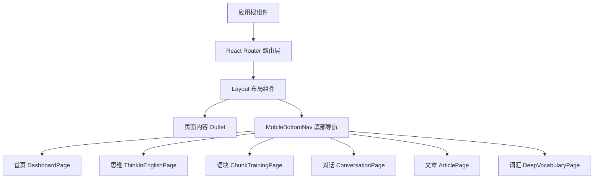
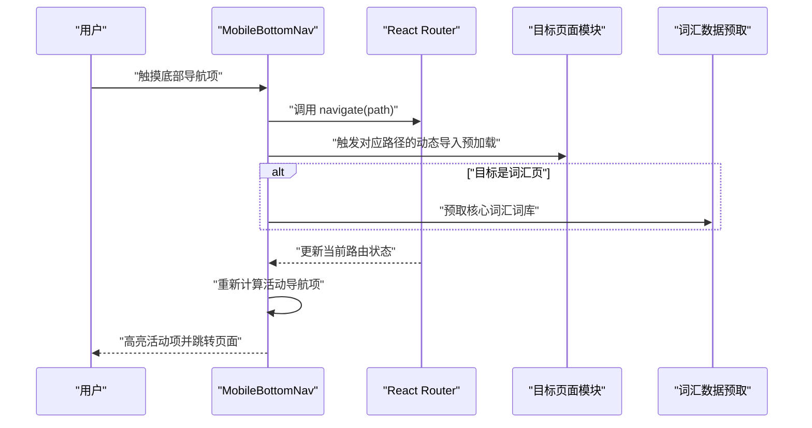
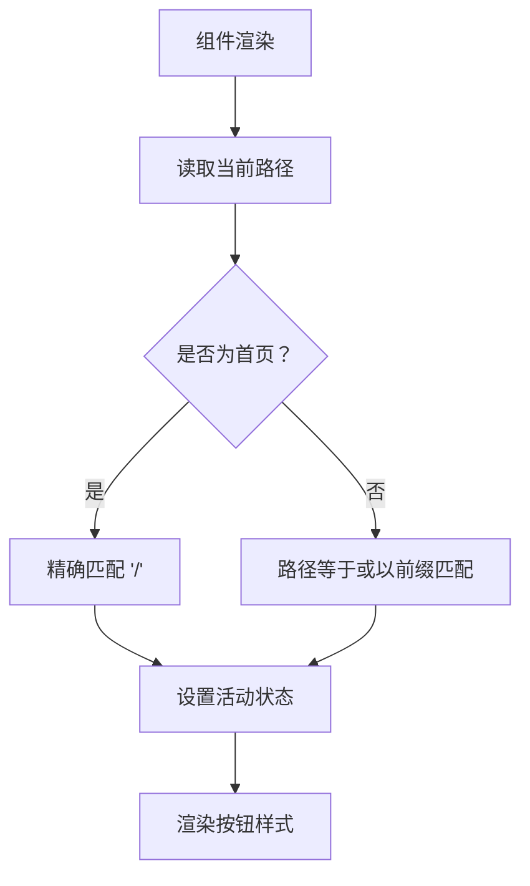
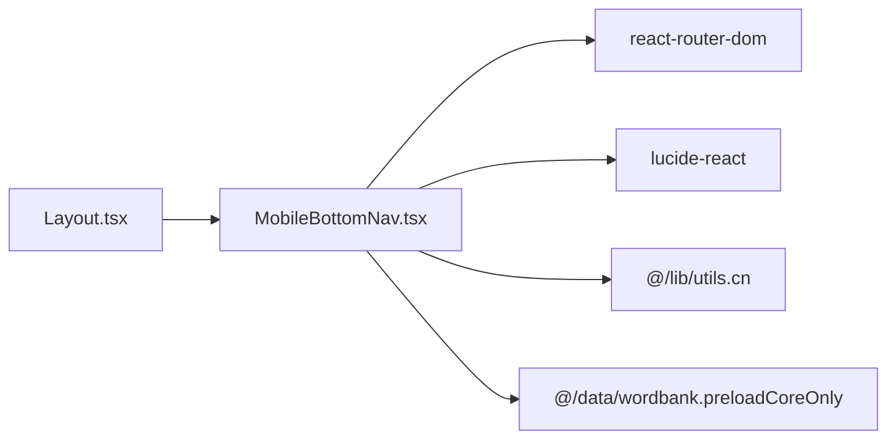

# 移动端底部导航

<cite>
**本文引用的文件**   
- [MobileBottomNav.tsx](file://src/components/MobileBottomNav.tsx)
- [Layout.tsx](file://src/components/Layout.tsx)
- [index.css](file://src/index.css)
- [utils.ts](file://src/lib/utils.ts)
</cite>

## 目录
1. [引言](#引言)
2. [项目结构中的位置](#项目结构中的位置)
3. [核心组件总览](#核心组件总览)
4. [架构与渲染流程](#架构与渲染流程)
5. [详细组件分析](#详细组件分析)
6. [依赖关系分析](#依赖关系分析)
7. [性能优化建议](#性能优化建议)
8. [无障碍访问与键盘导航](#无障碍访问与键盘导航)
9. [自定义指南](#自定义指南)
10. [常见问题排查](#常见问题排查)
11. [结论](#结论)

## 引言
MobileBottomNav 是 NativeThink 应用的移动端底部导航组件，负责在移动设备上展示一组主要功能入口。它基于 React Router 的当前路由计算活动项，使用响应式布局隐藏或显示，并结合触摸事件对页面模块进行预加载，以提升点击后的首屏体验。该组件同时为词汇等重模块触发本地数据预取，从而降低首次进入时的延迟。

## 项目结构中的位置
MobileBottomNav 属于应用级 UI 组件，由 Layout 组件在移动端条件渲染：当专注模式未启用时，Layout 会在页面内容下方挂载 MobileBottomNav。因此，它的职责边界很清晰——不负责业务页面逻辑，只负责“从底部快速切换主要模块”。

图表来源
- [Layout.tsx:120-151](file://src/components/Layout.tsx#L120-L151)
- [MobileBottomNav.tsx:15-24](file://src/components/MobileBottomNav.tsx#L15-L24)

章节来源
- [Layout.tsx:120-151](file://src/components/Layout.tsx#L120-L151)
- [MobileBottomNav.tsx:15-24](file://src/components/MobileBottomNav.tsx#L15-L24)

## 核心组件总览
MobileBottomNav 的核心能力包括：
- 根据当前路由判断导航项是否活动。
- 提供六个主要模块的图标和标签。
- 使用固定定位和 CSS 变量实现主题化、安全区域适配。
- 通过触摸事件预加载目标页面的动态代码块。
- 与全局路由状态保持同步。

关键数据结构如下：

| 名称 | 类型 | 说明 |
|---|---|---|
| ROUTE_PREFETCH | 对象映射 | 将路径映射到对应的动态导入函数，用于触摸时预热页面代码包 |
| MOBILE_NAV | 数组 | 定义底部导航项的路径、标签和图标组件 |
| pathname | 字符串 | 来自 React Router 的当前 URL 路径名 |
| navigate | 函数 | 来自 React Router 的路由跳转函数 |

章节来源
- [MobileBottomNav.tsx:1-13](file://src/components/MobileBottomNav.tsx#L1-L13)
- [MobileBottomNav.tsx:15-24](file://src/components/MobileBottomNav.tsx#L15-L24)

## 架构与渲染流程
底部导航的渲染与交互流程如下：

图表来源
- [MobileBottomNav.tsx:26-71](file://src/components/MobileBottomNav.tsx#L26-L71)

章节来源
- [MobileBottomNav.tsx:26-71](file://src/components/MobileBottomNav.tsx#L26-L71)

## 详细组件分析

### 布局设计与响应式适配
MobileBottomNav 采用固定定位的悬浮栏，宽度左右各留内边距，圆角、边框、背景透明度和阴影共同形成移动端常见的悬浮卡片效果。它使用 `safe-area-inset-bottom` 环境变量避开系统手势条和安全区域，避免被设备刘海或底部手势条遮挡。

关键点：
- 使用 `lg:hidden` 仅在移动端隐藏桌面侧边栏时出现，Desktop 端不显示底部导航。
- 容器高度、间距、字号均偏向移动端触控场景。
- 颜色走 CSS 变量，跟随主题变化。

章节来源
- [MobileBottomNav.tsx:33-43](file://src/components/MobileBottomNav.tsx#L33-L43)
- [Layout.tsx:128-151](file://src/components/Layout.tsx#L128-L151)
- [index.css:254-280](file://src/index.css#L254-L280)
- [index.css:320-320](file://src/index.css#L320-L320)

### 图标导航的实现
每个导航项包含一个 Lucide 图标和一个中文标签。图标尺寸统一为较小像素值，并根据活动状态调整描边粗细；标签在活动状态下加粗，非活动状态较细。图标选择来自 `MOBILE_NAV` 配置数组，新增导航项只需追加一项即可。

行为特征：
- 活动图标描边更粗，强调当前模块。
- 非活动图标半透明，悬停时变亮。
- 标签文字大小小且行高紧凑，适合多列并排。

章节来源
- [MobileBottomNav.tsx:15-24](file://src/components/MobileBottomNav.tsx#L15-L24)
- [MobileBottomNav.tsx:44-69](file://src/components/MobileBottomNav.tsx#L44-L69)

### 活动指示器与路由同步
当前组件没有独立的底部活动指示条，而是通过背景色、前景色、字体粗细和图标描边来表达活动状态。活动判断逻辑会处理首页的特殊情况：首页只有在完全匹配时才活动，其他路径则支持前缀匹配，使 `/think/xxx` 仍属于 think 模块。

同步机制：
- 使用 `useLocation` 读取当前路径。
- 每次路由变化后组件重新渲染，自动更新活动样式。
- 跳转通过 `navigate` 完成，不直接操作 DOM。

图表来源
- [MobileBottomNav.tsx:44-58](file://src/components/MobileBottomNav.tsx#L44-L58)

章节来源
- [MobileBottomNav.tsx:26-31](file://src/components/MobileBottomNav.tsx#L26-L31)
- [MobileBottomNav.tsx:44-58](file://src/components/MobileBottomNav.tsx#L44-L58)

### 手势支持与点击反馈
当前组件没有复杂的手势识别逻辑，主要交互包括：
- 点击：调用路由跳转。
- 触摸开始：触发目标页面的动态导入预加载，减少首次打开延迟。
- 视觉反馈：通过 Tailwind 类名切换颜色和字体粗细，提供轻量触觉感。

注意：
- 没有原生触摸震动反馈。
- 没有滑动切换模块的逻辑。
- 没有按压缩放或涟漪动画。

章节来源
- [MobileBottomNav.tsx:58-69](file://src/components/MobileBottomNav.tsx#L58-L69)

### 导航项的动态生成与配置管理
导航项由 `MOBILE_NAV` 数组驱动，而不是硬编码在 JSX 中。这使新增、删除、排序导航项变得简单。每个导航项包含：
- `path`：路由路径。
- `label`：中文标签。
- `icon`：Lucide 图标组件。

此外，`ROUTE_PREFETCH` 单独维护预加载映射，这样“展示配置”和“性能预热配置”可分开演进。

章节来源
- [MobileBottomNav.tsx:15-24](file://src/components/MobileBottomNav.tsx#L15-L24)
- [MobileBottomNav.tsx:7-13](file://src/components/MobileBottomNav.tsx#L7-L13)
- [MobileBottomNav.tsx:44-69](file://src/components/MobileBottomNav.tsx#L44-L69)

## 依赖关系分析
MobileBottomNav 的外部依赖主要包括：
- React Router：路由读取和跳转。
- Lucide React：图标组件。
- Tailwind CSS：样式工具类。
- 内部工具函数：`cn` 合并类名。
- 数据预取函数：词汇相关预加载。
- Layout：在移动端条件挂载。

图表来源
- [MobileBottomNav.tsx:1-13](file://src/components/MobileBottomNav.tsx#L1-L13)
- [Layout.tsx:1-10](file://src/components/Layout.tsx#L1-L10)

章节来源
- [MobileBottomNav.tsx:1-13](file://src/components/MobileBottomNav.tsx#L1-L13)
- [Layout.tsx:1-10](file://src/components/Layout.tsx#L1-L10)
- [utils.ts:4-4](file://src/lib/utils.ts#L4-L4)

## 性能优化建议
当前组件已经具备两项关键优化：

| 优化点 | 当前实现 | 进一步优化建议 |
|---|---|---|
| 页面懒加载 | 使用动态 `import()` 预加载目标页面 | 可在低电量或慢网络下禁用预加载 |
| 数据预取 | 触摸词汇页时预取核心词库 | 可增加去重、缓存失效策略 |
| 渲染开销 | 仅按导航项数量渲染少量按钮 | 导航项增多时可考虑虚拟列表或分页 |
| 主题变量 | 使用 CSS 变量控制导航颜色 | 可将更多样式抽离为 CSS 变量 |
| 内存管理 | 导航项配置为常量 | 大型扩展配置可改为按需加载 |

章节来源
- [MobileBottomNav.tsx:7-13](file://src/components/MobileBottomNav.tsx#L7-L13)
- [MobileBottomNav.tsx:58-69](file://src/components/MobileBottomNav.tsx#L58-L69)

## 无障碍访问与键盘导航
当前组件没有显式的无障碍属性，例如 `aria-label`、`aria-current`、`role="tablist"` 等。考虑到它是导航控件，建议补充：
- 为每个按钮添加语义化的无障碍标签。
- 为活动项增加 `aria-current="page"`。
- 确保键盘 Tab 可聚焦，Enter 或 Space 可触发跳转。
- 为图标补充替代文本，帮助屏幕阅读器理解导航含义。

这些改进不会改变现有行为，但能显著提升可访问性。

[本节为通用可访问性建议，不直接分析具体源码]

## 自定义指南

### 添加新导航项
步骤：
1. 在 `MOBILE_NAV` 中添加新项，指定路径、标签和图标。
2. 如需预加载页面，在 `ROUTE_PREFETCH` 中添加对应路径的动态导入。
3. 如该模块需要额外数据预取，在对应分支中加入预取逻辑。
4. 确认 Layout 未在专注模式下隐藏底部导航。

章节来源
- [MobileBottomNav.tsx:15-24](file://src/components/MobileBottomNav.tsx#L15-L24)
- [MobileBottomNav.tsx:7-13](file://src/components/MobileBottomNav.tsx#L7-L13)
- [MobileBottomNav.tsx:58-69](file://src/components/MobileBottomNav.tsx#L58-L69)
- [Layout.tsx:148-151](file://src/components/Layout.tsx#L148-L151)

### 修改导航样式
导航样式主要由 Tailwind 类和 CSS 变量组成：
- 容器外观：圆角、边框、背景透明度、阴影、模糊。
- 活动样式：背景色 `--nav-bg`、前景色 `--nav-fg`。
- 非活动样式：半透明白色文本、悬停变亮。
- 主题变量定义位于全局样式文件中。

章节来源
- [MobileBottomNav.tsx:33-43](file://src/components/MobileBottomNav.tsx#L33-L43)
- [MobileBottomNav.tsx:58-69](file://src/components/MobileBottomNav.tsx#L58-L69)
- [index.css:254-280](file://src/index.css#L254-L280)
- [index.css:496-497](file://src/index.css#L496-L497)
- [index.css:588-595](file://src/index.css#L588-L595)

### 调整交互行为
可调整的交互包括：
- 点击跳转：修改 `navigate` 调用逻辑。
- 触摸预加载：修改 `onTouchStart` 中的预加载规则。
- 活动判断：修改路径匹配逻辑，例如支持正则或模块分组。
- 视觉反馈：添加过渡动画、缩放、震动或涟漪效果。

章节来源
- [MobileBottomNav.tsx:44-69](file://src/components/MobileBottomNav.tsx#L44-L69)

### 禁用底部导航
如果某个页面不希望显示底部导航，可以在 Layout 中根据路由或专注模式控制渲染。当前默认在专注模式关闭时显示底部导航。

章节来源
- [Layout.tsx:148-151](file://src/components/Layout.tsx#L148-L151)

## 常见问题排查

| 问题 | 可能原因 | 排查建议 |
|---|---|---|
| 底部导航被系统手势条遮挡 | 安全区域变量未生效 | 检查设备是否支持 `safe-area-inset-bottom`，并确认容器使用了环境变量 |
| 导航项始终不活动 | 路径匹配逻辑不符合预期 | 检查首页特殊匹配和其他路径前缀匹配 |
| 点击导航无反应 | 路由未正确注册或路径不一致 | 核对 `MOBILE_NAV` 的 path 与路由配置 |
| 词汇页打开较慢 | 预加载未触发或网络异常 | 检查触摸事件是否执行，以及预取函数是否正常 |
| 主题色不生效 | CSS 变量未覆盖或 Tailwind 类优先级问题 | 检查 `--nav-bg` 和 `--nav-fg` 的定义和继承链 |

章节来源
- [MobileBottomNav.tsx:33-43](file://src/components/MobileBottomNav.tsx#L33-L43)
- [MobileBottomNav.tsx:44-58](file://src/components/MobileBottomNav.tsx#L44-L58)
- [MobileBottomNav.tsx:58-69](file://src/components/MobileBottomNav.tsx#L58-L69)
- [index.css:496-497](file://src/index.css#L496-L497)
- [index.css:588-595](file://src/index.css#L588-L595)

## 结论
MobileBottomNav 是一个简洁、可配置、与 React Router 紧密集成的移动端底部导航组件。它通过配置驱动的方式组织导航项，利用动态导入提升页面加载体验，并通过 CSS 变量和 Tailwind 类实现主题化和响应式布局。若需扩展，应优先扩展 `MOBILE_NAV` 和 `ROUTE_PREFETCH`，并保持活动状态、无障碍属性和性能优化的一致性。