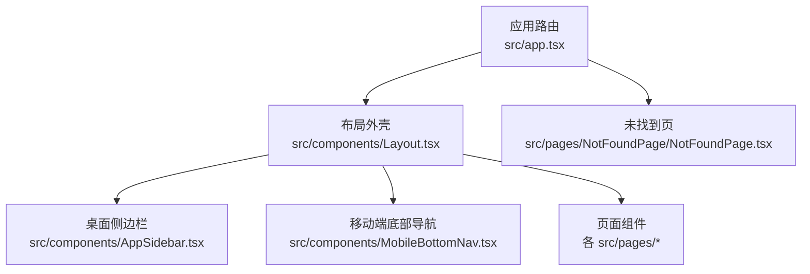
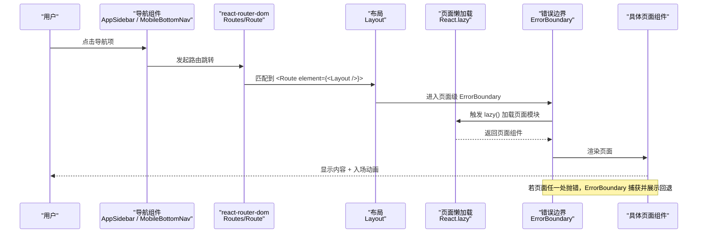
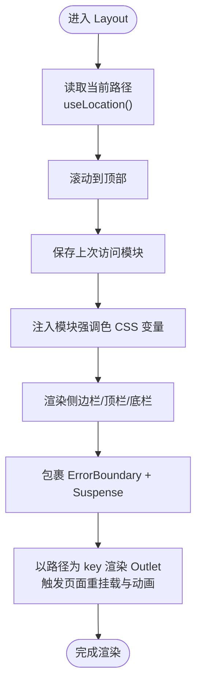
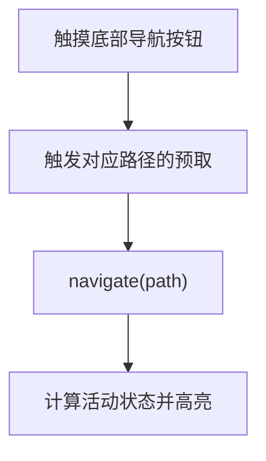
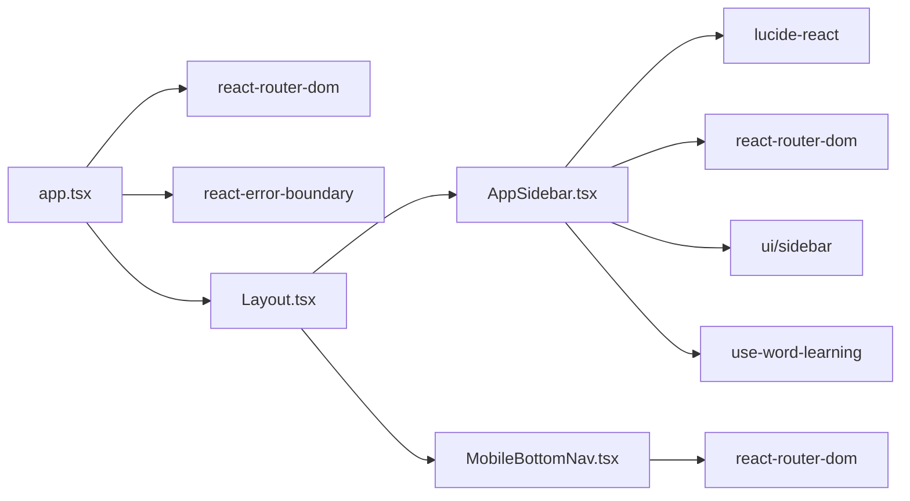

# 路由系统与导航

<cite>
**本文引用的文件**   
- [src/app.tsx](file://src/app.tsx)
- [src/components/Layout.tsx](file://src/components/Layout.tsx)
- [src/components/AppSidebar.tsx](file://src/components/AppSidebar.tsx)
- [src/components/MobileBottomNav.tsx](file://src/components/MobileBottomNav.tsx)
- [src/pages/NotFoundPage/NotFoundPage.tsx](file://src/pages/NotFoundPage/NotFoundPage.tsx)
- [docs/modules/shell-and-navigation.md](file://docs/modules/shell-and-navigation.md)
</cite>

## 目录
1. [简介](#简介)
2. [项目结构](#项目结构)
3. [核心组件](#核心组件)
4. [架构总览](#架构总览)
5. [详细组件分析](#详细组件分析)
6. [依赖关系分析](#依赖关系分析)
7. [性能与预取策略](#性能与预取策略)
8. [新增页面指南](#新增页面指南)
9. [故障排查](#故障排查)
10. [结论](#结论)

## 简介
本文件聚焦 NativeThink 应用基于 react-router-dom v7 的路由系统与导航机制，覆盖以下内容：
- 13 个主要页面的懒加载注册与独立 ErrorBoundary。
- 侧边栏导航 AppSidebar 的动态菜单、活动状态匹配、响应式折叠与抽屉行为。
- 移动端底部导航 MobileBottomNav 的图标导航、活动指示器与手势预取。
- NotFoundPage 兜底处理逻辑。
- 路由守卫、参数传递、查询字符串处理的最佳实践。
- 自定义路由与新增页面的完整步骤。
- 导航状态与全局状态的同步机制。

## 项目结构
路由入口在应用顶层，使用 `react-router-dom` 的 `<Routes>` 与 `<Route>` 配置所有页面；每个页面通过 `React.lazy` 懒加载，并包裹独立的 `ErrorBoundary` 提供页面级错误回退。布局层 Layout 负责壳 UI（侧边栏、顶栏、底部导航）、页面骨架、滚动重置与模块强调色注入。AppSidebar 与 MobileBottomNav 分别承担桌面端侧边栏与移动端底部 dock 的导航职责。



**图表来源**
- [src/app.tsx:1-66](file://src/app.tsx#L1-L66)
- [src/components/Layout.tsx:1-155](file://src/components/Layout.tsx#L1-L155)
- [src/components/AppSidebar.tsx:1-179](file://src/components/AppSidebar.tsx#L1-L179)
- [src/components/MobileBottomNav.tsx:1-73](file://src/components/MobileBottomNav.tsx#L1-L73)
- [src/pages/NotFoundPage/NotFoundPage.tsx:1-11](file://src/pages/NotFoundPage/NotFoundPage.tsx#L1-L11)

**章节来源**
- [src/app.tsx:1-66](file://src/app.tsx#L1-L66)
- [docs/modules/shell-and-navigation.md:1-121](file://docs/modules/shell-and-navigation.md#L1-L121)

## 核心组件
- 路由配置与应用根：集中声明 13 个主要页面路由，全部 lazy，并为每条路由包裹独立 ErrorBoundary；末尾以 `*` 兜底到 NotFoundPage。
- 布局 Layout：提供 SidebarProvider/SidebarInset、Header、AppSidebar、MobileBottomNav，统一滚动重置、模块强调色、页面骨架与第二层 Suspense/ErrorBoundary。
- 侧边栏 AppSidebar：动态生成菜单项、根据当前 pathname 计算活动状态、hover/touch 触发路由预取、响应式折叠与移动端抽屉关闭。
- 底部导航 MobileBottomNav：固定悬浮 dock、仅展示 6 个常用入口、touch 触发预取、活动高亮。
- 未找到页 NotFoundPage：返回 404 文案并提供返回首页链接。

**章节来源**
- [src/app.tsx:1-66](file://src/app.tsx#L1-L66)
- [src/components/Layout.tsx:1-155](file://src/components/Layout.tsx#L1-L155)
- [src/components/AppSidebar.tsx:1-179](file://src/components/AppSidebar.tsx#L1-L179)
- [src/components/MobileBottomNav.tsx:1-73](file://src/components/MobileBottomNav.tsx#L1-L73)
- [src/pages/NotFoundPage/NotFoundPage.tsx:1-11](file://src/pages/NotFoundPage/NotFoundPage.tsx#L1-L11)

## 架构总览
以下序列图描述从用户点击导航到页面渲染的关键流程，包括懒加载、错误边界与布局动画。



**图表来源**
- [src/app.tsx:1-66](file://src/app.tsx#L1-L66)
- [src/components/Layout.tsx:1-155](file://src/components/Layout.tsx#L1-L155)

## 详细组件分析

### 路由配置与懒加载
- 13 个主要页面通过 `lazy(() => import(...))` 单独拆分代码包，减少首屏体积。
- 每个 `<Route>` 包裹独立 `ErrorBoundary`，并传入页面中文名称作为错误提示标题。
- 兜底路由 `path="*"` 使用 Suspense 占位骨架 + ErrorBoundary 包裹 NotFoundPage。

关键要点
- 路由表集中维护，新增页面需同时更新路由与懒加载导入。
- 路由级 ErrorBoundary 粒度是整页：页面内任何一处抛错都会触发回退。
- 兜底路由提供骨架动画，避免白屏体验。

**章节来源**
- [src/app.tsx:1-66](file://src/app.tsx#L1-L66)

### 布局外壳 Layout
- 外层使用 SidebarProvider/SidebarInset，确保侧边栏与内容区域协同。
- 非专注模式下渲染 Header、AppSidebar、MobileBottomNav。
- 对每次路由变化执行：滚动到顶部、记录上次访问模块、为当前模块注入强调色变量。
- 内部再次嵌套 ErrorBoundary 与 Suspense，key 为 location.pathname，使切换路由时页面重挂载并触发入场动画。



**图表来源**
- [src/components/Layout.tsx:1-155](file://src/components/Layout.tsx#L1-L155)

**章节来源**
- [src/components/Layout.tsx:1-155](file://src/components/Layout.tsx#L1-L155)

### 侧边栏导航 AppSidebar
职责
- 动态菜单：NAV_ITEMS 定义 14 条菜单项，包含路径、标签与图标。
- 活动状态：对首页使用精确匹配 `/`，其余路径采用前缀匹配，即 `pathname === path || pathname.startsWith(path + '/')`。
- 预取：ROUTE_PREFETCH 映射路径到懒加载函数，hover 或 touch 时预热模块缓存；词汇页额外预加载词库核心数据。
- 响应式：桌面端 collapsible=\"icon\"；移动端使用整屏抽屉，点击导航后主动关闭抽屉。
- 学习提醒：词汇入口根据全局到期数量显示角标。

```mermaid
classDiagram
  class AppSidebar {
    - pathname : string
    - dueCount : number
    + render() JSX
    - isActive(itemPath) boolean
    - onHoverOrTouch(itemPath) void
  }

  class RoutePrefetch {
    + map : Record<string, () => Promise<unknown>>
  }

  class NavItems {
    + items : Array<{path,label,icon}>
  }

  AppSidebar --> RoutePrefetch : "使用"
  AppSidebar --> NavItems : "遍历"
```

**图表来源**
- [src/components/AppSidebar.tsx:1-179](file://src/components/AppSidebar.tsx#L1-L179)

注意事项
- 移动端抽屉关闭：NavLink 的 onClick 中调用 setOpenMobile(false)，否则新页面被抽屉遮罩吞掉点击。
- 预取时机：onMouseEnter/onTouchStart，不是 mount，避免无谓网络请求。
- 主题与外观：侧栏底部提供主题快捷切换，与设置页共享主题注册表。

**章节来源**
- [src/components/AppSidebar.tsx:1-179](file://src/components/AppSidebar.tsx#L1-L179)

### 移动端底部导航 MobileBottomNav
职责
- 固定悬浮 dock，适配安全区域 env(safe-area-inset-bottom)。
- 仅展示 6 个常用入口，按当前 pathname 计算活动状态。
- onTouchStart 触发 ROUTE_PREFETCH，提前预热模块。



**图表来源**
- [src/components/MobileBottomNav.tsx:1-73](file://src/components/MobileBottomNav.tsx#L1-L73)

**章节来源**
- [src/components/MobileBottomNav.tsx:1-73](file://src/components/MobileBottomNav.tsx#L1-L73)

### 未找到页 NotFoundPage
- 当路由匹配失败时，兜底路由渲染 NotFoundPage。
- 提供简洁的 404 文案与返回首页链接。
- 该组件也被包裹在 ErrorBoundary 中，防止其自身加载失败导致整体崩溃。

**章节来源**
- [src/pages/NotFoundPage/NotFoundPage.tsx:1-11](file://src/pages/NotFoundPage/NotFoundPage.tsx#L1-L11)
- [src/app.tsx:1-66](file://src/app.tsx#L1-L66)

## 依赖关系分析
- app.tsx 依赖 react-router-dom 的路由能力与 react-error-boundary 的错误边界能力。
- Layout 依赖侧边栏、底部导航、顶栏、focus-mode、sonner 等外部组件。
- AppSidebar 依赖 lucide-react 图标、react-router-dom 的 NavLink/useLocation、shadcn sidebar、全局复习计数 Hook 与主题系统。
- MobileBottomNav 依赖 react-router-dom 的 useNavigate/useLocation 与部分图标。



**图表来源**
- [src/app.tsx:1-66](file://src/app.tsx#L1-L66)
- [src/components/Layout.tsx:1-155](file://src/components/Layout.tsx#L1-L155)
- [src/components/AppSidebar.tsx:1-179](file://src/components/AppSidebar.tsx#L1-L179)
- [src/components/MobileBottomNav.tsx:1-73](file://src/components/MobileBottomNav.tsx#L1-L73)

**章节来源**
- [src/app.tsx:1-66](file://src/app.tsx#L1-L66)
- [src/components/Layout.tsx:1-155](file://src/components/Layout.tsx#L1-L155)
- [src/components/AppSidebar.tsx:1-179](file://src/components/AppSidebar.tsx#L1-L179)
- [src/components/MobileBottomNav.tsx:1-73](file://src/components/MobileBottomNav.tsx#L1-L73)

## 性能与预取策略
- 懒加载：所有页面均通过 lazy 拆分，首屏只加载必要代码。
- 预取：AppSidebar 的 hover/touch 与 MobileBottomNav 的 touch 触发对应模块预取，缩短首次点击后的加载延迟。
- 注意：预取发生在交互时，不是组件 mount 阶段；因此首屏慢的首要原因通常不在预取表，而在入口静态依赖与 modulepreload。
- 文档指出 MobileBottomNav 的预取表是复制品，只有 7 条，而 AppSidebar 有 13 条，新增页面时需注意两处保持一致。

**章节来源**
- [docs/modules/shell-and-navigation.md:1-121](file://docs/modules/shell-and-navigation.md#L1-L121)
- [src/components/AppSidebar.tsx:1-179](file://src/components/AppSidebar.tsx#L1-L179)
- [src/components/MobileBottomNav.tsx:1-73](file://src/components/MobileBottomNav.tsx#L1-L73)

## 新增页面指南
新增一个页面需要同时修改多处，不能只改一处，否则会表现为“不报错但功能退化”。建议按以下顺序执行：

1. 创建页面组件
   - 在 `src/pages/YourModulePage/YourModulePage.tsx` 实现页面逻辑。
   - 保持组件可独立运行，并在出错时提供降级展示。

2. 注册路由与懒加载
   - 在 `src/app.tsx` 添加 `lazy(() => import('@/pages/...'))` 导入。
   - 在 `<Routes>` 中添加 `<Route path="..." element={<ErrorBoundary fallback={...}><YourModulePage /></ErrorBoundary>} />`。
   - 将页面名填入 ErrorBoundary 的 fallback 提示中。

3. 加入侧边栏菜单
   - 在 `src/components/AppSidebar.tsx` 的 NAV_ITEMS 中加入路径、标签与图标。
   - 在 ROUTE_PREFETCH 中增加相同路径的预取函数，确保 hover/touch 能预热模块。

4. 加入底部导航（可选）
   - 如果该页面属于高频入口，需在 `src/components/MobileBottomNav.tsx` 的 MOBILE_NAV 与 ROUTE_PREFETCH 中同步添加。
   - 注意 MobileBottomNav 的预取表是复制品，必须与 AppSidebar 保持一致。

5. 补充首页与统计
   - 如该模块需要出现在首页进度环与学习统计中，还需检查 DashboardPage 的模块常量与学习统计白名单。
   - 参考文档中对“六处而非四处”的要求，避免进度静默丢弃或颜色回退。

最佳实践
- 路由路径命名语义化，避免过深层级。
- 对子路由使用前缀匹配，保证父级路径也能高亮。
- 页面内如有异步资源加载，务必用 Suspense/ErrorBoundary 包裹。
- 新增导航项必须测试移动端抽屉关闭行为，避免遮罩吞点。

**章节来源**
- [docs/modules/shell-and-navigation.md:1-121](file://docs/modules/shell-and-navigation.md#L1-L121)
- [src/app.tsx:1-66](file://src/app.tsx#L1-L66)
- [src/components/AppSidebar.tsx:1-179](file://src/components/AppSidebar.tsx#L1-L179)
- [src/components/MobileBottomNav.tsx:1-73](file://src/components/MobileBottomNav.tsx#L1-L73)

## 故障排查
常见问题与定位建议
- 页面 404：检查是否在 app.tsx 中注册路由与懒加载；确认路径与菜单一致。
- 点击导航后移动端抽屉仍遮挡：检查 NavLink 是否调用 setOpenMobile(false)。
- 页面加载失败出现“页面出错”：确认页面内组件没有抛出未捕获异常；共享组件的前置条件应降级而不是致命错误。
- 移动端预取无效：检查 MobileBottomNav 的 ROUTE_PREFETCH 是否已同步新增该路径。
- 首页进度不显示：检查模块常量与学习统计白名单是否同步更新。

错误边界行为
- 路由层 ErrorBoundary 捕获整页错误，展示带刷新按钮的回退界面。
- Layout 内的第二层 ErrorBoundary 作为最后防线，用于捕获布局层异常。
- NotFoundPage 本身也被 ErrorBoundary 包裹，防止兜底页自身加载失败。

**章节来源**
- [src/app.tsx:1-66](file://src/app.tsx#L1-L66)
- [src/components/Layout.tsx:1-155](file://src/components/Layout.tsx#L1-L155)
- [src/components/AppSidebar.tsx:1-179](file://src/components/AppSidebar.tsx#L1-L179)
- [src/components/MobileBottomNav.tsx:1-73](file://src/components/MobileBottomNav.tsx#L1-L73)

## 结论
NativeThink 的路由与导航系统以 react-router-dom v7 为核心，通过集中式路由配置、页面级 ErrorBoundary、双层的懒加载与错误边界、以及桌面与移动两套导航组件，实现了清晰的模块化与健壮的错误恢复。AppSidebar 与 MobileBottomNav 分别承担不同终端的导航职责，并通过预取策略优化交互体验。新增页面时需严格遵循多位置同步更新的规范，才能保证路由、菜单、预取、首页与统计的一致性。