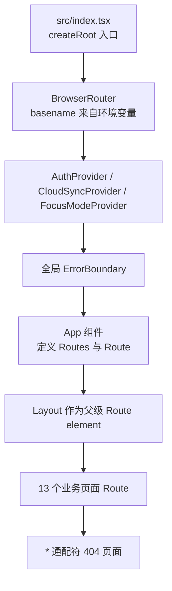
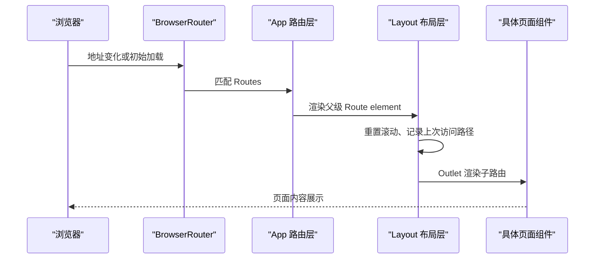
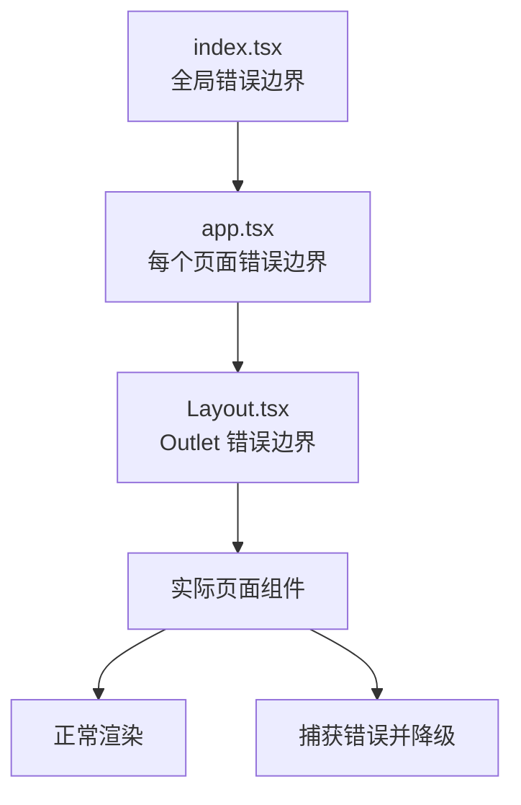
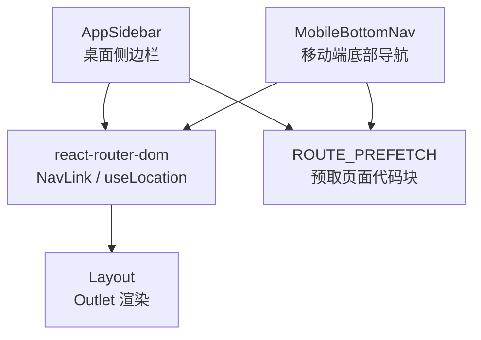
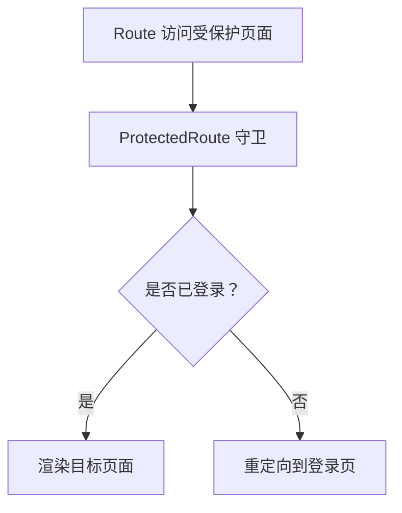
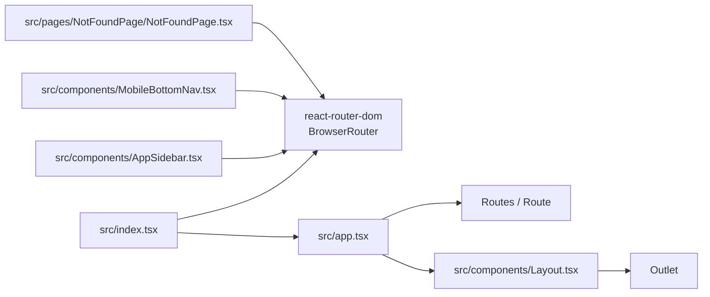

# 路由配置与懒加载

<cite>
**本文引用的文件**   
- [package.json](file://package.json)
- [src/index.tsx](file://src/index.tsx)
- [src/app.tsx](file://src/app.tsx)
- [src/components/Layout.tsx](file://src/components/Layout.tsx)
- [src/components/AppSidebar.tsx](file://src/components/AppSidebar.tsx)
- [src/components/MobileBottomNav.tsx](file://src/components/MobileBottomNav.tsx)
- [src/pages/NotFoundPage/NotFoundPage.tsx](file://src/pages/NotFoundPage/NotFoundPage.tsx)
- [src/lib/auth-provider.tsx](file://src/lib/auth-provider.tsx)
</cite>

## 目录
1. [简介](#简介)
2. [项目结构与入口](#项目结构与入口)
3. [核心组件总览](#核心组件总览)
4. [架构概览](#架构概览)
5. [路由注册与页面清单](#路由注册与页面清单)
6. [懒加载与错误隔离机制](#懒加载与错误隔离机制)
7. [布局、侧边栏与底部导航](#布局侧边栏与底部导航)
8. [路由参数、查询字符串与嵌套路由](#路由参数查询字符串与嵌套路由)
9. [认证守卫与权限控制现状](#认证守卫与权限控制现状)
10. [新增页面的完整步骤](#新增页面的完整步骤)
11. [依赖关系分析](#依赖关系分析)
12. [性能优化策略与最佳实践](#性能优化策略与最佳实践)
13. [常见问题排查](#常见问题排查)
14. [结论](#结论)

## 简介
本文面向 NativeThink 应用的路由子系统，聚焦基于 react-router-dom v7 的 BrowserRouter 配置、13 个主要页面的路由注册方式、React.lazy 与 Suspense 的懒加载实现、ErrorBoundary 错误隔离、侧边栏与底部导航联动、以及未来可扩展的路由参数、查询字符串和认证守卫方案。文档同时给出新增页面时的标准操作流程，并总结路由相关的性能优化与排错方法。

## 项目结构与入口
NativeThink 是 Vite + React 19 工程，使用 react-router-dom v7 进行客户端路由。应用根入口在 `src/index.tsx`，负责创建 React 根节点、挂载全局 Provider、初始化主题与点击动效、包裹 `<BrowserRouter>`，并在最外层提供 Toast、FocusMode、Auth、CloudSync 等上下文。



**图表来源**
- [src/index.tsx:1-123](file://src/index.tsx#L1-L123)
- [src/app.tsx:1-66](file://src/app.tsx#L1-L66)

**章节来源**
- [src/index.tsx:1-123](file://src/index.tsx#L1-L123)
- [package.json:1-130](file://package.json#L1-L130)

## 核心组件总览
| 文件 | 职责 | 与路由的关系 |
|---|---|---|
| `src/index.tsx` | 应用根入口、全局错误边界、BrowserRouter、Toast、平台壳包装 | 决定路由模式与基础路径 |
| `src/app.tsx` | 路由表、页面懒加载、每个页面的 ErrorBoundary、404 兜底 | 路由注册中心 |
| `src/components/Layout.tsx` | 布局容器、Outlet 渲染、模块强调色、滚动复位、页面级骨架屏 | 承载所有子路由内容 |
| `src/components/AppSidebar.tsx` | 桌面端侧边栏导航、激活态判断、路由预取 | 驱动用户进入各路由 |
| `src/components/MobileBottomNav.tsx` | 移动端底部快捷导航、预取缓存 | 驱动移动端路由跳转 |
| `src/pages/NotFoundPage/NotFoundPage.tsx` | 未匹配路由展示页 | 被 `*` 路由使用 |
| `src/lib/auth-provider.tsx` | 登录状态、Token、用户信息 Context | 为未来路由守卫提供认证数据 |

**章节来源**
- [src/index.tsx:1-123](file://src/index.tsx#L1-L123)
- [src/app.tsx:1-66](file://src/app.tsx#L1-L66)
- [src/components/Layout.tsx:1-155](file://src/components/Layout.tsx#L1-L155)
- [src/components/AppSidebar.tsx:1-179](file://src/components/AppSidebar.tsx#L1-L179)
- [src/components/MobileBottomNav.tsx:1-73](file://src/components/MobileBottomNav.tsx#L1-L73)
- [src/pages/NotFoundPage/NotFoundPage.tsx:1-11](file://src/pages/NotFoundPage/NotFoundPage.tsx#L1-L11)
- [src/lib/auth-provider.tsx:1-86](file://src/lib/auth-provider.tsx#L1-L86)

## 架构概览
下图展示了从浏览器地址变化到页面组件渲染的关键链路：



**图表来源**
- [src/index.tsx:100-123](file://src/index.tsx#L100-L123)
- [src/app.tsx:38-66](file://src/app.tsx#L38-L66)
- [src/components/Layout.tsx:89-155](file://src/components/Layout.tsx#L89-L155)

## 路由注册与页面清单
`src/app.tsx` 通过 `react-router-dom` 的 `Routes` 与 `Route` 注册全部路由。所有业务页面都放在一个共享的 `<Layout />` 下，因此这些路由都是相对 `/` 的子路由。

| 路径 | 页面名称 | 懒加载组件 | 错误边界提示 |
|---|---|---|---|
| `/` | 仪表盘 | DashboardPage | “仪表盘页面出错” |
| `/think` | 母语思维训练 | ThinkInEnglishPage | “母语思维训练页面出错” |
| `/chunks` | 语块训练 | ChunkTrainingPage | “语块训练页面出错” |
| `/conversation` | AI 对话 | ConversationPage | “AI对话页面出错” |
| `/shadowing` | 影子跟读 | ShadowingPage | “影子跟读页面出错” |
| `/articles` | 文章阅读 | ArticlePage | “文章阅读页面出错” |
| `/vocabulary` | 词汇深度 | DeepVocabularyPage | “词汇深度页面出错” |
| `/writing` | 写作练习 | WritingPage | “写作练习页面出错” |
| `/progress` | 学习记录 | ProgressPage | “学习记录页面出错” |
| `/favorites` | 我的收藏 | FavoritesPage | “我的收藏页面出错” |
| `/sentences` | 句子学习 | SentenceLabPage | “句子学习页面出错” |
| `/spelling` | 句子拼写 | SpellingPage | “句子拼写页面出错” |
| `/video` | 视频精听 | VideoLabPage | “视频精听页面出错” |
| `/settings` | 设置 | SettingsPage | “设置页面出错” |
| `*` | 未找到 | NotFoundPage | “页面未找到” |

当前项目中没有带动态参数的路由段，也没有嵌套的二级路由。所有 13 个主要页面均使用绝对路径形式的 `path` 属性直接注册。

**章节来源**
- [src/app.tsx:1-66](file://src/app.tsx#L1-L66)
- [src/pages/NotFoundPage/NotFoundPage.tsx:1-11](file://src/pages/NotFoundPage/NotFoundPage.tsx#L1-L11)

## 懒加载与错误隔离机制
### 懒加载实现
每个页面组件都通过 `React.lazy(() => import(...))` 动态导入，这样打包器会把每个页面拆成独立代码块，而不是把所有页面塞进主包。例如首页、母语思维训练、语块训练、AI 对话、影子跟读、文章阅读、词汇深度、写作练习、学习记录、收藏、句子学习、句子拼写、视频精听、设置等页面均采用该模式。

### Suspense 与骨架屏
页面懒加载时，`app.tsx` 中的每个路由都会把 Lazy 组件放进自己的 `ErrorBoundary`；而 `Layout.tsx` 中又用一层 `Suspense fallback={<PageFallback />}` 包裹 `<Outlet />`，用于在路由切换、首屏加载或异步资源加载时显示统一的骨架屏。

### 三级错误隔离
项目实现了三层错误边界：

1. **全局错误边界**：位于 `src/index.tsx`，包裹整个应用。如果应用启动阶段发生错误，会显示“页面加载出错”，并提供刷新重试按钮。
2. **页面级错误边界**：位于 `src/app.tsx`，每个页面单独包裹 `ErrorBoundary`，失败时显示对应页面的中文标题，如“母语思维训练页面出错”。
3. **布局级错误边界**：位于 `src/components/Layout.tsx`，包裹 `<Outlet />`，当某个页面内部渲染异常时，会显示“页面加载异常”，并保留布局结构。



**图表来源**
- [src/index.tsx:27-70](file://src/index.tsx#L27-L70)
- [src/app.tsx:13-36](file://src/app.tsx#L13-L36)
- [src/components/Layout.tsx:22-56](file://src/components/Layout.tsx#L22-L56)

**章节来源**
- [src/app.tsx:1-66](file://src/app.tsx#L1-L66)
- [src/components/Layout.tsx:1-155](file://src/components/Layout.tsx#L1-L155)
- [src/index.tsx:1-123](file://src/index.tsx#L1-L123)

## 布局、侧边栏与底部导航
### Layout 的职责
`Layout` 是所有业务页面的外壳。它负责：

- 根据当前路由计算模块强调色，用于页面头部光晕与细节区分。
- 路由变化时重置滚动位置，并把最近访问路径写入本地存储，供仪表盘“继续上次学习”使用。
- 在 Android 原生环境下检测英语语音包，必要时弹出安装引导。
- 使用 `SidebarProvider` 与 `SidebarInset` 管理侧边栏与主内容区。
- 使用 `Outlet` 渲染子路由内容。
- 对 `<Outlet />` 再套一层 `ErrorBoundary` 与 `Suspense`，保证单个页面崩溃不会破坏整体布局。

### 侧边栏导航
`AppSidebar` 维护一份与路由一一对应的导航项列表，包含图标、路径、标签和预取函数。激活态判断逻辑支持 `/` 精确匹配，其他路径支持前缀匹配，即 `/vocabulary/detail` 也会被视作属于 `/vocabulary`。鼠标悬停或触摸时会触发对应页面的动态导入预取，提前预热浏览器缓存。

### 底部导航
`MobileBottomNav` 只暴露顶部 6 个高频功能：首页、思维、语块、对话、文章、词汇。它的激活态判断与侧边栏一致，并且同样在触摸时触发懒加载预取。



**图表来源**
- [src/components/AppSidebar.tsx:1-179](file://src/components/AppSidebar.tsx#L1-L179)
- [src/components/MobileBottomNav.tsx:1-73](file://src/components/MobileBottomNav.tsx#L1-L73)
- [src/components/Layout.tsx:1-155](file://src/components/Layout.tsx#L1-L155)

**章节来源**
- [src/components/Layout.tsx:1-155](file://src/components/Layout.tsx#L1-L155)
- [src/components/AppSidebar.tsx:1-179](file://src/components/AppSidebar.tsx#L1-L179)
- [src/components/MobileBottomNav.tsx:1-73](file://src/components/MobileBottomNav.tsx#L1-L73)

## 路由参数、查询字符串与嵌套路由
### 当前状态
现有路由均为静态路径，没有动态段，也没有嵌套子路由。例如 `/vocabulary` 是独立页面，而不是 `/vocabulary/:id` 这类参数化路由。

### 推荐做法
如果需要新增带参数的页面，建议遵循以下约定：

| 需求 | 推荐写法 | 说明 |
|---|---|---|
| 单值参数 | `path="vocabulary/:id"` | 使用 `useParams()` 获取参数 |
| 多值参数 | `path="articles/:year/:month"` | 按 URL 段顺序读取 |
| 查询字符串 | 保持路由不变，使用 `useSearchParams()` | 适合筛选、分页、搜索条件 |
| 嵌套路由 | 父路由不渲染页面，仅用 `element={<Outlet />}` | 子路由渲染详情或工具面板 |
| 可选参数 | `path="vocabulary/:id?"` | 避免必须传参导致 404 |
| 通配符子路由 | `path="*" ` 放在子路由末尾 | 处理未知子路径 |

### 查询字符串处理示例思路
以词汇复习为例，可以在 `DashboardPage` 或 `DeepVocabularyPage` 中使用 `useSearchParams()` 读取 `?mode=review&level=cet4`，再根据查询参数决定是否跳转到特定子视图。URL 变化时，React Router 会自动重新渲染页面组件。

### 嵌套路由示例思路
若词汇页面需要“词库概览 + 单词详情”结构，可以把 `/vocabulary` 改为布局型路由，子路由使用 `/vocabulary/list` 和 `/vocabulary/:id`。注意此时 `AppSidebar` 的激活态判断已经支持路径前缀匹配，所以 `/vocabulary/*` 仍会被视为词汇模块。

[本节为概念性说明，不涉及具体源码片段]

## 认证守卫与权限控制现状
### 当前实现
目前 `src/app.tsx` 中的路由没有加入认证守卫。所有 13 个页面都可以直接访问。认证状态由 `AuthProvider` 提供，包含用户对象、Token、加载状态、登录、注册、登出和 `isAuthenticated`。

### 现有认证流程
`AuthProvider` 会在应用启动时检查本地存储的 Token，并调用后端 `/api/auth/me` 验证。如果接口成功，则设置用户信息；否则清除 Token 并假设离线状态下 Token 仍然有效。

### 推荐的守卫实现方案
建议在新增受保护页面时采用如下模式：

1. 在 `src/app.tsx` 中定义受保护路由，将页面组件传给守卫组件。
2. 守卫组件读取 `useAuth().isAuthenticated`。
3. 已登录则渲染目标页面。
4. 未登录则重定向到登录页，或显示登录对话框。
5. 对于需要角色权限的页面，可在守卫内增加角色校验。



**图表来源**
- [src/lib/auth-provider.tsx:1-86](file://src/lib/auth-provider.tsx#L1-L86)
- [src/app.tsx:1-66](file://src/app.tsx#L1-L66)

**章节来源**
- [src/lib/auth-provider.tsx:1-86](file://src/lib/auth-provider.tsx#L1-L86)
- [src/app.tsx:1-66](file://src/app.tsx#L1-L66)

## 新增页面的完整步骤
假设新增一个名为 `ReadingPage` 的页面，路径为 `/reading`。

### 第一步：创建页面组件
新建 `src/pages/ReadingPage/ReadingPage.tsx`，导出默认 React 组件。

### 第二步：在 app.tsx 中注册路由
在 `import` 区域添加懒加载声明：

```text
const ReadingPage = lazy(() => import("@/pages/ReadingPage/ReadingPage"));
```

在 `Routes` 中添加路由：

```text
<Route path="reading" element={<ErrorBoundary fallback={<PageErrorFallback page="阅读" />}><ReadingPage /></ErrorBoundary>} />
```

### 第三步：配置侧边栏
在 `AppSidebar.tsx` 的 `ROUTE_PREFETCH` 中添加预取函数：

```text
'/reading': () => import('@/pages/ReadingPage/ReadingPage'),
```

在 `NAV_ITEMS` 中添加导航项：

```text
{ path: '/reading', label: '阅读', icon: FileText },
```

### 第四步：配置移动端底部导航
如需在底部导航出现，在 `MobileBottomNav.tsx` 的 `ROUTE_PREFETCH` 和 `MOBILE_NAV` 中添加对应条目。如果不需要常驻底部导航，则只需更新侧边栏。

### 第五步：确认布局与错误隔离
由于路由注册在 `Layout` 之下，新页面会自动获得：

- 模块强调色
- 滚动复位
- 页面骨架屏
- 页面级错误边界
- 布局级错误边界

### 第六步：测试激活态
打开侧边栏和移动端底部导航，确认：

- 当前路径高亮正确
- 鼠标悬停或触摸能触发懒加载预取
- 跳转后页面正常加载
- 页面报错时显示对应的中文错误提示

**章节来源**
- [src/app.tsx:1-66](file://src/app.tsx#L1-L66)
- [src/components/AppSidebar.tsx:1-179](file://src/components/AppSidebar.tsx#L1-L179)
- [src/components/MobileBottomNav.tsx:1-73](file://src/components/MobileBottomNav.tsx#L1-L73)
- [src/components/Layout.tsx:1-155](file://src/components/Layout.tsx#L1-L155)

## 依赖关系分析


**图表来源**
- [src/index.tsx:1-123](file://src/index.tsx#L1-L123)
- [src/app.tsx:1-66](file://src/app.tsx#L1-L66)
- [src/components/Layout.tsx:1-155](file://src/components/Layout.tsx#L1-L155)
- [src/components/AppSidebar.tsx:1-179](file://src/components/AppSidebar.tsx#L1-L179)
- [src/components/MobileBottomNav.tsx:1-73](file://src/components/MobileBottomNav.tsx#L1-L73)
- [src/pages/NotFoundPage/NotFoundPage.tsx:1-11](file://src/pages/NotFoundPage/NotFoundPage.tsx#L1-L11)

**章节来源**
- [package.json:1-130](file://package.json#L1-L130)
- [src/index.tsx:1-123](file://src/index.tsx#L1-L123)
- [src/app.tsx:1-66](file://src/app.tsx#L1-L66)

## 性能优化策略与最佳实践
### 已实现的优化
1. **页面级懒加载**：每个页面使用 `React.lazy`，减少主包体积。
2. **布局级骨架屏**：`Layout.tsx` 的 `Suspense fallback` 在路由切换时提供统一加载占位。
3. **侧边栏与底部导航预取**：鼠标悬停或触摸时提前 `import()` 目标页面，降低首次渲染延迟。
4. **404 页面也懒加载**：通配符路由下的 `NotFoundPage` 同样使用 `lazy`，避免未命中路由时仍加载无关代码。
5. **平台壳动态加载**：`src/index.tsx` 动态引入 Lark 平台壳，非平台环境完全不请求。
6. **首页语料懒加载**：仪表盘内的每日一句语料通过 `import('@/data/chunks')` 延迟加载，避免主包膨胀。

### 进一步优化建议
| 优化方向 | 建议 |
|---|---|
| 路由预加载策略 | 对高频页面（如词汇、思维）增加更积极的预取，对低频页面保持按需加载 |
| 路由级数据预取 | 在页面组件内部使用 `useEffect` 或 React Router v7 的数据加载能力预取 API |
| 图片与媒体懒加载 | 大图、视频、音频使用 IntersectionObserver 或原生 `loading="lazy"` |
| 代码分割粒度 | 大型页面可按功能模块进一步拆分，避免单个 chunk 过大 |
| 缓存复用 | 相同页面多次切换时可考虑状态缓存，但需注意内存占用 |
| 构建产物监控 | 使用 bundle 分析工具检查每个页面 chunk 的大小变化 |

**章节来源**
- [src/app.tsx:1-66](file://src/app.tsx#L1-L66)
- [src/components/Layout.tsx:1-155](file://src/components/Layout.tsx#L1-L155)
- [src/components/AppSidebar.tsx:1-179](file://src/components/AppSidebar.tsx#L1-L179)
- [src/components/MobileBottomNav.tsx:1-73](file://src/components/MobileBottomNav.tsx#L1-L73)
- [src/pages/DashboardPage/DashboardPage.tsx:1-200](file://src/pages/DashboardPage/DashboardPage.tsx#L1-L200)

## 常见问题排查
| 问题 | 可能原因 | 解决方案 |
|---|---|---|
| 页面白屏 | 页面组件抛出未捕获异常 | 查看页面级 ErrorBoundary 提示，或刷新页面重试 |
| 布局还在但内容空白 | Layout 层 ErrorBoundary 捕获了页面错误 | 检查页面内部异步逻辑和数据加载 |
| 路由跳转后滚动位置未重置 | Layout 的滚动复位逻辑未生效 | 检查 `main.flex-1` 元素是否存在，或自定义滚动行为 |
| 侧边栏高亮不正确 | 路径匹配逻辑不符合预期 | 确认 `pathname` 与 `item.path` 的比较逻辑 |
| 移动端底部导航点击无效 | 使用了错误的导航 API | 使用 `useNavigate` 或 `NavLink` |
| 新增页面无法访问 | 未在 `app.tsx` 注册路由 | 检查 `path` 是否与导航项一致 |
| 新增页面不在侧边栏 | 未添加到 `NAV_ITEMS` 或 `ROUTE_PREFETCH` | 同步更新导航配置 |
| 404 页面不显示 | 通配符路由位置错误或组件未懒加载 | 确认 `*` 路由在 `Routes` 末尾且包裹 `ErrorBoundary` |
| 登录后仍被拦截 | 认证状态尚未初始化完成 | 等待 `AuthProvider` 的 loading 状态结束，或使用守卫组件 |
| 基础路径部署失败 | `CLIENT_BASE_PATH` 未配置 | 在部署环境中设置正确的 `CLIENT_BASE_PATH` |

**章节来源**
- [src/app.tsx:1-66](file://src/app.tsx#L1-L66)
- [src/components/Layout.tsx:1-155](file://src/components/Layout.tsx#L1-L155)
- [src/components/AppSidebar.tsx:1-179](file://src/components/AppSidebar.tsx#L1-L179)
- [src/components/MobileBottomNav.tsx:1-73](file://src/components/MobileBottomNav.tsx#L1-L73)
- [src/lib/auth-provider.tsx:1-86](file://src/lib/auth-provider.tsx#L1-L86)

## 结论
NativeThink 的路由系统以 `src/index.tsx` 的 `BrowserRouter` 为入口，以 `src/app.tsx` 的 `Routes` 为中心，通过 `Layout` 统一管理页面外壳、错误边界和骨架屏。13 个主要页面均采用 `React.lazy` 懒加载，并通过三级 ErrorBoundary 实现健壮的错误隔离。侧边栏与底部导航不仅负责导航，还承担路由预取职责，有助于提升移动端体验。

当前路由尚未启用认证守卫和动态参数，但这不影响现有功能的稳定性。未来新增页面时，只需按照“创建页面 → 注册路由 → 配置侧边栏 → 可选配置底部导航”的流程即可保持一致性。若后续需要登录保护、角色权限、参数化路由或嵌套路由，可在现有架构基础上平滑扩展。