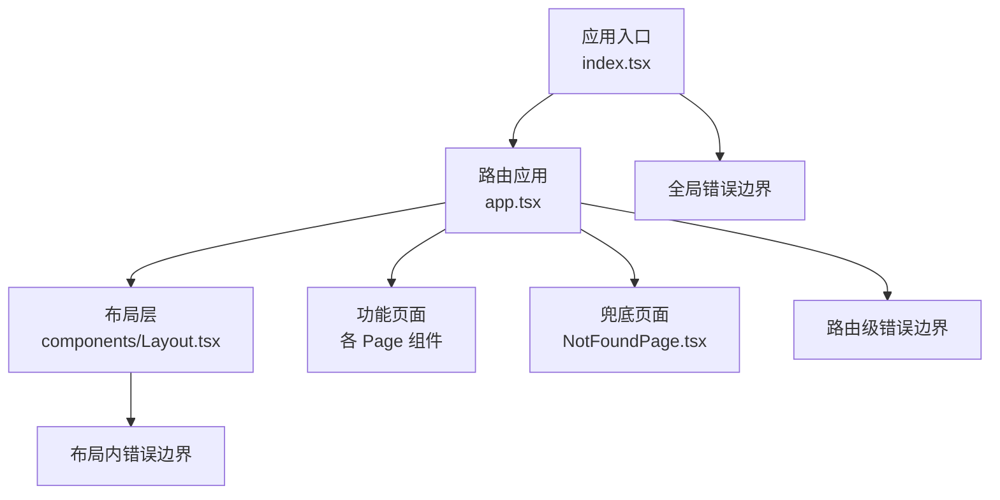
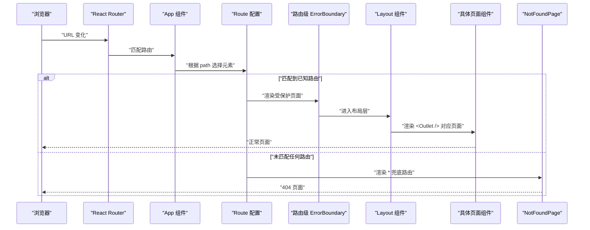
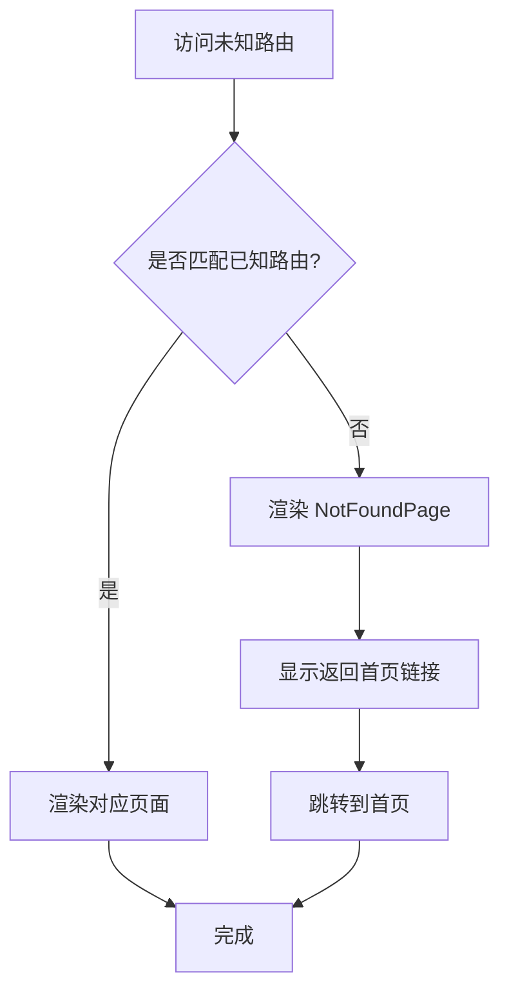
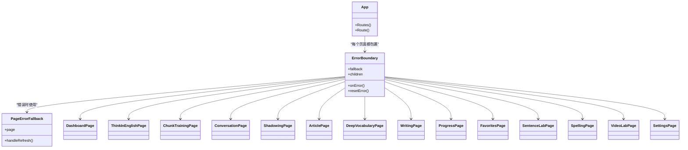
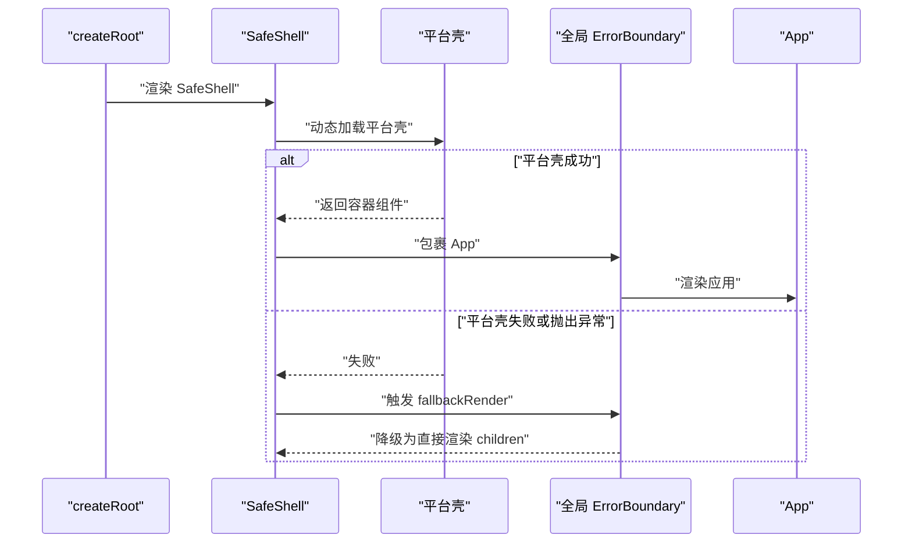
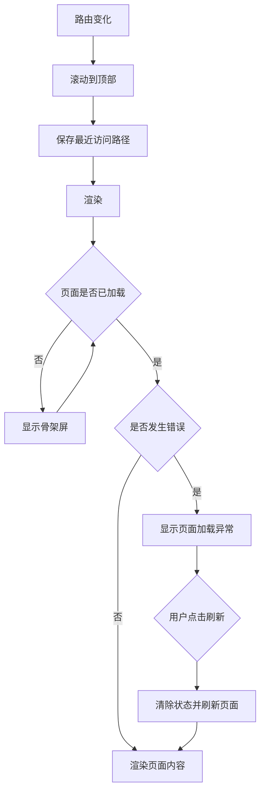
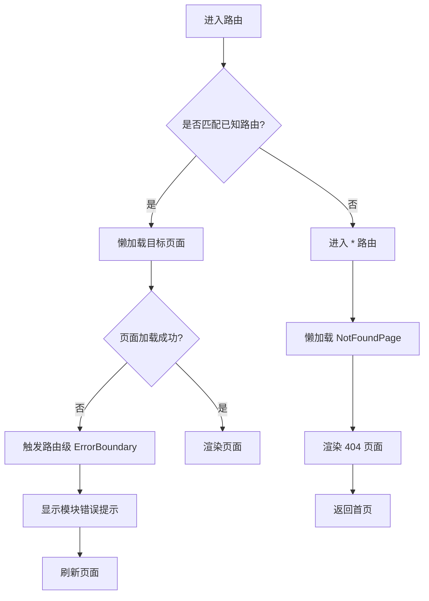
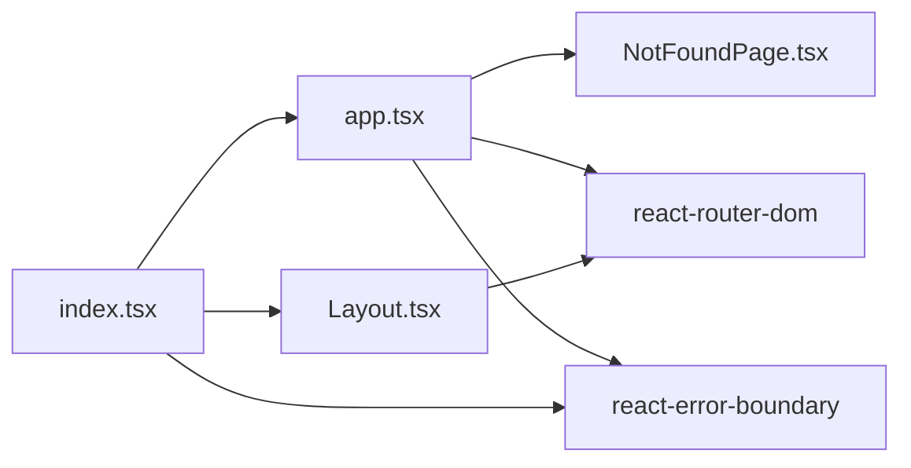

# 错误处理与兜底路由

<cite>
**本文引用的文件**   
- [NotFoundPage.tsx](file://src/pages/NotFoundPage/NotFoundPage.tsx)
- [app.tsx](file://src/app.tsx)
- [index.tsx](file://src/index.tsx)
- [Layout.tsx](file://src/components/Layout.tsx)
</cite>

## 目录
1. [引言](#引言)
2. [项目结构中的错误处理位置](#项目结构中的错误处理位置)
3. [核心组件总览](#核心组件总览)
4. [架构概览](#架构概览)
5. [详细组件分析](#详细组件分析)
6. [依赖关系分析](#依赖关系分析)
7. [性能与健壮性考量](#性能与健壮性考量)
8. [故障排查指南](#故障排查指南)
9. [结论](#结论)

## 引言
本文聚焦 NativeThink 应用的前端错误处理与兜底路由机制，围绕以下目标展开：
- 说明 NotFoundPage 组件如何作为“页面不存在”的兜底展示。
- 解释 ErrorBoundary 在应用入口、路由模块和布局层的使用模式。
- 描述路由级错误隔离、恢复策略，以及无效路由的用户引导方式。
- 梳理错误状态管理、错误信息展示和用户可操作的恢复动作。
- 说明当前错误日志记录与监控集成的现状，并给出扩展建议。
- 提供常见路由错误的排查方法和调试技巧。
- 说明错误边界与全局错误处理的协作关系，以及如何自定义错误页面和恢复流程。

## 项目结构中的错误处理位置
该项目的错误处理主要分布在三个层次：
- 应用入口层：负责包裹整个 React 应用，提供全局错误兜底和平台壳容错。
- 路由层：为每个功能页面单独包裹错误边界，使某个页面崩溃不会拖垮其他页面。
- 布局层：对 `Outlet` 渲染区域再套一层错误边界和 Suspense，承接异步加载失败和运行时异常。

**图表来源**
- [index.tsx:100-123](file://src/index.tsx#L100-L123)
- [app.tsx:1-66](file://src/app.tsx#L1-L66)
- [Layout.tsx:1-155](file://src/components/Layout.tsx#L1-L155)
- [NotFoundPage.tsx:1-11](file://src/pages/NotFoundPage/NotFoundPage.tsx#L1-L11)

**章节来源**
- [index.tsx:1-123](file://src/index.tsx#L1-L123)
- [app.tsx:1-66](file://src/app.tsx#L1-L66)
- [Layout.tsx:1-155](file://src/components/Layout.tsx#L1-L155)
- [NotFoundPage.tsx:1-11](file://src/pages/NotFoundPage/NotFoundPage.tsx#L1-L11)

## 核心组件总览
- **NotFoundPage**：用于显示“页面不存在”，提供返回首页链接。
- **路由级错误边界**：为仪表盘、思维训练、语块训练、AI对话、影子跟读、文章阅读、词汇深度、写作练习、学习记录、收藏、句子学习、拼写、视频精听、设置等页面分别包裹错误边界。
- **全局错误边界**：包裹整个 `<App />`，当应用初始化或顶层组件出错时，展示统一的“页面加载出错”界面。
- **布局层错误边界**：包裹 `<Outlet />`，承接子路由内容渲染异常；同时配合 Suspense 提供骨架屏加载体验。

这些组件共同构成“多层防护”：
1. 最外层捕获应用级异常。
2. 路由层按模块隔离异常。
3. 布局层兜住具体页面内容的渲染异常。
4. 未知路由统一落入 NotFoundPage。

**章节来源**
- [app.tsx:1-66](file://src/app.tsx#L1-L66)
- [index.tsx:100-123](file://src/index.tsx#L100-L123)
- [Layout.tsx:33-66](file://src/components/Layout.tsx#L33-L66)
- [NotFoundPage.tsx:1-11](file://src/pages/NotFoundPage/NotFoundPage.tsx#L1-L11)

## 架构概览
下图展示从浏览器 URL 变化到最终页面渲染、错误捕获的关键路径。

**图表来源**
- [app.tsx:43-66](file://src/app.tsx#L43-L66)
- [NotFoundPage.tsx:1-11](file://src/pages/NotFoundPage/NotFoundPage.tsx#L1-L11)

## 详细组件分析

### NotFoundPage 组件
NotFoundPage 是一个简单的静态页面组件，承担“未知路由”的用户提示职责：
- 使用大字号标题显示“404”。
- 用副标题提示“页面不存在”。
- 提供返回首页链接，将用户引导回应用主入口。

它本身不包含复杂逻辑，也没有内部状态，属于纯展示型兜底组件。它的存在让无效路由不会表现为白屏，而是给出不易误解的错误信息和下一步操作。

**图表来源**
- [app.tsx:62-66](file://src/app.tsx#L62-L66)
- [NotFoundPage.tsx:1-11](file://src/pages/NotFoundPage/NotFoundPage.tsx#L1-L11)

**章节来源**
- [NotFoundPage.tsx:1-11](file://src/pages/NotFoundPage/NotFoundPage.tsx#L1-L11)
- [app.tsx:62-66](file://src/app.tsx#L62-L66)

### 路由级错误边界与页面错误隔离
在 `app.tsx` 中，每个功能页面都被 `<ErrorBoundary>` 包裹，并传入一个 `PageErrorFallback` 作为 fallback。其作用包括：
- 将某个页面的渲染错误限制在该页面范围内，避免整页崩溃。
- 通过 `page` 属性向用户说明是哪个功能模块出错，例如“母语思维训练页面出错”。
- 提供“刷新页面”按钮，调用 `window.location.reload()` 进行恢复。
- 使用与主题一致的视觉样式，而不是裸错误信息。

这种设计适合“模块级容错”：单个功能出错时，用户可以感知问题并尝试恢复，而不必看到完全不可用的应用。

**图表来源**
- [app.tsx:1-66](file://src/app.tsx#L1-L66)

**章节来源**
- [app.tsx:1-66](file://src/app.tsx#L1-L66)

### 全局错误边界与入口容错
`index.tsx` 中存在两个关键的全局错误处理点：

1. **SafeShell 内部的 ErrorBoundary**：用于包裹平台壳容器（例如 miaoda 平台的 `AppContainer`）。如果平台壳加载失败或抛出异常，会降级为直接渲染应用内容，避免因为第三方壳导致应用启动失败。
2. **包裹 `<App />` 的全局 ErrorBoundary**：当应用整体初始化失败、Provider 层报错或顶层组件抛错时，展示 `GlobalErrorFallback`。

`GlobalErrorFallback` 的特点：
- 不依赖业务 UI 库，保证在最基础环境下也能渲染。
- 显示错误消息和“刷新重试”按钮。
- 通过 `resetErrorBoundary` 触发错误边界重置，便于恢复。

**图表来源**
- [index.tsx:60-92](file://src/index.tsx#L60-L92)
- [index.tsx:100-123](file://src/index.tsx#L100-L123)

**章节来源**
- [index.tsx:25-38](file://src/index.tsx#L25-L38)
- [index.tsx:60-92](file://src/index.tsx#L60-L92)
- [index.tsx:100-123](file://src/index.tsx#L100-L123)

### 布局层错误边界与 Suspense 协同
`Layout.tsx` 中的布局组件负责侧边栏、头部、移动端底部导航和内容区。它还实现了一个类形式的本地 `ErrorBoundary`，包裹 `<Outlet />` 和 `<Suspense>`：
- 当子路由内容渲染抛出异常时，显示“页面加载异常”提示。
- 提供“刷新页面”按钮，先清空错误状态，再执行 `window.location.reload()`。
- 与 Suspense 的骨架屏配合：异步懒加载页面未完成时显示占位卡片，完成后替换为真实内容。

**图表来源**
- [Layout.tsx:33-66](file://src/components/Layout.tsx#L33-L66)
- [Layout.tsx:130-155](file://src/components/Layout.tsx#L130-L155)

**章节来源**
- [Layout.tsx:1-155](file://src/components/Layout.tsx#L1-L155)

### 错误状态管理与错误信息展示策略
项目中的错误展示遵循“可理解、可操作、可恢复”的原则：

| 层级 | 错误类型 | 展示方式 | 恢复方式 |
| --- | --- | --- | --- |
| 应用入口 | 全局初始化异常、平台壳异常 | 简单 HTML 风格的错误页，显示错误消息 | “刷新重试” |
| 路由级 | 单个页面组件异常 | 带模块名称的错误卡片，如“母语思维训练页面出错” | “刷新页面” |
| 布局级 | 子路由内容渲染异常 | 布局内错误卡片，显示错误消息 | “刷新页面” |
| 路由匹配 | 未知路由 | 404 页面，显示“页面不存在” | “返回首页” |

错误信息展示策略：
- 对用户可见的消息尽量简洁、友好，避免直接暴露堆栈。
- 通过按钮明确引导用户执行恢复动作。
- 在路由级错误中保留模块语义，让用户知道是哪个功能出问题。
- 在全局错误中保持最小依赖，确保即使 UI 框架部分损坏也能展示基本恢复入口。

**章节来源**
- [app.tsx:17-42](file://src/app.tsx#L17-L42)
- [index.tsx:25-38](file://src/index.tsx#L25-L38)
- [Layout.tsx:33-66](file://src/components/Layout.tsx#L33-L66)
- [NotFoundPage.tsx:1-11](file://src/pages/NotFoundPage/NotFoundPage.tsx#L1-L11)

### 路由错误的捕获和处理流程
路由错误的处理可以分为两类：

#### 1. 路由匹配失败：未知路径
- 所有未匹配的 `path` 由 `*` 路由接管。
- `*` 路由首先用 `Suspense` 包裹，防止懒加载阶段出现空白。
- 在 `Suspense` 内部再用 `ErrorBoundary` 包裹 `NotFoundPage`，确保 404 页面自身也不会白屏。
- 用户看到 404 后，可通过“返回首页”跳转回根路由。

#### 2. 路由匹配成功但页面渲染失败
- 该页面被独立 `ErrorBoundary` 包裹。
- 错误只影响该页面，不影响其他页面。
- 用户看到模块名+错误提示，并可刷新页面尝试恢复。

**图表来源**
- [app.tsx:43-66](file://src/app.tsx#L43-L66)
- [NotFoundPage.tsx:1-11](file://src/pages/NotFoundPage/NotFoundPage.tsx#L1-L11)

**章节来源**
- [app.tsx:43-66](file://src/app.tsx#L43-L66)
- [NotFoundPage.tsx:1-11](file://src/pages/NotFoundPage/NotFoundPage.tsx#L1-L11)

### 错误日志记录和监控集成现状
在当前源码中，前端应用没有集中式错误上报服务或外部监控 SDK 集成。现有错误处理主要停留在“用户可见错误界面”和“开发控制台日志”层面：
- 路由级和布局级错误会触发浏览器控制台日志。
- 一些业务逻辑中使用了 `console.error` 输出 AI 请求失败等错误。
- 服务端和本地服务器脚本中有较多 `console.error`，但这些不属于前端错误上报机制。

这意味着：
- 生产环境中，开发者不能仅依赖前端自动上报错误。
- 需要额外接入错误监控服务，例如 Sentry、Bugsnag 或自研日志上报接口。
- 应在 `react-error-boundary` 的 `onError` 回调中收集错误上下文，包括当前路由、模块名、用户标识、时间戳等。

**章节来源**
- [app.tsx:1-66](file://src/app.tsx#L1-L66)
- [index.tsx:1-123](file://src/index.tsx#L1-L123)
- [Layout.tsx:1-155](file://src/components/Layout.tsx#L1-L155)

### 自定义错误页面与错误恢复机制
项目中已经提供了两种错误恢复思路：

#### 页面级恢复
- 路由级 `PageErrorFallback` 使用 `window.location.reload()` 强制刷新整个页面。
- 布局级错误边界先清空本地错误状态，再刷新页面。

这种方式适合“页面数据或状态损坏”的场景，但代价是丢失用户输入。

#### 边界级恢复
- 全局 `GlobalErrorFallback` 使用 `resetErrorBoundary` 触发错误边界重置。
- 这种方式适合轻量错误恢复，例如临时网络异常或可重试的资源加载失败。

如果需要更精细的恢复机制，可以：
- 为不同错误类型定义不同恢复策略。
- 区分“可重试错误”和“必须刷新错误”。
- 在错误边界中增加“重试”“返回首页”“查看日志”等操作。
- 将错误信息上报后，再决定是否展示给用户。

**章节来源**
- [app.tsx:17-42](file://src/app.tsx#L17-L42)
- [index.tsx:25-38](file://src/index.tsx#L25-L38)
- [Layout.tsx:33-66](file://src/components/Layout.tsx#L33-L66)

## 依赖关系分析
错误处理相关的主要依赖如下：

**图表来源**
- [index.tsx:1-123](file://src/index.tsx#L1-L123)
- [app.tsx:1-66](file://src/app.tsx#L1-L66)
- [Layout.tsx:1-155](file://src/components/Layout.tsx#L1-L155)
- [NotFoundPage.tsx:1-11](file://src/pages/NotFoundPage/NotFoundPage.tsx#L1-L11)

依赖特点：
- 错误处理依赖 `react-error-boundary` 和 `react-router-dom`。
- 路由匹配和懒加载由 React Router 提供。
- 页面级错误边界由业务代码显式声明，耦合度较低，易于扩展。
- 全局错误边界集中在入口，有利于统一管理。

**章节来源**
- [index.tsx:1-123](file://src/index.tsx#L1-L123)
- [app.tsx:1-66](file://src/app.tsx#L1-L66)
- [Layout.tsx:1-155](file://src/components/Layout.tsx#L1-L155)
- [NotFoundPage.tsx:1-11](file://src/pages/NotFoundPage/NotFoundPage.tsx#L1-L11)

## 性能与健壮性考量
- **懒加载页面**：所有页面都通过 `lazy` 引入，减少首屏体积，同时配合 Suspense 骨架屏提升感知性能。
- **错误边界粒度**：按页面划分错误边界，避免单页崩溃导致全应用不可用。
- **全局降级**：平台壳加载失败时，应用仍能继续运行，提高部署环境兼容性。
- **刷新恢复**：目前恢复策略以刷新为主，简单可靠，但可能丢失用户状态。
- **骨架屏优先**：异步加载期间展示占位内容，减少白屏感。

优化建议：
- 对于可重试的网络错误，优先尝试局部重试，而不是立即刷新。
- 对频繁触发的错误，增加防抖或去重上报，避免日志风暴。
- 在错误边界中记录错误来源路由和模块名，便于定位问题。
- 考虑引入错误上报 SDK，将关键错误发送到后端或监控平台。

[本节为通用性能建议，不直接分析具体代码片段]

## 故障排查指南

### 常见问题分类
| 现象 | 可能原因 | 排查方法 | 恢复建议 |
| --- | --- | --- | --- |
| 访问任意 URL 都显示 404 | 路由配置缺失、base 路径配置错误、打包产物部署路径不一致 | 检查浏览器地址栏、路由 base、部署路径 | 修正路由或部署路径，必要时刷新缓存 |
| 某个功能页面白屏 | 页面组件抛错、数据格式异常、懒加载失败 | 打开浏览器控制台查看错误堆栈 | 使用页面级错误提示中的“刷新页面” |
| 整个应用无法启动 | Provider 初始化失败、全局资源加载失败 | 检查入口日志和全局错误边界 | 使用“刷新重试” |
| 路由切换后页面异常 | 子路由数据或副作用异常 | 检查布局层错误边界和控制台日志 | 刷新页面或重新进入该路由 |
| 平台壳环境异常 | 第三方壳动态加载失败 | 检查 SafeShell 的降级逻辑 | 应用会自动降级，无需用户操作 |

### 调试技巧
1. **确认路由是否匹配**  
   检查当前 URL 是否在 `app.tsx` 的路由配置中。若未匹配，应进入 `*` 路由并显示 404。

2. **定位具体页面错误**  
   观察路由级错误提示中的模块名称，例如“母语思维训练页面出错”，然后重点排查对应页面组件。

3. **检查懒加载是否正常**  
   如果页面长时间处于骨架屏状态，检查对应 `lazy(() => import(...))` 是否能正确加载。

4. **验证错误边界是否生效**  
   在目标页面中故意抛出异常，确认是否被路由级错误边界捕获，而不是触发全局错误。

5. **检查全局错误边界**  
   如果连应用都无法挂载，优先检查 `index.tsx` 中的全局错误边界和 Provider 初始化逻辑。

6. **结合控制台日志**  
   前端错误通常会在控制台留下堆栈信息；对于 AI 或网络相关错误，还可结合业务层的 `console.error` 快速定位。

**章节来源**
- [app.tsx:43-66](file://src/app.tsx#L43-L66)
- [index.tsx:100-123](file://src/index.tsx#L100-L123)
- [Layout.tsx:130-155](file://src/components/Layout.tsx#L130-L155)
- [NotFoundPage.tsx:1-11](file://src/pages/NotFoundPage/NotFoundPage.tsx#L1-L11)

## 结论
NativeThink 应用的错误处理采用“多层错误边界 + 兜底路由 + 骨架屏 + 可恢复交互”的组合策略：
- NotFoundPage 提供清晰、友好的 404 体验，并将用户引导回首页。
- 路由级错误边界实现模块级隔离，避免单页崩溃扩散。
- 全局错误边界保障应用入口和基本恢复能力。
- 布局层错误边界与 Suspense 协同，兼顾异步加载和渲染异常。
- 当前方案以用户可见错误和刷新恢复为主，尚未集成集中式错误监控。

后续改进方向包括：
- 接入错误上报系统，记录错误类型、路由、模块名和用户上下文。
- 细化恢复策略，区分可重试错误和必须刷新错误。
- 为 NotFoundPage 和错误页面增加更丰富的用户引导，例如推荐功能入口、帮助文档链接。
- 在错误边界中统一采集诊断信息，提升线上问题定位效率。