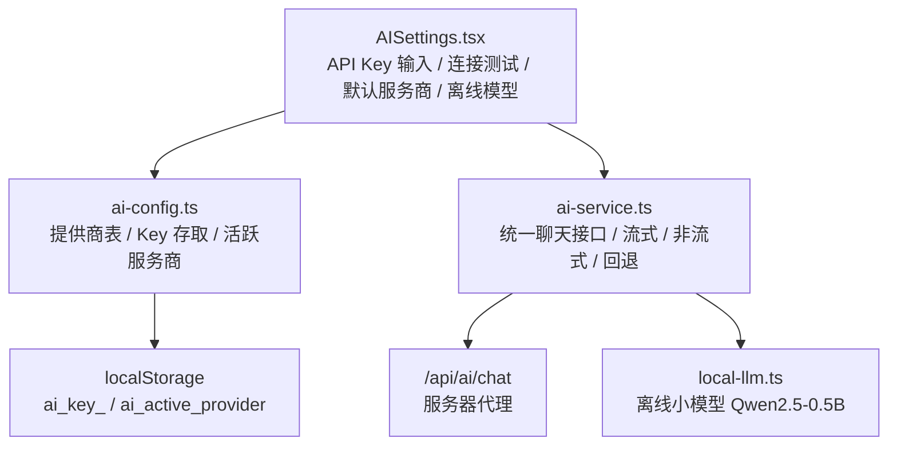
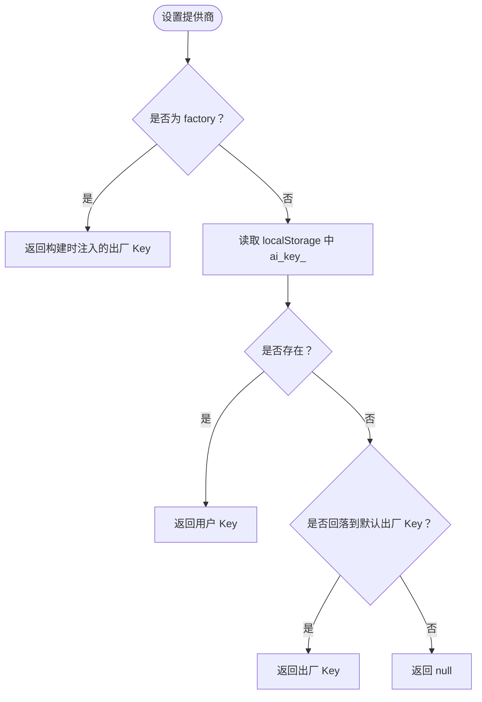
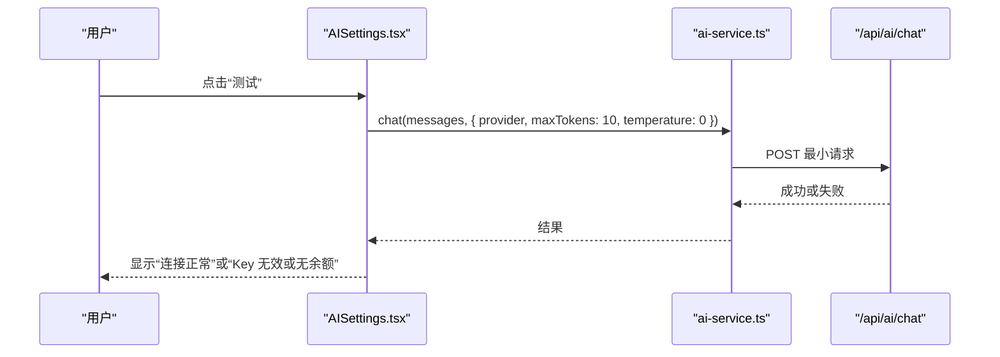
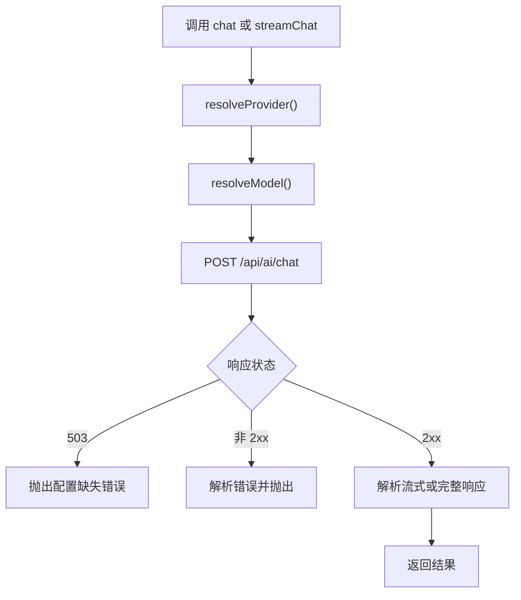
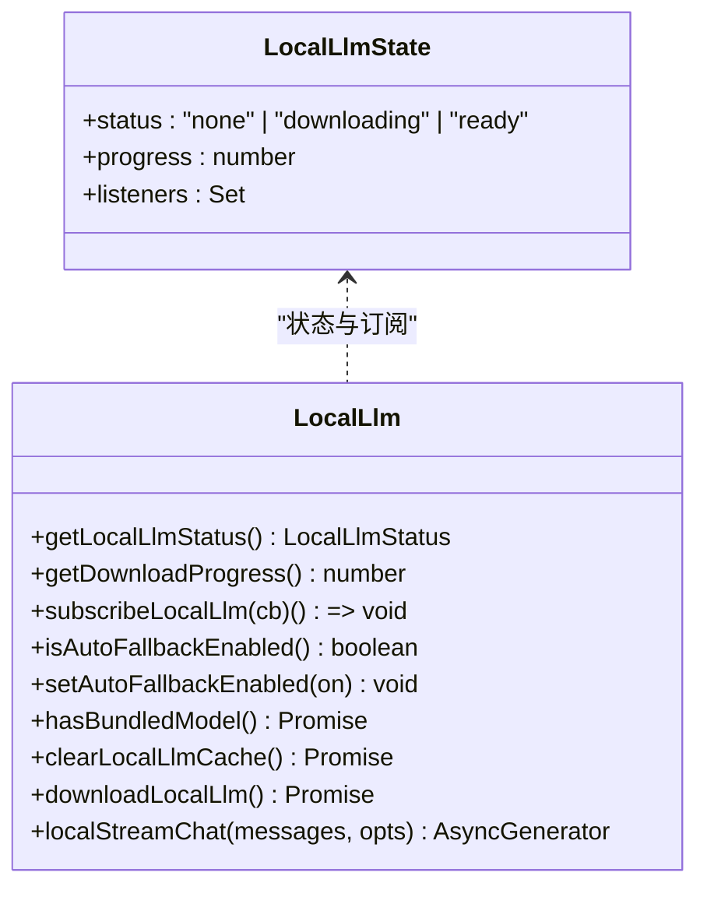
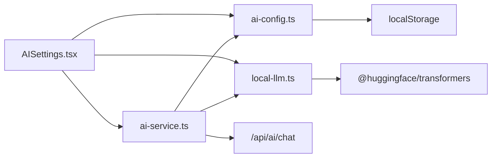
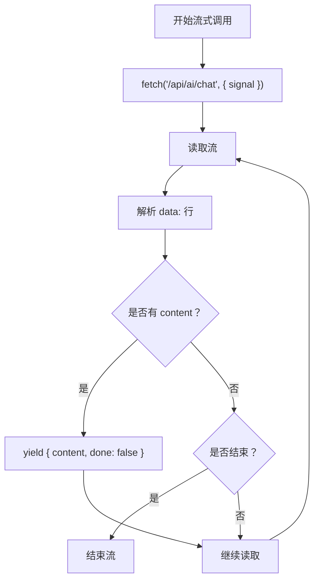
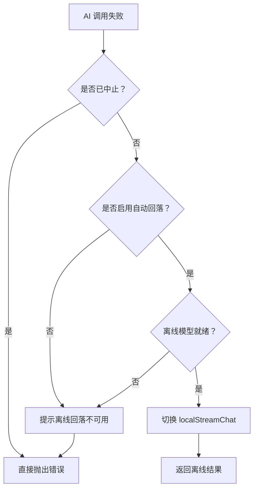

# AI 服务配置

<cite>
**本文引用的文件**   
- [ai-config.ts](file://src/services/ai-config.ts)
- [AISettings.tsx](file://src/components/AISettings.tsx)
- [ai-service.ts](file://src/services/ai-service.ts)
- [local-llm.ts](file://src/lib/local-llm.ts)
- [safe-storage.ts](file://src/lib/safe-storage.ts)
- [ai-services.md](file://docs/modules/ai-services.md)
</cite>

## 目录
1. [引言](#引言)
2. [项目结构与职责划分](#项目结构与职责划分)
3. [核心组件总览](#核心组件总览)
4. [系统架构](#系统架构)
5. [详细组件分析](#详细组件分析)
6. [依赖关系分析](#依赖关系分析)
7. [性能与资源特征](#性能与资源特征)
8. [安全与密钥管理](#安全与密钥管理)
9. [流式响应与中断处理](#流式响应与中断处理)
10. [重试、回退与错误处理](#重试回退与错误处理)
11. [不同提供商的配置示例与最佳实践](#不同提供商的配置示例与最佳实践)
12. [故障排查指南](#故障排查指南)
13. [结论](#结论)

## 引言
本文件为 NativeThink 的 AI 服务配置体系提供完整说明，覆盖以下方面：
- 多提供商配置结构：OpenAI 兼容的后端、智谱 GLM、DeepSeek、豆包、通义千问、SiliconFlow、Moonshot、Groq 以及“出厂内置免费选项”。
- 用户界面：AISettings 弹窗中的 API Key 输入、连接测试、默认服务商切换、离线小模型下载与自动回落开关。
- 服务路由逻辑：根据显式 provider、当前活跃 provider、已配置的 provider 列表选择后端，并通过服务器代理统一转发。
- 本地大语言模型集成：Qwen2.5-0.5B-Instruct 的惰性加载、浏览器缓存、WebGPU/WASM 设备选择、下载看门狗与流式生成。
- 安全存储、请求中断、错误提示、限流回退、服务端守卫等工程化细节。
- 面向实际使用的配置建议、性能调优和排错方法。

## 项目结构与职责划分
AI 相关代码主要分布在四个位置：
- 配置层：`src/services/ai-config.ts`
- 服务层：`src/services/ai-service.ts`
- 用户界面层：`src/components/AISettings.tsx`
- 离线模型层：`src/lib/local-llm.ts`
- 通用本地存储封装（非 AI 专用）：`src/lib/safe-storage.ts`
- 模块级文档：`docs/modules/ai-services.md`



**图表来源**
- [AISettings.tsx:1-60](file://src/components/AISettings.tsx#L1-L60)
- [ai-config.ts:1-60](file://src/services/ai-config.ts#L1-L60)
- [ai-service.ts:1-40](file://src/services/ai-service.ts#L1-L40)
- [local-llm.ts:1-30](file://src/lib/local-llm.ts#L1-L30)

**章节来源**
- [ai-config.ts:1-60](file://src/services/ai-config.ts#L1-L60)
- [AISettings.tsx:1-60](file://src/components/AISettings.tsx#L1-L60)
- [ai-service.ts:1-40](file://src/services/ai-service.ts#L1-L40)
- [local-llm.ts:1-30](file://src/lib/local-llm.ts#L1-L30)

## 核心组件总览
| 组件 | 主要职责 | 关键能力 |
|---|---|---|
| `ai-config.ts` | 定义所有 AI 提供商、出厂 Key、Key 存取、活跃服务商 | 工厂 Key、提供商枚举、Key 事件广播、迁移规则 |
| `ai-service.ts` | 统一调用 OpenAI 兼容聊天接口 | 流式与非流式聊天、模型解析、服务器代理、离线回退 |
| `AISettings.tsx` | 用户配置面板 | 提供商卡片、Key 输入、连接测试、选用默认、离线模型管理 |
| `local-llm.ts` | 浏览器端离线 LLM | 惰性加载、下载进度、WebGPU/WASM、TextStreamer 流式输出 |
| `safe-storage.ts` | 带前缀隔离的本地存储封装 | 应用与用户隔离、旧键迁移、云同步钩子、调试接口 |

**章节来源**
- [ai-config.ts:1-60](file://src/services/ai-config.ts#L1-L60)
- [ai-service.ts:1-40](file://src/services/ai-service.ts#L1-L40)
- [AISettings.tsx:1-60](file://src/components/AISettings.tsx#L1-L60)
- [local-llm.ts:1-30](file://src/lib/local-llm.ts#L1-L30)
- [safe-storage.ts:1-30](file://src/lib/safe-storage.ts#L1-L30)

## 系统架构
NativeThink 的 AI 调用路径采用“前端配置 + 统一服务 + 服务器代理 + 可选离线模型”的分层设计：

```mermaid
sequenceDiagram
  participant UI as "AISettings.tsx"
  participant Client as "ai-service.ts"
  participant Server as "/api/ai/chat"
  participant Provider as "AI 提供商"
  participant Local as "local-llm.ts"

  UI->>Client: chat() 或 streamChat()
  Client->>Client: resolveProvider()
  Client->>Server: POST {provider, model, messages, apiKey}
  Server-->>Client: SSE 流或完整 JSON
  alt 成功
    Client-->>UI: 流式内容或完整文本
  else 失败
    Client->>Client: 判断是否允许离线回退
    opt 自动回落且模型就绪
      Client->>Local: localStreamChat()
      Local-->>Client: 离线流式结果
      Client-->>UI: 降级后的结果
    else 不允许回落
      Client-->>UI: 抛出错误并提示
    end
  end
```

**图表来源**
- [ai-service.ts:40-120](file://src/services/ai-service.ts#L40-L120)
- [ai-service.ts:201-368](file://src/services/ai-service.ts#L201-L368)
- [local-llm.ts:120-204](file://src/lib/local-llm.ts#L120-L204)

**章节来源**
- [ai-service.ts:40-120](file://src/services/ai-service.ts#L40-L120)
- [ai-service.ts:201-368](file://src/services/ai-service.ts#L201-L368)

## 详细组件分析

### 多提供商配置结构：ai-config.ts
`ai-config.ts` 是 AI 服务的配置中心，承担三类职责：
1. **提供商元数据**：名称、描述、API 端点、默认模型、免费模型、注册链接、是否支持流式。
2. **出厂免费选项**：通过构建时注入的 `__FACTORY_API_KEY__` 提供“出厂内置免费 Key”，归属 `factory` 提供商，用户不可覆盖。
3. **用户配置与状态**：通过 `localStorage` 保存每个提供商的 Key、当前活跃提供商，并提供变更事件广播。

#### 提供商类型与列表
- 支持的提供商包括：`factory`、`deepseek`、`doubao`、`qwen`、`glm`、`siliconflow`、`moonshot`、`groq`。
- 所有提供商都使用 OpenAI 兼容的 chat completions 格式；端点由 `PROVIDER_CONFIGS` 维护。

#### Key 获取策略
- `getAPIKey(provider)`：
  - `factory` 始终返回构建时注入的出厂 Key。
  - 其他提供商从 `localStorage` 读取 `ai_key_<provider>`。
  - 如果用户未配置自有 Key，且默认提供商有出厂 Key，则可能回落到对应出厂 Key。

#### 活跃服务商与迁移
- `getActiveProvider()` 默认返回 `factory`。
- 存在迁移逻辑：老版本中默认值为 `glm`，若用户没有自有 GLM Key，则自动迁移到 `factory`。

#### 变更通知
- 每次修改 Key 或活跃服务商后，会触发 `nativethink-ai-config-changed` 事件，供其他模块刷新状态。



**图表来源**
- [ai-config.ts:10-25](file://src/services/ai-config.ts#L10-L25)
- [ai-config.ts:55-140](file://src/services/ai-config.ts#L55-L140)
- [ai-config.ts:140-206](file://src/services/ai-config.ts#L140-L206)

**章节来源**
- [ai-config.ts:1-60](file://src/services/ai-config.ts#L1-L60)
- [ai-config.ts:55-140](file://src/services/ai-config.ts#L55-L140)
- [ai-config.ts:140-206](file://src/services/ai-config.ts#L140-L206)

### 用户界面：AISettings.tsx
AISettings 是一个可复用的对话框组件，用于管理 AI 提供商配置和离线模型。它负责：
- 初始化所有提供商的状态，包括已保存的 Key、是否显示 Key、测试状态。
- 监听离线模型状态变化，并在打开弹窗时探测安装包是否内置模型。
- 提供 API Key 输入、清空、连接测试、设为默认。
- 展示离线备用小模型的下载进度、清除缓存、自动回落开关。

#### 提供商卡片行为
每个提供商卡片包含：
- 提供商名称与描述。
- 免费模型标识。
- API Key 输入框（`factory` 不显示输入框）。
- “测试连接”按钮。
- “选用”或“使用中”标签。
- 测试结果反馈：连接成功、Key 无效或无余额。

#### 连接测试流程
测试时会构造一个最小消息，调用 `chat()` 并限制 `maxTokens` 与 `temperature`，以验证 Key 有效且网络可达。



**图表来源**
- [AISettings.tsx:60-120](file://src/components/AISettings.tsx#L60-L120)
- [ai-service.ts:201-260](file://src/services/ai-service.ts#L201-L260)

**章节来源**
- [AISettings.tsx:1-200](file://src/components/AISettings.tsx#L1-L200)
- [AISettings.tsx:201-488](file://src/components/AISettings.tsx#L201-L488)

### 服务路由逻辑：ai-service.ts
`ai-service.ts` 是 AI 调用的统一入口，屏蔽了不同提供商的差异，并处理流式响应、服务器代理、离线回退。

#### 提供商选择顺序
`resolveProvider()` 的选择顺序如下：
1. 显式传入的 provider，且该 provider 有 Key。
2. 已配置的 provider 列表中，优先使用当前活跃 provider。
3. 否则使用第一个已配置的 provider。
4. 最后回退到 `getActiveProvider()`。

#### 模型选择策略
- 如果显式传入 model，则直接使用。
- 否则按任务类型选择：`translate` 倾向更准的模型，`chat` 倾向更快的模型。
- 再回退到提供商配置的免费模型。

#### 流式与非流式调用
- `apiStreamChat()`：通过 `/api/ai/chat` 发起 SSE 流，逐行解析 `data:` 字段，提取 `choices[0].delta.content`。
- `apiChat()`：非流式调用，返回完整文本。

#### 错误与 503 处理
- 服务端返回 503 时，前端会转换为“服务端 AI Key 未配置”的可读错误。
- 其他 HTTP 错误会尝试解析错误信息，并带上提供商名称与状态码。



**图表来源**
- [ai-service.ts:40-120](file://src/services/ai-service.ts#L40-L120)
- [ai-service.ts:201-320](file://src/services/ai-service.ts#L201-L320)

**章节来源**
- [ai-service.ts:1-120](file://src/services/ai-service.ts#L1-L120)
- [ai-service.ts:201-368](file://src/services/ai-service.ts#L201-L368)

### 本地大语言模型集成：local-llm.ts
`local-llm.ts` 实现浏览器端的离线兜底 LLM，使用 transformers.js 加载 Qwen2.5-0.5B-Instruct ONNX 模型。

#### 模型可用性状态
- `none`：未下载或未就绪。
- `downloading`：正在下载或加载中。
- `ready`：已从浏览器缓存或同源资源加载完成。

#### 惰性加载机制
- 首次调用 `downloadLocalLlm()` 时才动态 `import('@huggingface/transformers')`。
- 打包版可通过同源 `/models/<id>/config.json` 秒加载；网页版需远程下载。
- 设备选择：优先 WebGPU，否则回退到 WASM。
- 量化模型：LLM 使用 q4，翻译模型使用 q8。

#### 下载源与看门狗
- 中文环境优先 `hf-mirror.com`，其次 `huggingface.co`。
- 下载阶段设有 45 秒无进度看门狗，超时后换下一个源重试。
- 下载完成后将状态写入 `localStorage`，并触发订阅者更新 UI。

#### 流式输出
- 使用 TextStreamer 将 token 推入队列，再以异步生成器形式逐条产出。
- 支持 AbortSignal 中断。
- 如果流式回调未触发，会回退到完整结果中的 `generated_text`。



**图表来源**
- [local-llm.ts:1-60](file://src/lib/local-llm.ts#L1-L60)
- [local-llm.ts:60-120](file://src/lib/local-llm.ts#L60-L120)
- [local-llm.ts:120-204](file://src/lib/local-llm.ts#L120-L204)

**章节来源**
- [local-llm.ts:1-60](file://src/lib/local-llm.ts#L1-L60)
- [local-llm.ts:60-120](file://src/lib/local-llm.ts#L60-L120)
- [local-llm.ts:120-204](file://src/lib/local-llm.ts#L120-L204)

### 安全存储与本地 Key 持久化
AI Key 的持久化直接基于浏览器 `localStorage`，而不是 `safe-storage.ts`：
- `ai_key_<provider>`：每个提供商的 API Key。
- `ai_active_provider`：当前活跃提供商。
- `__nativethink_local_llm_state`：离线模型就绪状态。
- `__nativethink_local_llm_auto`：是否启用自动离线回退。

`safe-storage.ts` 是更通用的跨平台本地存储封装，提供：
- 应用 ID 与用户 ID 隔离的前缀。
- 匿名 ID 自愈与迁移。
- 旧键迁移。
- 云同步钩子。
- 调试接口 `getPrefixedKey`、`getCurrentUserId`。

需要注意的是，AI Key 并未走 `safeStorage`，而是直接读写 `localStorage`；因此其安全性依赖于浏览器本地存储策略，不应把注释中的“保护 API Key”理解为真正的服务端级安全边界。

**章节来源**
- [ai-config.ts:140-206](file://src/services/ai-config.ts#L140-L206)
- [local-llm.ts:1-30](file://src/lib/local-llm.ts#L1-L30)
- [safe-storage.ts:1-60](file://src/lib/safe-storage.ts#L1-L60)
- [safe-storage.ts:180-216](file://src/lib/safe-storage.ts#L180-L216)

## 依赖关系分析


**图表来源**
- [AISettings.tsx:1-60](file://src/components/AISettings.tsx#L1-L60)
- [ai-service.ts:1-40](file://src/services/ai-service.ts#L1-L40)
- [local-llm.ts:1-30](file://src/lib/local-llm.ts#L1-L30)
- [ai-config.ts:1-60](file://src/services/ai-config.ts#L1-L60)

**章节来源**
- [AISettings.tsx:1-60](file://src/components/AISettings.tsx#L1-L60)
- [ai-service.ts:1-40](file://src/services/ai-service.ts#L1-L40)
- [local-llm.ts:1-30](file://src/lib/local-llm.ts#L1-L30)
- [ai-config.ts:1-60](file://src/services/ai-config.ts#L1-L60)

## 性能与资源特征
| 维度 | 表现与建议 |
|---|---|
| 云端流式响应 | 低首字延迟，适合对话与实时反馈；注意网络抖动与服务端限流。 |
| 离线模型体积 | Qwen2.5-0.5B q4 约 780MB，另需约 22.5MB 运行时；首次加载较慢，之后可用浏览器缓存或同源资源。 |
| 设备加速 | 有 GPU 时使用 WebGPU，否则回退到 WASM；WASM 加载更慢但兼容性更好。 |
| 下载可靠性 | 中文环境优先镜像源，配合 45 秒看门狗避免长期卡住。 |
| 内存占用 | 离线模型加载后会常驻内存；不适合频繁反复切换大量并发请求的场景。 |
| 包体影响 | `local-llm.ts` 顶部静态导入会使包装逻辑进入入口 chunk，但 transformers 与 wasm 仍为动态 import；新增静态 import 会影响首屏大小。 |

**章节来源**
- [ai-services.md:1-107](file://docs/modules/ai-services.md#L1-L107)
- [local-llm.ts:1-30](file://src/lib/local-llm.ts#L1-L30)
- [local-llm.ts:60-120](file://src/lib/local-llm.ts#L60-L120)

## 安全与密钥管理
### 客户端 Key 存储
- 用户 Key 存储在 `localStorage`，键名为 `ai_key_<provider>`。
- 出厂 Key 由构建时注入，仅对 `factory` 提供商暴露，用户无法覆盖。
- AISettings 底部提示“API Key 仅保存在浏览器本地存储中，不会上传到任何服务器”，但需注意：服务调用会把 `apiKey` 放入请求体发送给服务器代理，因此不应把前端视为最终安全边界。

### 服务端代理与安全守卫
- 所有 AI 调用统一经过 `/api/ai/chat`。
- 服务端优先使用客户端传来的 `apiKey`，其次使用环境变量中的 Key，否则返回 503。
- 文档指出服务端还具备 Origin 白名单、IP 限流、messages 形状校验、出厂 Key 用量监控等机制。

### 安全建议
- 不要把 `scripts/.apikey` 提交到仓库。
- 不要在前端日志中打印 `apiKey`。
- 不要把 `localStorage` 中的 Key 同步到云端，除非明确需要跨设备共享。
- 在公开部署环境中，确保服务器代理正确配置上游 Key，避免误用出厂 Key。

**章节来源**
- [ai-config.ts:10-25](file://src/services/ai-config.ts#L10-L25)
- [ai-config.ts:140-206](file://src/services/ai-config.ts#L140-L206)
- [ai-service.ts:40-120](file://src/services/ai-service.ts#L40-L120)
- [ai-services.md:1-107](file://docs/modules/ai-services.md#L1-L107)

## 流式响应与中断处理
### 流式解析流程
`apiStreamChat()` 会：
1. 发起 POST `/api/ai/chat`，携带 `stream: true`。
2. 使用 `ReadableStream` 读取响应 body。
3. 按行解析 `data:` 开头的行。
4. 遇到 `[DONE]` 或 `finish_reason` 时结束流。
5. 每段 `delta.content` 作为 `StreamChunk` 产出。

### 中断处理
- 上层调用可传入 `AbortSignal`。
- `streamChat()` 捕获异常后，若信号已中止，直接重新抛出，不做离线回退。
- `localStreamChat()` 也会检查 `signal.aborted`，并抛 `AbortError`。



**图表来源**
- [ai-service.ts:40-120](file://src/services/ai-service.ts#L40-L120)
- [ai-service.ts:320-368](file://src/services/ai-service.ts#L320-L368)
- [local-llm.ts:120-204](file://src/lib/local-llm.ts#L120-L204)

**章节来源**
- [ai-service.ts:40-120](file://src/services/ai-service.ts#L40-L120)
- [ai-service.ts:320-368](file://src/services/ai-service.ts#L320-L368)
- [local-llm.ts:120-204](file://src/lib/local-llm.ts#L120-L204)

## 重试、回退与错误处理
### 错误分类
- 客户端侧：缺少 Key、Key 无效、网络失败、流解析异常。
- 服务端侧：503（未配置 Key）、其他 HTTP 错误。
- 上游提供商：限流、配额不足、模型不可用。

### 自动离线回退
`streamChat()` 与 `chat()` 的异常处理逻辑：
1. 如果是用户主动取消，直接抛出错误。
2. 如果没有开启自动回落，或离线模型未就绪，提示用户并抛出原错误。
3. 如果满足条件，则切换到 `localStreamChat()`，并将 `maxTokens` 限制到不超过 600，默认 400。
4. 提示去抖时间为 30 秒。

### 服务端免费档回退
根据文档，服务端会对智谱系免费模型进行 429/5xx 回退链；客户端则通过 `task` 字段区分翻译与对话，从而选择更合适的基础模型。



**图表来源**
- [ai-service.ts:320-368](file://src/services/ai-service.ts#L320-L368)
- [local-llm.ts:120-204](file://src/lib/local-llm.ts#L120-L204)
- [ai-services.md:1-107](file://docs/modules/ai-services.md#L1-L107)

**章节来源**
- [ai-service.ts:320-368](file://src/services/ai-service.ts#L320-L368)
- [local-llm.ts:120-204](file://src/lib/local-llm.ts#L120-L204)
- [ai-services.md:1-107](file://docs/modules/ai-services.md#L1-L107)

## 不同提供商的配置示例与最佳实践
以下为配置模板说明，不包含真实 Key：

| 提供商 | 配置要点 | 适用场景 |
|---|---|---|
| 出厂内置免费选项 | 无需 Key，由构建时注入；适用于快速体验与教学演示。 | 新用户试用、内部分享、离线演示。 |
| DeepSeek | 填入 DeepSeek 平台 Key，默认模型 `deepseek-chat`。 | 推理型对话、代码辅助。 |
| 豆包 Doubao | 填入火山引擎 Ark Key，默认模型 `doubao-lite-32k`。 | 中文对话、轻量推理。 |
| 通义千问 Qwen | 填入阿里云 DashScope Key，默认模型 `qwen-plus`，免费模型 `qwen-turbo`。 | 中文写作、长上下文。 |
| 智谱 GLM | 填入智谱 Key，默认模型 `glm-4-flash`；翻译场景推荐 `glm-4.7-flash`。 | 中文理解、翻译、教育类任务。 |
| SiliconFlow | 填入聚合平台 Key，默认模型 `Qwen/Qwen2.5-7B-Instruct`。 | 多模型聚合、低成本实验。 |
| Moonshot Kimi | 填入 Moonshot Key，默认模型 `moonshot-v1-8k`。 | 长文本、阅读辅助。 |
| Groq | 填入 Groq Key，默认模型 `llama-3.3-70b-versatile`，免费模型 `llama-3.1-8b-instant`。 | 超低延迟推理。 |

### 最佳实践
- 生产环境优先使用用户自己的 Key，不要依赖出厂 Key。
- 翻译任务优先选择更准模型；对话任务优先选择更快模型。
- 在移动端优先启用离线自动回落，提升弱网体验。
- 定期测试 Key 有效性，避免过期或额度耗尽导致静默失败。
- 不要把 Key 写进日志、截图或公共报告。

**章节来源**
- [ai-config.ts:55-140](file://src/services/ai-config.ts#L55-L140)
- [aisettings.tsx:201-488](file://src/components/AISettings.tsx#L201-L488)
- [ai-service.ts:40-120](file://src/services/ai-service.ts#L40-L120)

## 故障排查指南
| 现象 | 可能原因 | 排查步骤 |
|---|---|---|
| 所有提供商都报“服务端 AI Key 未配置” | 服务器代理未配置上游 Key，或返回 503 | 检查服务端环境变量、Cloudflare Pages Functions 配置、Origin 白名单。 |
| 某个提供商测试失败 | Key 无效、余额不足、地区限流 | 使用该提供商控制台验证 Key；查看是否触发 429 或配额限制。 |
| 流式响应卡顿 | 网络差、上游限流、离线模型尚未就绪 | 检查网络；确认是否触发离线回退；观察下载进度。 |
| 离线模型一直下载中 | 镜像源不可达、WASM 加载慢 | 检查国内网络是否能访问 hf-mirror；等待看门狗切换源。 |
| 离线模型加载失败 | 安装包未内置模型、浏览器缓存损坏 | 尝试清除离线模型缓存后重新下载。 |
| 切换 Key 后其他页面未生效 | 未触发配置变更事件或页面未监听 | 检查 `AI_CONFIG_CHANGED_EVENT` 是否派发；确认调用方是否刷新状态。 |
| 移动端首屏过大 | 不小心把 transformers 或模型相关逻辑写成静态 import | 运行包体积检查，确认只动态 import 重型依赖。 |

### 常用定位入口
- 提供商配置：`ai-config.ts`
- 聊天调用与回退：`ai-service.ts`
- 离线模型状态与下载：`local-llm.ts`
- 设置面板行为：`AISettings.tsx`
- 模块级说明与守卫规则：`docs/modules/ai-services.md`

**章节来源**
- [ai-config.ts:140-206](file://src/services/ai-config.ts#L140-L206)
- [ai-service.ts:201-368](file://src/services/ai-service.ts#L201-L368)
- [local-llm.ts:60-120](file://src/lib/local-llm.ts#L60-L120)
- [AISettings.tsx:201-488](file://src/components/AISettings.tsx#L201-L488)
- [ai-services.md:1-107](file://docs/modules/ai-services.md#L1-L107)

## 结论
NativeThink 的 AI 服务配置系统以 `ai-config.ts` 为配置中心、`ai-service.ts` 为统一调用层、`AISettings.tsx` 为用户入口、`local-llm.ts` 为离线兜底，形成“云端为主、本地为辅”的双通道方案。其优势在于：
- 多提供商统一管理，便于扩展新后端。
- 流式响应支持实时交互。
- 出厂免费选项降低入门门槛。
- 离线小模型提升弱网与限流下的可用性。
- 清晰的配置界面与连接测试流程。

需要注意的风险包括：
- 前端 Key 不是真正的安全边界。
- 离线模型体积较大，首次加载成本明显。
- 服务端与前端配置表需要同步维护。
- 构建时的出厂 Key 必须严格纳入 `.gitignore`。

在实际使用中，应优先让用户配置自有 Key，合理选择翻译与对话模型，开启离线自动回落以提升鲁棒性，并结合服务端守卫与限流策略保障系统稳定。