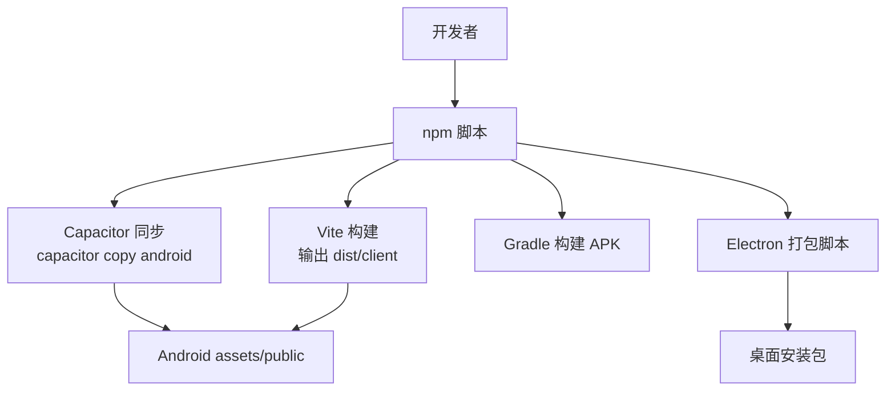
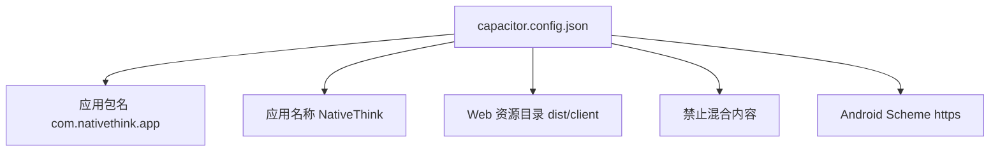
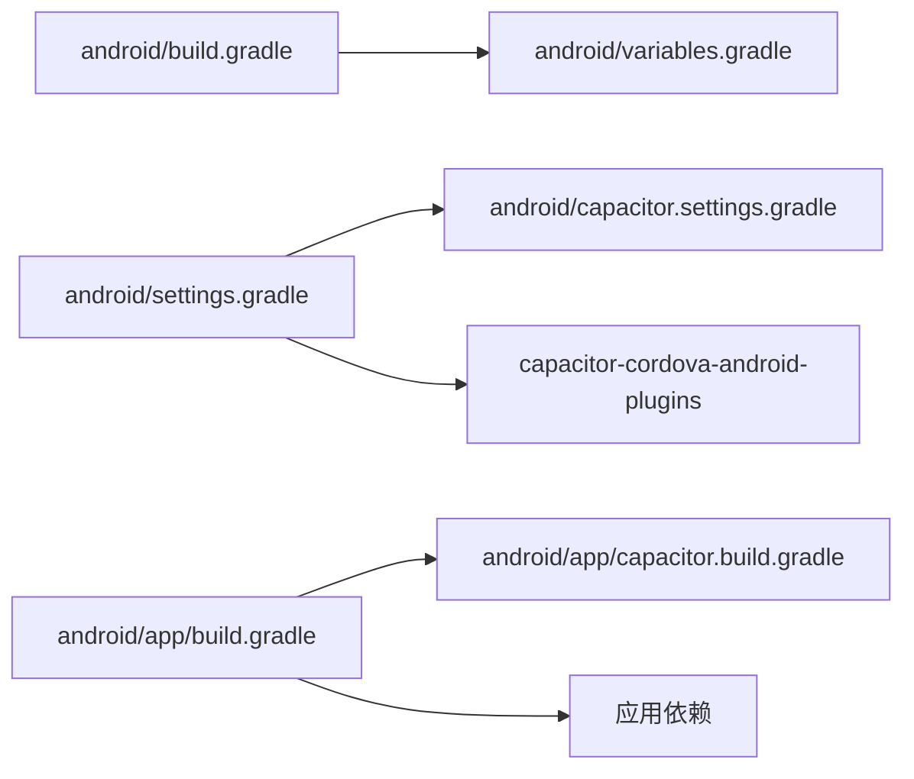
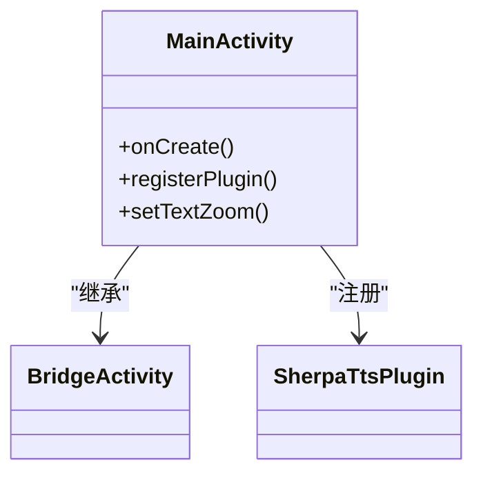
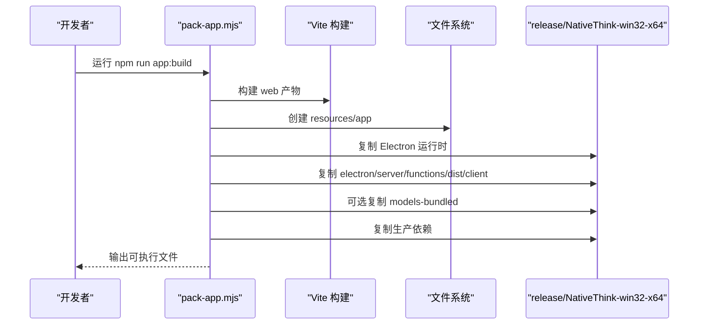
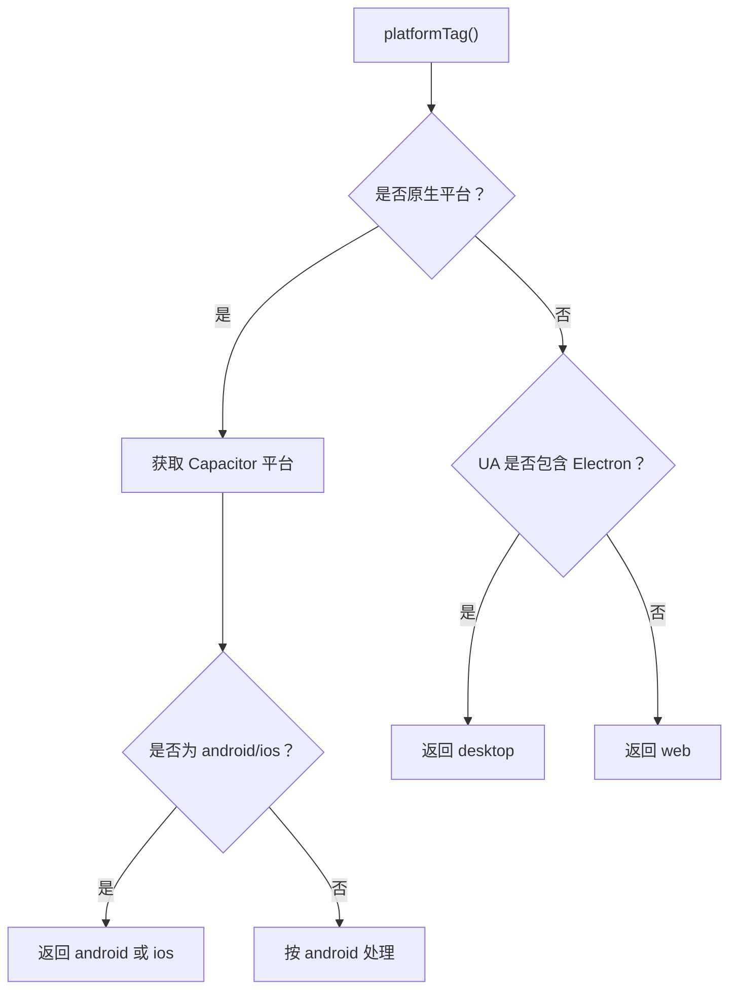
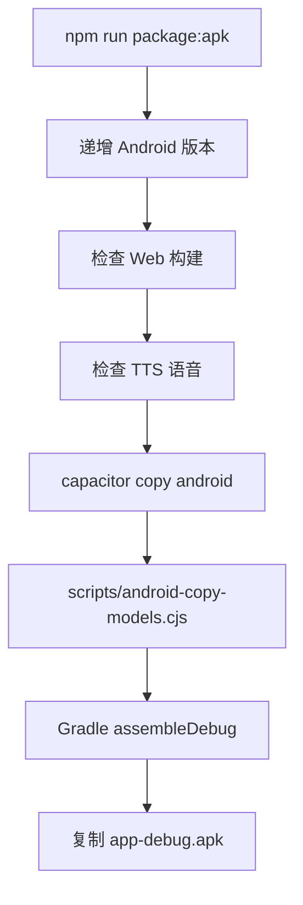
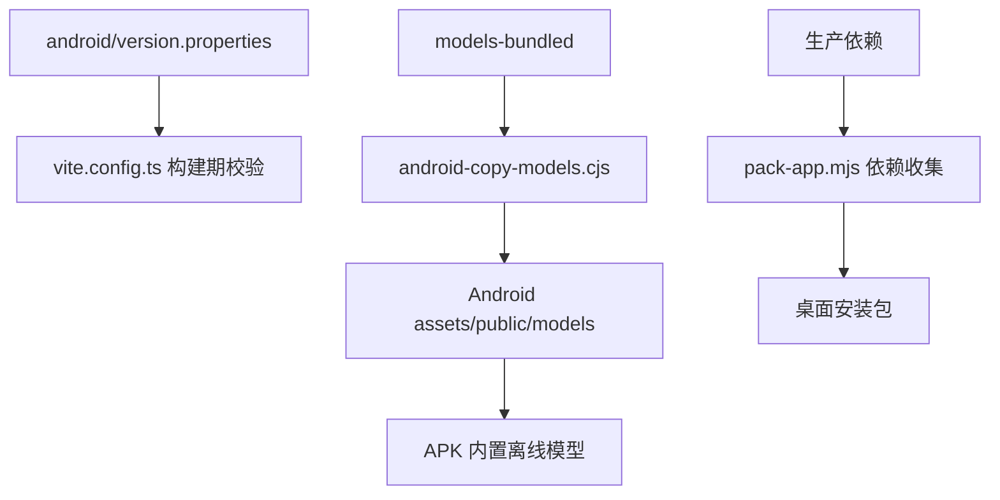

# Capacitor 应用配置

<cite>
**本文引用的文件**
- [capacitor.config.json](file://capacitor.config.json)
- [package.json](file://package.json)
- [vite.config.ts](file://vite.config.ts)
- [scripts/pack-app.mjs](file://scripts/pack-app.mjs)
- [android/app/build.gradle](file://android/app/build.gradle)
- [android/app/capacitor.build.gradle](file://android/app/capacitor.build.gradle)
- [android/build.gradle](file://android/build.gradle)
- [android/variables.gradle](file://android/variables.gradle)
- [android/gradle.properties](file://android/gradle.properties)
- [android/settings.gradle](file://android/settings.gradle)
- [android/capacitor.settings.gradle](file://android/capacitor.settings.gradle)
- [android/app/src/main/AndroidManifest.xml](file://android/app/src/main/AndroidManifest.xml)
- [android/app/src/main/java/com/nativethink/app/MainActivity.java](file://android/app/src/main/java/com/nativethink/app/MainActivity.java)
- [android/app/src/main/res/values/strings.xml](file://android/app/src/main/res/values/strings.xml)
- [scripts/android-copy-models.cjs](file://scripts/android-copy-models.cjs)
- [src/lib/app-env.ts](file://src/lib/app-env.ts)
</cite>

## 目录

1. [引言](#引言)
2. [项目结构与构建入口](#项目结构与构建入口)
3. [Capacitor 核心配置](#capacitor-核心配置)
4. [Android 原生构建与权限](#android-原生构建与权限)
5. [Electron 桌面端打包流程](#electron-桌面端打包流程)
6. [跨平台兼容性](#跨平台兼容性)
7. [APK 打包、签名与发布](#apk-打包签名与发布)
8. [热更新与动态加载机制](#热更新与动态加载机制)
9. [常见问题排查](#常见问题排查)
10. [结论](#结论)

## 引言

NativeThink 是一个基于 React、Vite、Capacitor 和 Electron 的跨平台英语母语思维训练应用。其前端静态资源由 Vite 构建到 `dist/client`，再由 Capacitor 同步到 Android 工程；Electron 负责桌面端可执行程序打包；Gradle 负责 Android APK 构建。

Capacitor 配置集中在根目录的 `capacitor.config.json`，并通过 Gradle、清单文件和自定义脚本扩展出 Android 平台的权限、插件、版本和离线模型能力。Electron 主进程入口在 `package.json` 中声明为 `electron/main.mjs`，但仓库实际未提供该文件，桌面端打包脚本会直接复制 `electron` 目录作为运行时应用的一部分。

## 项目结构与构建入口

从顶层结构看，应用采用“Web 产物 + 多平台壳”的分层组织：

| 层级 | 职责 | 关键路径 |
|---|---|---|
| Web 前端 | React + TypeScript + Tailwind | `src/`、`vite.config.ts` |
| Capacitor 配置 | 应用标识、Web 目录、Android 行为 | `capacitor.config.json` |
| Android 原生层 | Gradle、清单、Activity、原生插件 | `android/` |
| Electron 桌面层 | 打包脚本、可选主进程代码 | `electron/`、`scripts/pack-app.mjs` |
| 构建脚本 | Web 构建、APK 打包、模型拷贝、桌面打包 | `scripts/`、`package.json` |

**图表来源**
- [package.json:7-44](file://package.json#L7-L44)
- [capacitor.config.json:1-11](file://capacitor.config.json#L1-L11)
- [scripts/pack-app.mjs:1-108](file://scripts/pack-app.mjs#L1-L108)

**章节来源**
- [package.json:1-44](file://package.json#L1-L44)
- [capacitor.config.json:1-11](file://capacitor.config.json#L1-L11)

## Capacitor 核心配置

`capacitor.config.json` 是 NativeThink 的 Capacitor 入口配置，内容简洁，主要定义以下字段：

| 字段 | 值 | 含义 |
|---|---|---|
| `appId` | `com.nativethink.app` | Android 包名，决定应用的唯一身份 |
| `appName` | `NativeThink` | 应用显示名称 |
| `webDir` | `dist/client` | Capacitor 同步的 Web 静态资源目录 |
| `android.allowMixedContent` | `false` | 禁止混合内容，提升 HTTPS WebView 安全性 |
| `server.androidScheme` | `https` | Android 内嵌 WebView 使用的 Scheme |

### 应用标识

`appId` 同时出现在三个位置：

1. Capacitor 配置中的 `appId`
2. Android `build.gradle` 中的 `applicationId`
3. `strings.xml` 中的 `package_name`

三者保持一致时，安装、升级、URL Scheme、FileProvider 等才能正确工作。

### Web 资源目录

`webDir` 指向 `dist/client`，这是 `npm run build:web` 的输出目录。若修改 Vite 输出路径，需要同步修改 `capacitor.config.json` 和 `package.json` 中的相关脚本。

### Scheme 协议

当前配置将 Android Scheme 设为 `https`。这意味着 Android 端 WebView 通过 HTTPS 加载本地或远程资源。若后续改为 HTTP 开发服务器或本地调试地址，需要确认 `allowMixedContent` 是否允许降级。

**图表来源**
- [capacitor.config.json:1-11](file://capacitor.config.json#L1-L11)

**章节来源**
- [capacitor.config.json:1-11](file://capacitor.config.json#L1-L11)
- [android/app/build.gradle:12-17](file://android/app/build.gradle#L12-L17)
- [android/app/src/main/res/values/strings.xml:1-7](file://android/app/src/main/res/values/strings.xml#L1-L7)

## Android 原生构建与权限

### Gradle 构建体系

Android 工程使用 Gradle 多模块结构：

| 文件 | 作用 |
|---|---|
| `android/build.gradle` | 顶层构建脚本，引入 Google、Maven Central 仓库及 Gradle 插件 |
| `android/variables.gradle` | 集中声明 SDK 版本、AndroidX 依赖版本 |
| `android/settings.gradle` | 包含 `:app` 和 Cordova 插件模块 |
| `android/capacitor.settings.gradle` | Capacitor 生成的模块映射 |
| `android/app/build.gradle` | 应用模块构建配置 |
| `android/app/capacitor.build.gradle` | Capacitor 生成文件，注入 Java 版本和插件依赖 |
| `android/gradle.properties` | Gradle JVM 参数、Java 路径 |

**图表来源**
- [android/build.gradle:1-29](file://android/build.gradle#L1-L29)
- [android/variables.gradle:1-16](file://android/variables.gradle#L1-L16)
- [android/settings.gradle:1-5](file://android/settings.gradle#L1-L5)
- [android/capacitor.settings.gradle:1-6](file://android/capacitor.settings.gradle#L1-L6)
- [android/app/build.gradle:1-95](file://android/app/build.gradle#L1-L95)
- [android/app/capacitor.build.gradle:1-19](file://android/app/capacitor.build.gradle#L1-L19)

### 版本与架构

- 最小 Android 版本：API 24
- 编译目标：API 36
- 默认 ABI：`arm64-v8a`、`armeabi-v7a`
- 模拟器模式（设置环境变量 `NT_EMU=1`）：仅打包 `x86_64`

这一设计显著减小 APK 体积，因为内置离线朗读引擎的原生库较大，桌面模拟器才需要 x86_64。

### 权限声明

`AndroidManifest.xml` 声明了以下权限：

| 权限 | 用途 |
|---|---|
| `INTERNET` | 网络请求、API 调用、云同步 |
| `RECORD_AUDIO` | 跟读录音、语音识别 |
| `MODIFY_AUDIO_SETTINGS` | 音频路由与录制设置 |

其中录音权限会在用户触发跟读功能时由 BridgeWebChromeClient 进行运行时申请，但清单中必须预先声明。

### Activity 与原生插件

`MainActivity` 继承自 Capacitor 的 `BridgeActivity`，并在初始化时注册自定义原生插件 `SherpaTtsPlugin`。此外，针对高 DPI 屏幕自动将 WebView 文本放大至 120%，避免文字过小影响阅读体验。

**图表来源**
- [android/app/src/main/java/com/nativethink/app/MainActivity.java:1-26](file://android/app/src/main/java/com/nativethink/app/MainActivity.java#L1-L26)

**章节来源**
- [android/app/build.gradle:12-52](file://android/app/build.gradle#L12-L52)
- [android/variables.gradle:1-16](file://android/variables.gradle#L1-L16)
- [android/app/src/main/AndroidManifest.xml:1-41](file://android/app/src/main/AndroidManifest.xml#L1-L41)
- [android/app/src/main/java/com/nativethink/app/MainActivity.java:1-26](file://android/app/src/main/java/com/nativethink/app/MainActivity.java#L1-L26)
- [android/app/capacitor.build.gradle:1-19](file://android/app/capacitor.build.gradle#L1-L19)

## Electron 桌面端打包流程

`package.json` 将 Electron 主进程入口声明为 `electron/main.mjs`，并依赖 `electron` 和 `electron-packager`。但仓库中没有该文件，说明当前桌面端可能处于未完成状态，或者主进程逻辑由 `scripts/pack-app.mjs` 替代式管理。

### 打包脚本行为

`scripts/pack-app.mjs` 执行以下流程：

1. 可选跳过 Web 构建
2. 清理输出目录 `release/NativeThink-win32-x64`
3. 复制 Electron 运行时并重命名为 `NativeThink.exe`
4. 复制 `electron`、`server`、`functions`、`dist/client`
5. 可选链接 `models-bundled` 离线模型
6. 收集生产依赖并复制到 `resources/app/node_modules`
7. 输出 Windows 便携应用

**图表来源**
- [scripts/pack-app.mjs:1-108](file://scripts/pack-app.mjs#L1-L108)
- [package.json:7-15](file://package.json#L7-L15)

### 桌面端与 Web 的关系

桌面端并非传统 Electron 渲染进程 + Node 后端分离架构，而是把 Web 静态资源、函数服务、Electron 主进程目录一起打包进一个便携目录。这种结构更适合快速分发，但不适合复杂的多窗口、系统托盘或原生系统集成场景。

**章节来源**
- [package.json:1-15](file://package.json#L1-L15)
- [package.json:121-123](file://package.json#L121-L123)
- [scripts/pack-app.mjs:1-108](file://scripts/pack-app.mjs#L1-L108)

## 跨平台兼容性

### 平台检测

应用通过 `src/lib/app-env.ts` 统一判断运行平台，优先级如下：

1. Capacitor 原生平台：`android` / `ios`
2. Electron UA：`desktop`
3. 浏览器环境：`web`

该逻辑优先判断 Capacitor，避免 Chrome UA 误判为桌面端。

**图表来源**
- [src/lib/app-env.ts:1-29](file://src/lib/app-env.ts#L1-L29)

### 文件系统访问

- Android：通过 `FileProvider` 暴露内部文件 URI，供 WebView 读取共享文件。
- Electron：通过 Node.js 文件系统 API 直接读写本地磁盘。
- Web：受浏览器沙箱限制，无法直接访问任意文件系统。

### 网络权限

Android 已声明 `INTERNET`，可用于 API 调用、云同步、AI 服务和在线词典。若未来接入推送服务，还需根据具体 SDK 添加对应权限。

### 通知权限

当前 Android 构建脚本尝试条件加载 Google Services 插件，但仓库未提供 `google-services.json`，因此通知功能默认不可用。若启用 Firebase Cloud Messaging，需要补充配置文件和相应权限。

**章节来源**
- [src/lib/app-env.ts:1-29](file://src/lib/app-env.ts#L1-L29)
- [android/app/src/main/AndroidManifest.xml:1-41](file://android/app/src/main/AndroidManifest.xml#L1-L41)
- [android/app/build.gradle:86-95](file://android/app/build.gradle#L86-L95)

## APK 打包、签名与发布

### 版本号管理

版本号来自 `android/version.properties`，由 `scripts/bump-android-version.cjs` 递增写入。`vite.config.ts` 在构建期读取 `versionName`，将其注入 HTML 元信息，从而保证 Web 构建产物与 Android 包版本同源。

`build.gradle` 从同一属性文件读取 `versionCode` 和 `versionName`，确保 aapt 与 Web 侧版本一致。

### 签名配置

应用支持固定签名，防止 debug/release 互相覆盖安装导致卸载。签名配置读取外部 `keystore.properties`，该文件已在 `.gitignore` 中排除，不应提交到仓库。

| 配置项 | 说明 |
|---|---|
| `storeFile` | 密钥库路径 |
| `storePassword` | 密钥库密码 |
| `keyAlias` | 密钥别名 |
| `keyPassword` | 密钥密码 |

若不存在该文件，Gradle 仍会构建，但不会签名。

### 构建命令

| 命令 | 作用 |
|---|---|
| `npm run package:web` | 递增版本、下载 TTS 模型、构建 Web |
| `npm run package:apk` | 构建 Web、同步 Capacitor、拷贝模型、Gradle 构建 Debug APK |
| `npm run android:apk` | 先打包 Web，再打包 APK |
| `npm run version:apk-bump` | 递增 Android 版本 |

**图表来源**
- [package.json:31-39](file://package.json#L31-L39)
- [scripts/android-copy-models.cjs:1-23](file://scripts/android-copy-models.cjs#L1-L23)
- [android/app/build.gradle:1-52](file://android/app/build.gradle#L1-L52)

### 发布建议

1. 首次发布前准备有效的 keystore 并配置 `keystore.properties`。
2. 使用 release 构建类型而非 debug。
3. 在 CI 环境中安全注入签名凭据，不要写入仓库。
4. 如需上架商店，需配置混淆、ProGuard、Google Play 签名策略及上传渠道脚本。
5. 若启用推送，需补充 Firebase 配置和相关权限。

**章节来源**
- [android/app/build.gradle:1-52](file://android/app/build.gradle#L1-L52)
- [android/app/build.gradle:54-85](file://android/app/build.gradle#L54-L85)
- [package.json:31-39](file://package.json#L31-L39)
- [vite.config.ts:73-92](file://vite.config.ts#L73-L92)

## 热更新与动态加载机制

### Capacitor 与静态资源

Capacitor 本身不直接提供运行时热更新能力。本项目通过 `capacitor copy android` 将最新 Web 产物同步到 Android 工程中，属于“构建期热替换”，而非运行期热更新。

### Web 构建产物校验

`vite.config.ts` 会从 `android/version.properties` 读取 `versionName`，如果读取失败则抛出错误，阻止构建。配合 `scripts/ensure-web-build.mjs`，可防止将旧版 Web 产物打入新版本 APK。

### 离线模型动态加载

Android 构建流程中包含 `scripts/android-copy-models.cjs`，它会把 `models-bundled` 硬链接到 `android/app/src/main/assets/public/models`。Capacitor 的 `assets/public` 会被合并到 APK assets 中，使离线模型随 APK 发布，无需运行时下载。

### 桌面端动态依赖

Electron 打包脚本只复制 `jose`、`undici`、`msedge-tts` 及其生产依赖树，而不是整个 `node_modules`，从而减少桌面安装包体积。

**图表来源**
- [vite.config.ts:73-92](file://vite.config.ts#L73-L92)
- [scripts/android-copy-models.cjs:1-23](file://scripts/android-copy-models.cjs#L1-L23)
- [scripts/pack-app.mjs:61-108](file://scripts/pack-app.mjs#L61-L108)

**章节来源**
- [vite.config.ts:73-92](file://vite.config.ts#L73-L92)
- [scripts/android-copy-models.cjs:1-23](file://scripts/android-copy-models.cjs#L1-L23)
- [scripts/pack-app.mjs:61-108](file://scripts/pack-app.mjs#L61-L108)

## 常见问题排查

### 问题一：修改 `appId` 后无法覆盖安装

**原因**：`capacitor.config.json`、`build.gradle` 的 `applicationId`、`strings.xml` 的 `package_name` 不一致。

**解决**：统一为 `com.nativethink.app`，然后重新执行 `capacitor sync android` 并清理旧应用。

**章节来源**
- [capacitor.config.json:1-11](file://capacitor.config.json#L1-L11)
- [android/app/build.gradle:12-17](file://android/app/build.gradle#L12-L17)
- [android/app/src/main/res/values/strings.xml:1-7](file://android/app/src/main/res/values/strings.xml#L1-L7)

### 问题二：APK 体积异常增大

**原因**：包含了模拟器 ABI 或未剥离离线模型。

**解决**：
- 非模拟器构建不要设置 `NT_EMU=1`
- 确保 `scripts/android-copy-models.cjs` 只在需要时执行
- 发布时使用 release 构建并开启混淆

**章节来源**
- [android/app/build.gradle:22-36](file://android/app/build.gradle#L22-L36)
- [scripts/android-copy-models.cjs:1-23](file://scripts/android-copy-models.cjs#L1-L23)

### 问题三：录音功能无权限

**原因**：清单缺少 `RECORD_AUDIO` 或 `MODIFY_AUDIO_SETTINGS`，或运行时权限被拒绝。

**解决**：确认清单中存在对应权限，并在触发录音前引导用户授权。

**章节来源**
- [android/app/src/main/AndroidManifest.xml:32-41](file://android/app/src/main/AndroidManifest.xml#L32-L41)

### 问题四：Web 构建因版本号缺失失败

**原因**：`android/version.properties` 不存在或没有 `versionName`。

**解决**：先执行 `npm run version:apk-bump`，再执行 Web 构建。

**章节来源**
- [vite.config.ts:73-92](file://vite.config.ts#L73-L92)

### 问题五：Electron 桌面端启动失败

**原因**：`package.json` 声明的主进程入口 `electron/main.mjs` 不存在。

**解决**：
- 若仅需打包已有 Electron 目录，确保 `electron/` 下有合法主进程文件
- 若尚未实现桌面端主进程，暂不建议直接使用 `npm run app:start`
- 可使用 `scripts/pack-app.mjs` 完成基础打包流程

**章节来源**
- [package.json:1-15](file://package.json#L1-L15)
- [scripts/pack-app.mjs:1-108](file://scripts/pack-app.mjs#L1-L108)

### 问题六：Firebase 推送不可用

**原因**：未提供 `google-services.json`，Gradle 条件加载失败。

**解决**：配置 Firebase 项目并放置 `google-services.json`，同时添加所需权限。

**章节来源**
- [android/app/build.gradle:86-95](file://android/app/build.gradle#L86-L95)

## 结论

NativeThink 的 Capacitor 配置保持了“小而集中”的风格：核心配置仅包含应用标识、Web 目录、Android Scheme 和安全选项；Android 构建细节分散在 Gradle、清单和自定义脚本中；Electron 目前以打包脚本为主，主进程尚未完整落地。

对于后续维护者，建议重点注意以下三点：

1. 所有应用标识变更应同步更新 Capacitor 配置、Gradle、字符串资源和 URL Scheme。
2. 任何 Web 输出路径变化都应联动更新 `capacitor.config.json`、`package.json` 和构建脚本。
3. 发布前务必准备独立的安全签名配置，并区分 debug、模拟器和 release 构建目标。