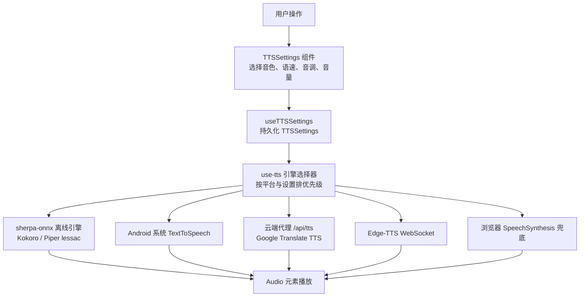
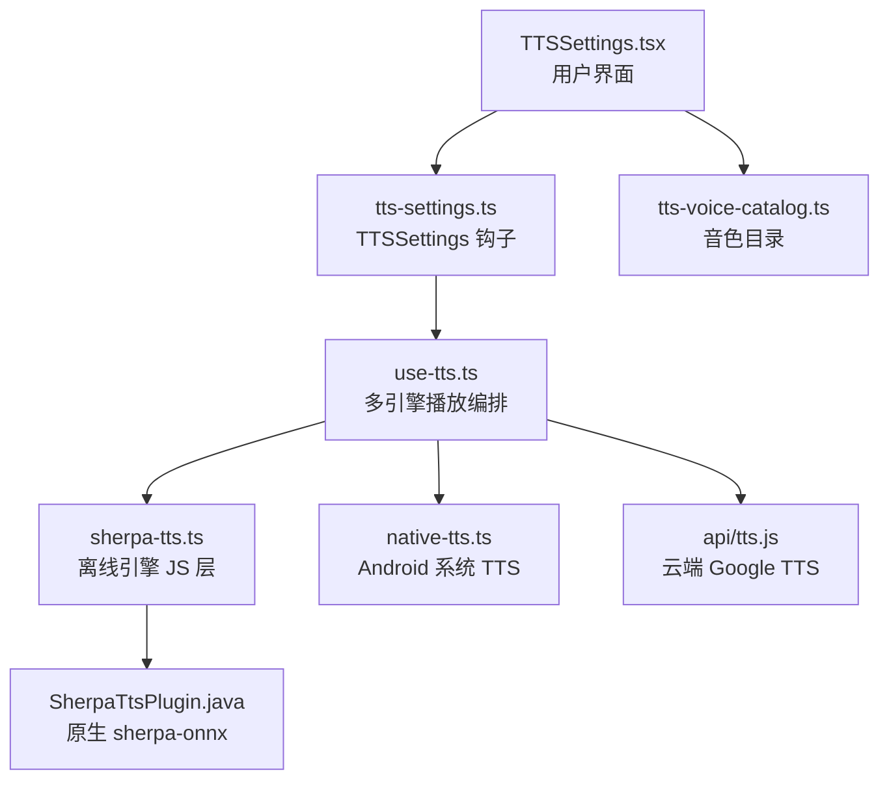
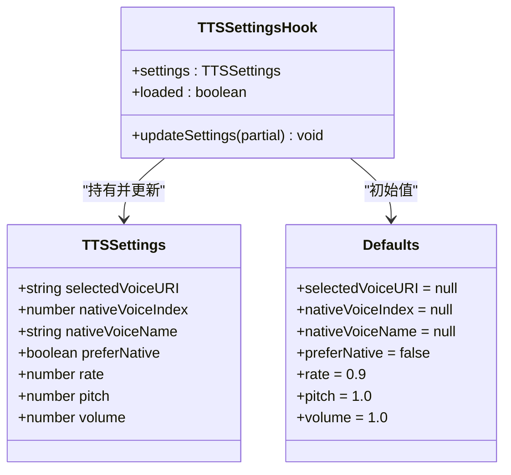
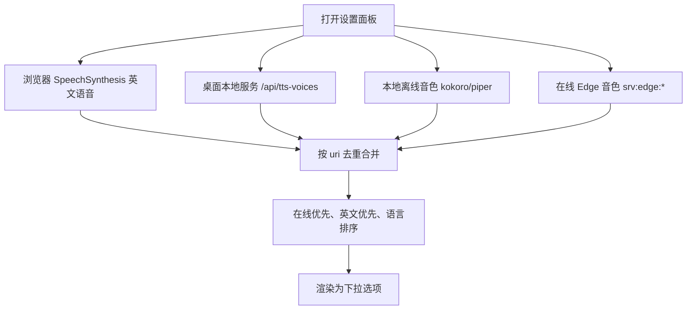
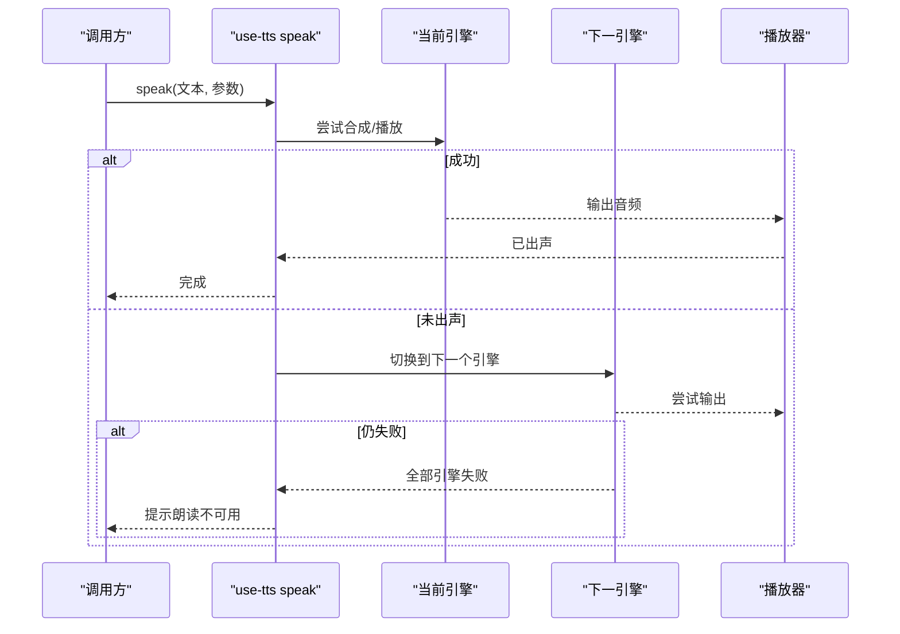
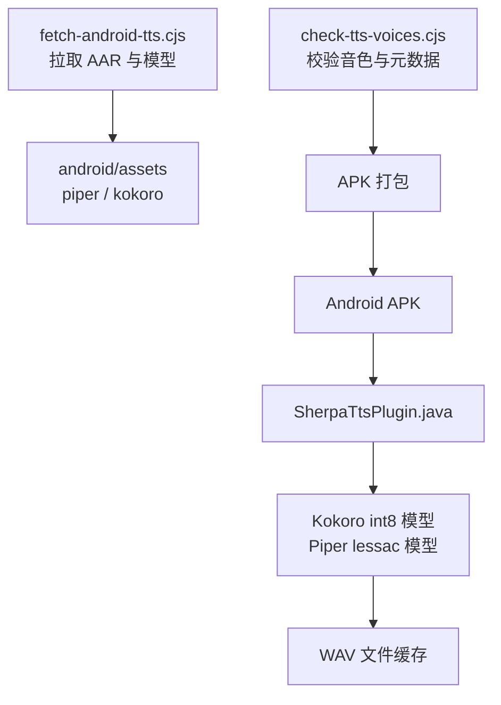
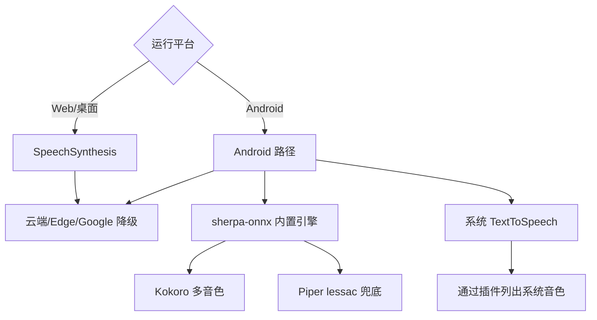
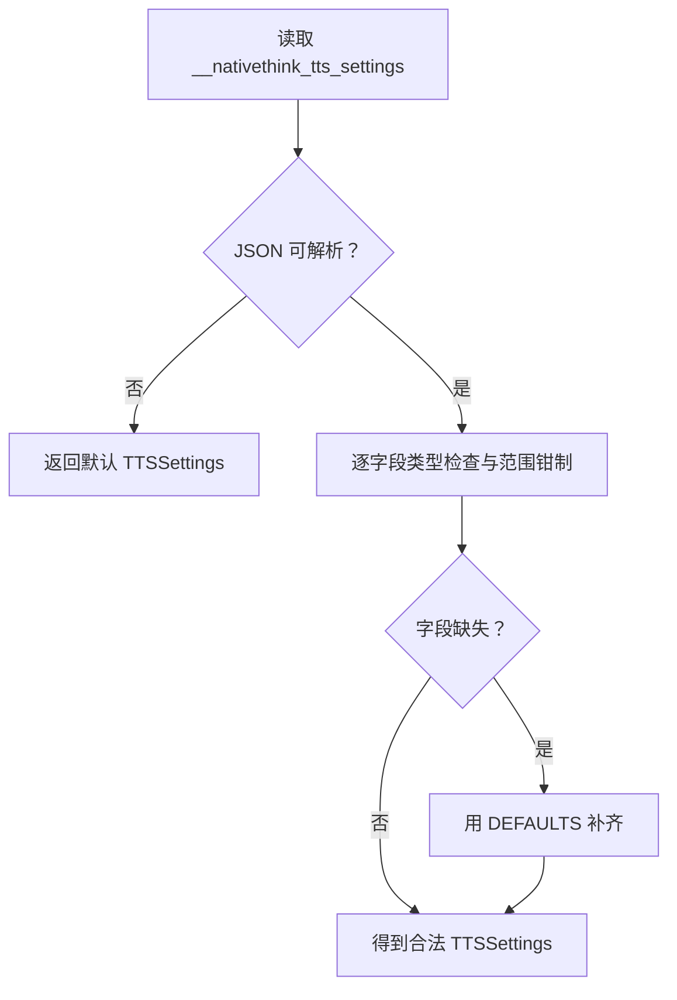

# TTS 语音合成配置

<cite>
**本文引用的文件**   
- [src/lib/tts-settings.ts](file://src/lib/tts-settings.ts)
- [src/components/TTSSettings.tsx](file://src/components/TTSSettings.tsx)
- [src/lib/use-tts.ts](file://src/lib/use-tts.ts)
- [src/lib/sherpa-tts.ts](file://src/lib/sherpa-tts.ts)
- [src/lib/tts-voice-catalog.ts](file://src/lib/tts-voice-catalog.ts)
- [src/lib/native-tts.ts](file://src/lib/native-tts.ts)
- [functions/api/tts.js](file://functions/api/tts.js)
- [android/app/src/main/java/com/nativethink/app/SherpaTtsPlugin.java](file://android/app/src/main/java/com/nativethink/app/SherpaTtsPlugin.java)
- [scripts/check-tts-voices.cjs](file://scripts/check-tts-voices.cjs)
- [scripts/fetch-android-tts.cjs](file://scripts/fetch-android-tts.cjs)
- [docs/modules/tts.md](file://docs/modules/tts.md)
</cite>

## 目录

1. [引言](#引言)
2. [项目结构定位](#项目结构定位)
3. [核心配置模型 TTSSettings](#核心配置模型-ttssettings)
4. [用户界面 TTSSettings 组件](#用户界面-ttssettings-组件)
5. [多引擎降级链与优先级](#多引擎降级链与优先级)
6. [离线模型加载与云端通道](#离线模型加载与云端通道)
7. [平台差异：Web / Electron / Android](#平台差异web--electron--android)
8. [持久化与数据迁移](#持久化与数据迁移)
9. [性能调优建议](#性能调优建议)
10. [常见问题诊断](#常见问题诊断)
11. [结论](#结论)

## 引言

NativeThink 的 TTS 语音合成配置系统围绕三个目标构建：

1. **可感知**：用户在设置页能看到当前选中的音色、语速、音调和音量，并能试听。
2. **可降级**：当内置离线引擎、系统原生引擎或云端通道不可用时，朗读不会静默失败，而是按策略切换到下一条可用通道。
3. **跨平台**：同一套 `TTSSettings` 配置能在 Web、Electron 桌面和 Android APK 上工作，只是底层引擎不同。

整个系统不是单一 API，而是一条从“用户选择”到“最终播放音频”的完整链路：

**图表来源**   
- [src/components/TTSSettings.tsx:1-120](file://src/components/TTSSettings.tsx#L1-L120)
- [src/lib/tts-settings.ts:1-140](file://src/lib/tts-settings.ts#L1-L140)
- [src/lib/use-tts.ts:1-120](file://src/lib/use-tts.ts#L1-L120)
- [src/lib/sherpa-tts.ts:1-80](file://src/lib/sherpa-tts.ts#L1-L80)

**章节来源**   
- [docs/modules/tts.md:1-60](file://docs/modules/tts.md#L1-L60)

## 项目结构定位

TTS 相关代码分布在以下层次：

| 层次 | 主要文件 | 职责 |
|---|---|---|
| 配置层 | `src/lib/tts-settings.ts` | 定义 `TTSSettings` 类型、默认值、持久化、英文语音筛选 |
| 界面层 | `src/components/TTSSettings.tsx` | 音色下拉、语速/音调/音量滑块、试听、自检、引擎状态展示 |
| 播放编排层 | `src/lib/use-tts.ts` | 多引擎降级、切片、进度上报、缓存、看门狗 |
| 离线引擎层 | `src/lib/sherpa-tts.ts` | sherpa-onnx 预热、健康检查、请求去重、结果缓存 |
| 原生桥接层 | `android/.../SherpaTtsPlugin.java` | Kokoro/Piper 模型加载、WAV 落盘、线程池保护 |
| 音色目录层 | `src/lib/tts-voice-catalog.ts` | 本地离线音色表、在线 Edge 音色表、默认与兜底音色 |
| 系统引擎封装 | `src/lib/native-tts.ts` | Android 系统 TextToSpeech 插件调用、英语音色过滤、安装引导 |
| 云端代理 | `functions/api/tts.js` | Cloudflare Pages Function 代理 Google Translate TTS |
| 脚本层 | `scripts/check-tts-voices.cjs`、`scripts/fetch-android-tts.cjs` | 打包前校验音色、拉取离线模型资产 |

**图表来源**   
- [src/components/TTSSettings.tsx:1-120](file://src/components/TTSSettings.tsx#L1-L120)
- [src/lib/tts-settings.ts:1-140](file://src/lib/tts-settings.ts#L1-L140)
- [src/lib/use-tts.ts:1-120](file://src/lib/use-tts.ts#L1-L120)
- [src/lib/sherpa-tts.ts:1-80](file://src/lib/sherpa-tts.ts#L1-L80)
- [src/lib/tts-voice-catalog.ts:1-60](file://src/lib/tts-voice-catalog.ts#L1-L60)
- [src/lib/native-tts.ts:1-60](file://src/lib/native-tts.ts#L1-L60)
- [functions/api/tts.js:1-30](file://functions/api/tts.js#L1-L30)
- [android/app/src/main/java/com/nativethink/app/SherpaTtsPlugin.java:1-60](file://android/app/src/main/java/com/nativethink/app/SherpaTtsPlugin.java#L1-L60)

**章节来源**   
- [src/lib/tts-settings.ts:1-140](file://src/lib/tts-settings.ts#L1-L140)
- [src/components/TTSSettings.tsx:1-120](file://src/components/TTSSettings.tsx#L1-L120)
- [src/lib/use-tts.ts:1-120](file://src/lib/use-tts.ts#L1-L120)

## 核心配置模型 TTSSettings

`TTSSettings` 是 TTS 配置的集中数据结构，它不直接描述“用哪个引擎”，而是描述“用户想要什么样的声音和播放效果”。引擎选择由 `use-tts.ts` 根据平台与设置推导。

### 字段说明

| 字段 | 类型 | 默认值 | 含义 | 是否参与实际合成 |
|---|---:|---:|---|---:|
| `selectedVoiceURI` | `string \| null` | `null` | 用户选择的语音标识；`null` 表示自动选择最佳可用语音 | 是 |
| `nativeVoiceIndex` | `number \| null` | `null` | Android 系统原生 TTS 引擎的语音索引；`null` 使用系统默认 | 是（仅系统引擎） |
| `nativeVoiceName` | `string \| null` | `null` | 原生语音的可读名，仅用于设置页回显 | 否 |
| `preferNative` | `boolean` | `false` | 优先使用系统原生 TTS 引擎；开启后不再尝试云端或 Edge 通道 | 间接影响引擎优先级 |
| `rate` | `number` | `0.9` | 播放语速，范围 `0.5 – 1.5` | 是 |
| `pitch` | `number` | `1.0` | 播放音调，范围 `0.5 – 2.0` | 是 |
| `volume` | `number` | `1.0` | 播放音量，范围 `0.0 – 1.0` | 是 |

### 设计要点

1. **数值字段全部钳制**：`loadSettings` 与 `updateSettings` 都会把 `rate`、`pitch`、`volume` 限制在允许区间内，避免旧数据或异常输入破坏播放。
2. **语音 URI 语义分层**：
   - `kokoro:*`、`piper:*` 表示本地离线音色。
   - `srv:edge:*` 表示在线 Edge 神经音色。
   - `null` 表示让系统或引擎自动选择最佳语音。
3. **Android 原生语音独立于浏览器语音**：因为 Android WebView 的 `speechSynthesis.getVoices()` 通常为空，系统 TTS 通过 Capacitor 插件获取，因此需要 `nativeVoiceIndex` 和 `nativeVoiceName`。
4. **云同步重读**：`useSyncDown` 触发后重新读取本地存储，确保另一台设备修改过的音色、语速等在本机生效。

**图表来源**   
- [src/lib/tts-settings.ts:12-140](file://src/lib/tts-settings.ts#L12-L140)

**章节来源**   
- [src/lib/tts-settings.ts:12-140](file://src/lib/tts-settings.ts#L12-L140)

## 用户界面 TTSSettings 组件

`TTSSettings.tsx` 是用户配置 TTS 的主要入口，它以弹出面板形式提供：

- 音色选择下拉框
- 试听按钮
- 语速滑块
- 音调滑块
- 音量滑块
- 音效开关（答题反馈音等）
- 朗读自检与引擎状态信息
- Android 上的内置离线引擎状态、初始化日志、闪退护栏状态

### 界面与配置的映射关系

| 界面控件 | 对应配置或行为 | 说明 |
|---|---|---|
| 音色下拉 | `settings.selectedVoiceURI` | 支持系统语音、本地离线音色、在线 Edge 音色、本地服务器音色 |
| 试听 | `previewTtsVoice` / `previewNativeVoice` / `sherpaSpeak` | 不同引擎使用不同试听路径 |
| 语速滑块 | `settings.rate` | 范围 `0.5 – 1.5`，受 `clamp` 约束 |
| 音调滑块 | `settings.pitch` | 范围 `0.5 – 2.0` |
| 音量滑块 | `settings.volume` | 范围 `0.0 – 1.0` |
| “只用系统引擎” | `settings.preferNative` | 打开后引擎候选只保留系统原生引擎 |
| 音效开关 | `isSfxEnabled` | 与 TTS 无关，但放在同一面板中方便用户关闭反馈音 |
| 朗读自检 | `probeTtsEngines` | 检测各引擎起播耗时与可用性 |
| 内置引擎状态 | `sherpa`、`sherpaDisabled` | 显示 sherpa-onnx 是否就绪、是否被闪退护栏停用 |
| 初始化日志 | `sherpaLog` | 原生崩溃时唯一能读取的诊断线索 |

### 音色来源合并逻辑

设置页会把多种音色来源合并为一个统一列表：

**图表来源**   
- [src/components/TTSSettings.tsx:1-120](file://src/components/TTSSettings.tsx#L1-L120)
- [src/lib/tts-voice-catalog.ts:1-162](file://src/lib/tts-voice-catalog.ts#L1-L162)

### 重要实现细节

1. **桌面端额外请求 `/api/tts-voices`**：只有 `platformTag() === 'desktop'` 时才发起，避免 Web 版和 APK 每个页面都产生一次网络请求。
2. **移动端延迟重试**：部分移动 WebView 需要用户手势上下文才能填充语音列表，因此会在面板打开时多次尝试加载。
3. **系统引擎回显**：如果用户没有手动选语音，界面会如实显示“当前自动使用的本地音色”，避免用户以为选了某个音色却听不到预期声音。
4. **离线引擎 RTF 提示**：当选中 Kokoro 等长文可能慢的离线音色时，界面会明确提示合成速度可能追不上播放，而不是悄悄换引擎。

**章节来源**   
- [src/components/TTSSettings.tsx:1-200](file://src/components/TTSSettings.tsx#L1-L200)
- [src/lib/tts-voice-catalog.ts:1-162](file://src/lib/tts-voice-catalog.ts#L1-L162)

## 多引擎降级链与优先级

`use-tts.ts` 是整个 TTS 系统的播放编排中心。它维护一个五元类型的引擎候选集合：

| 引擎标识 | 含义 | 适用场景 |
|---|---|---|
| `piper` | sherpa-onnx 内置离线引擎（Piper/Kokoro） | Android APK，追求离线、零网络依赖 |
| `native` | Android 系统 TextToSpeech | 已有系统语音包且希望走系统引擎 |
| `cf` | Cloudflare Pages Function 代理 `/api/tts` | 移动端云端优先，绕过直连限制 |
| `edge` | Edge-TTS WebSocket | 桌面或备用在线通道 |
| `google` | Google Translate TTS URL | 最后兜底的在线通道 |

### 引擎优先级规则

| 条件 | 引擎顺序 |
|---|---|
| Android 默认 | `piper → native → cf → edge → google` |
| 用户显式选择在线音色 `srv:edge:*` | `cf → piper → native → edge → google` |
| 打开“只用系统引擎” `preferNative` | 仅 `native` |
| 内置引擎被闪退护栏停用 | 从候选中移除 `piper` |
| 非 Android（网页、桌面、iOS） | `cf → edge → google` |

### 降级时机

降级不是“每次失败就重试整句”，而是遵循以下原则：

1. 同一句只要**已经出声**，就不再换引擎重试，避免用户听到同一段话被重复朗读。
2. 所有引擎都失败后才进入最后的 `SpeechSynthesis.speak` 兜底。
3. 兜底也失败时才提示用户“朗读暂时不可用”。
4. 失败提示有 5 秒去抖，避免频繁弹窗。

**图表来源**   
- [src/lib/use-tts.ts:1-120](file://src/lib/use-tts.ts#L1-L120)
- [docs/modules/tts.md:60-120](file://docs/modules/tts.md#L60-L120)

**章节来源**   
- [src/lib/use-tts.ts:1-200](file://src/lib/use-tts.ts#L1-L200)
- [docs/modules/tts.md:60-120](file://docs/modules/tts.md#L60-L120)

## 离线模型加载与云端通道

### 离线引擎：sherpa-onnx + Kokoro/Piper

sherpa-onnx 是 Android APK 的内置离线引擎，由前端 `sherpa-tts.ts` 与原生 `SherpaTtsPlugin.java` 共同实现。

#### 关键能力

| 能力 | 说明 |
|---|---|
| 模型加载 | Kokoro 多音色模型 + Piper lessac 兜底音色 |
| 音色选择 | JS 侧传 `modelId` 与 `speakerId`，原生侧执行具体合成 |
| 结果缓存 | 按 `(模型, 音色, 文本, 语速)` 哈希生成 WAV 文件，避免重复合成 |
| 健康检查 | 上次启动若崩掉，下次自动停用内置引擎，防止反复闪退 |
| 并发保护 | 原生侧使用单线程工作队列 + 最大排队数，避免线程爆炸导致 OOM |
| 预热接口 | `warmSherpa()` 在进入阅读/学习页前提前加载模型 |

#### 模型与音色目录

本地离线音色集中在 `tts-voice-catalog.ts`：

| 类别 | 内容 |
|---|---|
| 默认本地音色 | `piper:lessac`，RTF 约 0.076，长文最流畅 |
| Kokoro 可选音色 | 11 个英语音色，覆盖美音、英音、男女声 |
| 在线 Edge 音色 | 12 个 `srv:edge:*` 神经音色 |
| 兜底音色 | `FALLBACK_VOICE` 与 `DEFAULT_LOCAL_VOICE_ID` |

#### 打包与校验

- `scripts/fetch-android-tts.cjs` 负责从镜像源拉取 AAR、Piper 音色、Kokoro 多音色模型。
- `scripts/check-tts-voices.cjs` 在打包前校验模型文件是否齐全、`speakerId` 是否与模型内嵌元数据一致。
- 原生插件 `SherpaTtsPlugin.java` 维护模型注册表，必须与脚本保持一致。

**图表来源**   
- [scripts/fetch-android-tts.cjs:1-120](file://scripts/fetch-android-tts.cjs#L1-L120)
- [scripts/check-tts-voices.cjs:1-120](file://scripts/check-tts-voices.cjs#L1-L120)
- [android/app/src/main/java/com/nativethink/app/SherpaTtsPlugin.java:1-120](file://android/app/src/main/java/com/nativethink/app/SherpaTtsPlugin.java#L1-L120)

**章节来源**   
- [src/lib/sherpa-tts.ts:1-200](file://src/lib/sherpa-tts.ts#L1-L200)
- [src/lib/tts-voice-catalog.ts:1-162](file://src/lib/tts-voice-catalog.ts#L1-L162)
- [scripts/fetch-android-tts.cjs:1-200](file://scripts/fetch-android-tts.cjs#L1-L200)
- [scripts/check-tts-voices.cjs:1-200](file://scripts/check-tts-voices.cjs#L1-L200)
- [android/app/src/main/java/com/nativethink/app/SherpaTtsPlugin.java:1-200](file://android/app/src/main/java/com/nativethink/app/SherpaTtsPlugin.java#L1-L200)

### 云端通道：Cloudflare 代理 Google Translate TTS

`functions/api/tts.js` 是一个 Cloudflare Pages Function，作用是把浏览器对 Google Translate TTS 的请求代理到 Cloudflare 边缘节点。

#### 关键行为

| 行为 | 说明 |
|---|---|
| 上游地址 | `https://translate.google.com/translate_tts` |
| 字符上限 | 严格拒绝超过 200 字符的请求，避免上游返回模糊 502 |
| 响应类型 | `audio/mpeg` |
| CDN 缓存 | 一年不可变缓存，相同文本第二次几乎瞬时命中 |
| CORS | 支持 Capacitor APK 的跨域访问与预检请求 |

#### 为什么不用浏览器直连

文档明确指出：浏览器永远不直接连接 Google，而是由 Cloudflare 代理，这样在中国大陆也能工作。

**章节来源**   
- [functions/api/tts.js:1-69](file://functions/api/tts.js#L1-L69)
- [docs/modules/tts.md:1-40](file://docs/modules/tts.md#L1-L40)

## 平台差异：Web / Electron / Android

### Web 与桌面

- 首选浏览器 `SpeechSynthesis`。
- 如果不可用，则走云端 `/api/tts`、Edge-TTS WebSocket、Google TTS URL。
- 桌面 Electron 版本还会额外请求本地服务 `/api/tts-voices`，枚举 Windows SAPI / OneCore 音色。
- iOS 上 `SpeechSynthesis` 不可靠，通常会走云端或 Edge 通道。

### Android

Android 是最复杂的一层，因为它同时存在三类 TTS 能力：

| 能力 | 来源 | 特点 |
|---|---|---|
| 内置离线引擎 | sherpa-onnx + Kokoro/Piper | 完全离线，但模型体积大、部分音色合成较慢 |
| 系统原生 TTS | Capacitor TextToSpeech 插件 | 依赖设备上安装的语音包，有些机器只有网络语音 |
| 云端 TTS | `/api/tts`、Edge-TTS、Google | 依赖网络，但音质通常更好 |

Android WebView 的问题在于：`window.speechSynthesis.getVoices()` 通常返回空数组，所以“选择音色”不能走浏览器 API，必须通过原生插件查询系统语音。

**图表来源**   
- [src/lib/use-tts.ts:1-120](file://src/lib/use-tts.ts#L1-L120)
- [src/lib/native-tts.ts:1-120](file://src/lib/native-tts.ts#L1-L120)
- [src/lib/sherpa-tts.ts:1-120](file://src/lib/sherpa-tts.ts#L1-L120)

**章节来源**   
- [src/lib/use-tts.ts:1-200](file://src/lib/use-tts.ts#L1-L200)
- [src/lib/native-tts.ts:1-199](file://src/lib/native-tts.ts#L1-L199)

## 持久化与数据迁移

### 存储位置

TTS 设置通过 `safeStorage` 持久化，键名为 `__nativethink_tts_settings`。这与项目中主题设置等其他用户配置采用相同模式。

### 加载流程

`loadSettings` 的行为是防御性的：

1. 读取 JSON 字符串。
2. 解析失败时返回默认值。
3. 对每个字段做类型检查和范围钳制。
4. 缺失字段回退到默认值。

### 更新流程

`updateSettings` 使用 React state 合并 partial 更新，并在保存前再次钳制数值字段。云同步下行后也会触发重读，从而把其他设备修改的配置同步到本机。

### 数据迁移策略

当前实现没有显式的“版本号迁移逻辑”，而是通过**宽松解析 + 默认值回退**完成软迁移：

| 旧数据情况 | 处理结果 |
|---|---|
| 缺少某些字段 | 使用 `DEFAULTS` 中对应字段 |
| `nativeVoiceIndex` 不是数字 | 回退为 `null` |
| `nativeVoiceName` 不是字符串 | 回退为 `null` |
| `preferNative` 不是布尔真值 | 回退为 `false` |
| `rate`、`pitch`、`volume` 越界 | 钳制到允许范围 |
| 存储损坏无法解析 | 整体回退到默认设置 |

这种策略适合向后兼容：新增字段不会影响老用户，错误字段不会导致应用崩溃。

**图表来源**   
- [src/lib/tts-settings.ts:35-90](file://src/lib/tts-settings.ts#L35-L90)

**章节来源**   
- [src/lib/tts-settings.ts:1-140](file://src/lib/tts-settings.ts#L1-L140)

## 性能调优建议

### 语速、音调、音量

| 参数 | 推荐范围 | 建议 |
|---|---|---|
| `rate` | `0.5 – 1.5` | 默认 `0.9` 偏慢，适合学习跟读；快速浏览可提高到 `1.0–1.2` |
| `pitch` | `0.5 – 2.0` | 默认 `1.0`；过高会让声音尖锐，过低显得沉闷 |
| `volume` | `0.0 – 1.0` | 默认 `1.0`；夜间学习可降到 `0.5–0.8` |

这些值会被 `clamp` 强制限制，即使用户手动输入异常值也不会破坏播放。

### 离线引擎性能

- **默认音色 lessac** 更适合长文连续朗读，RTF 远低于 1.0。
- **Kokoro 音色** 音质更好，但部分音色 RTF 接近或大于 1.0，长文可能出现句间停顿。
- 设置页会明确告知用户“合成慢于播放”的风险，而不是静默降级。
- 建议在进入阅读或学习页之前调用 `warmSherpa()`，避免首次朗读冷启动。

### 云端通道性能

- `/api/tts` 使用 Cloudflare CDN 缓存，同一文本第二次播放几乎瞬时。
- Edge-TTS WebSocket 有 1.5 秒连接超时，避免在网络受限环境下长时间卡住。
- Google TTS URL 作为最后兜底，不应作为主通道。

### 原生线程与并发

原生插件限制了最大排队合成任务数量，并使用单线程工作队列，避免大量并发合成耗尽系统线程导致闪退。JS 层也对相同 `(voiceId, text, speed)` 的并发请求做了 Promise 去重。

**章节来源**   
- [src/lib/tts-settings.ts:12-140](file://src/lib/tts-settings.ts#L12-L140)
- [src/lib/sherpa-tts.ts:1-200](file://src/lib/sherpa-tts.ts#L1-L200)
- [docs/modules/tts.md:60-137](file://docs/modules/tts.md#L60-L137)

## 常见问题诊断

### 问题一：Android 上没有任何朗读声音可选

**原因**：WebView 的 `speechSynthesis.getVoices()` 为空，系统 TTS 需要通过 Capacitor 插件查询。

**排查步骤**：

1. 确认 `isAndroidNative()` 为真。
2. 查看设置页中“系统原生语音”列表是否仍在“读取中…”。
3. 检查 `listNativeEnglishVoices()` 是否超时返回空数组。
4. 如需安装系统语音包，调用 `openNativeTtsInstall()`。

**解决方案**：

- 如果系统没有本地英语语音，优先选择内置离线引擎或在线 Edge 音色。
- 如果系统确实有本地语音包，可在设置中选择系统引擎。

**章节来源**   
- [src/lib/native-tts.ts:1-199](file://src/lib/native-tts.ts#L1-L199)
- [src/components/TTSSettings.tsx:1-200](file://src/components/TTSSettings.tsx#L1-L200)

### 问题二：内置离线引擎闪退或无法加载

**原因**：sherpa-onnx 是原生代码，崩溃时会直接杀死进程，无法被 JavaScript try/catch 捕获。

**机制**：

- 启动时写入“加载中标记”。
- 如果下次启动发现标记仍存在，说明上次加载未完成，自动禁用内置引擎。
- 用户可通过设置页手动重新启用。

**排查步骤**：

1. 查看 `isBundledEngineDisabled()`。
2. 在设置面板查看 `sherpa.status`。
3. 读取 `getSherpaInitLog()` 定位原生加载阶段。
4. 如确认为模型损坏或兼容性问题，点击“重新启用内置引擎”或清理缓存。

**解决方案**：

- 临时使用系统引擎或云端通道。
- 修复后重新启用内置引擎。
- 清理 sherpa 缓存：`purgeSherpaCache()`。

**章节来源**   
- [src/lib/sherpa-tts.ts:1-120](file://src/lib/sherpa-tts.ts#L1-L120)
- [src/components/TTSSettings.tsx:1-200](file://src/components/TTSSettings.tsx#L1-L200)

### 问题三：朗读不出声或突然中断

**原因**：可能是引擎切换、取消代际冲突、看门狗误判或音频元素 AbortError。

**排查步骤**：

1. 查看“上次朗读实测”报告，判断慢在离线引擎还是联网合成。
2. 确认没有同时触发多次 `speak()` 造成互相取消。
3. 检查是否打开了“只用系统引擎”但仍期望走云端。
4. 如果是 Android 系统引擎，注意其整句才 resolve 的特性，固定短超时不适用。

**解决方案**：

- 使用设置页“朗读自检”定位具体引擎。
- 切换为更稳定的默认离线音色或在线音色。
- 避免快速连续点喇叭或自动朗读。

**章节来源**   
- [src/components/TTSSettings.tsx:1-200](file://src/components/TTSSettings.tsx#L1-L200)
- [docs/modules/tts.md:120-204](file://docs/modules/tts.md#L120-L204)

### 问题四：音色选错或读音不符合预期

**原因**：

- 选择了在线 Edge 音色，但实际走了离线引擎。
- Kokoro 音色合成速度慢，长文出现停顿。
- Android 系统语音标签看起来一样，但内部 `voiceURI` 不同。

**排查步骤**：

1. 查看设置页“自动使用的本地音色”。
2. 确认所选音色是 `kokoro:*`、`piper:*` 还是 `srv:edge:*`。
3. 使用“试听”功能验证当前引擎是否能正确输出。
4. 对 Android 系统语音，查看可区分标签和 `localService` 属性。

**解决方案**：

- 想完全离线：选择 `piper:lessac` 或 Kokoro 音色。
- 想高质量在线声音：选择 `srv:edge:*`。
- 想稳定连续长文：优先 lessac。

**章节来源**   
- [src/lib/tts-voice-catalog.ts:1-162](file://src/lib/tts-voice-catalog.ts#L1-L162)
- [src/lib/native-tts.ts:1-120](file://src/lib/native-tts.ts#L1-L120)
- [src/components/TTSSettings.tsx:1-200](file://src/components/TTSSettings.tsx#L1-L200)

### 问题五：打包后缺少离线音色

**原因**：Kokoro 或 Piper 模型文件未下载到 `android/app/src/main/assets`。

**排查步骤**：

1. 运行 `node scripts/check-tts-voices.cjs`。
2. 查看是否有“模型目录不存在”“缺文件”“espeak-ng-data 不足”等错误。
3. 运行 `node scripts/fetch-android-tts.cjs` 拉取资产。

**解决方案**：

- 使用官方脚本拉取模型。
- 不要手动删除 assets 下的模型文件。
- 构建前始终通过 `check-tts-voices.cjs`。

**章节来源**   
- [scripts/check-tts-voices.cjs:1-200](file://scripts/check-tts-voices.cjs#L1-L200)
- [scripts/fetch-android-tts.cjs:1-200](file://scripts/fetch-android-tts.cjs#L1-L200)

## 结论

NativeThink 的 TTS 配置系统以 `TTSSettings` 为核心，将“用户可见的音色、语速、音调、音量”与“底层多引擎播放编排”解耦。它不是简单地在浏览器 `SpeechSynthesis` 上套一层 UI，而是覆盖了：

- **配置结构**：明确的字段类型、默认值和范围钳制。
- **用户界面**：音色选择、试听、参数调节、自检与引擎状态。
- **引擎优先级**：Android 内置离线、系统原生、云端代理、Edge、Google。
- **离线模型**：sherpa-onnx + Kokoro/Piper，带健康检查、缓存和闪退护栏。
- **云端代理**：Cloudflare 代理 Google Translate TTS，解决网络可达性与缓存问题。
- **平台差异**：Web、Electron、Android 各自适配语音来源与降级策略。
- **持久化**：安全存储 + 宽松迁移 + 云同步重读。
- **诊断能力**：自检、日志、上次朗读报告、内置引擎状态。

对于使用者而言，最简单的建议是：

- 日常学习保持默认 `piper:lessac`，保证长文连续。
- 想体验更好音质时再选 Kokoro 音色，并接受可能的句间停顿。
- 网络良好且需要多样口音时选 `srv:edge:*`。
- Android 上没有系统语音包时，优先使用内置离线引擎或在线音色。
- 遇到闪退或加载失败，先查看“内置引擎状态”和“初始化日志”，必要时停用内置引擎恢复基本朗读能力。