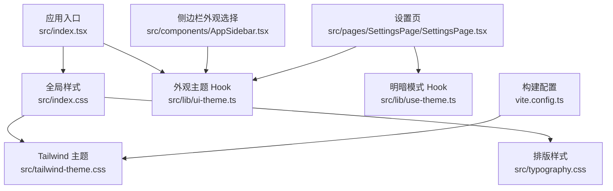
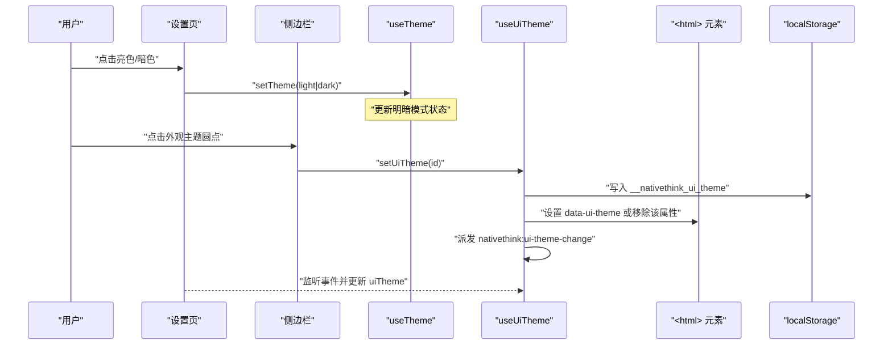
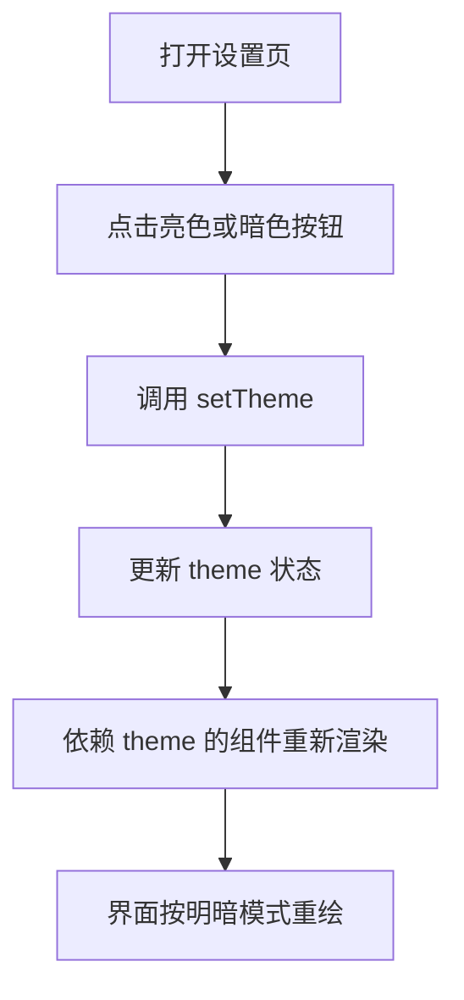
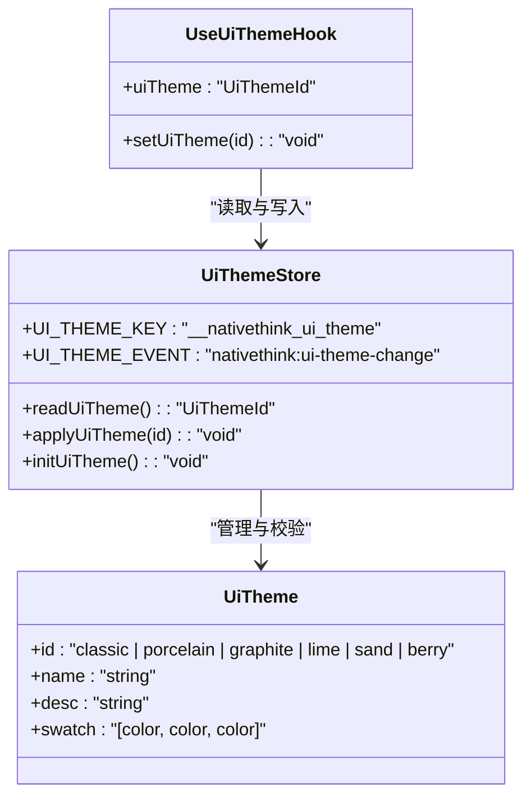
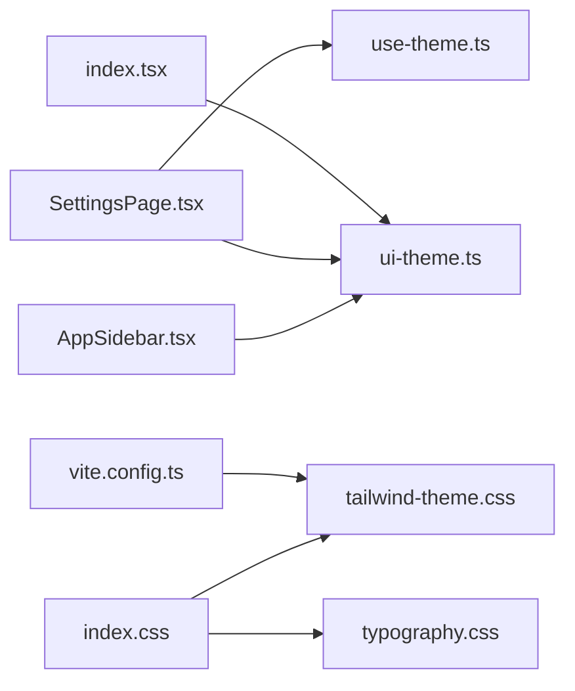

# 主题与外观定制

<cite>
**本文引用的文件**   
- [src/lib/ui-theme.ts](file://src/lib/ui-theme.ts)
- [src/index.css](file://src/index.css)
- [src/typography.css](file://src/typography.css)
- [src/index.tsx](file://src/index.tsx)
- [src/components/AppSidebar.tsx](file://src/components/AppSidebar.tsx)
- [src/pages/SettingsPage/SettingsPage.tsx](file://src/pages/SettingsPage/SettingsPage.tsx)
- [vite.config.ts](file://vite.config.ts)
</cite>

## 目录
1. [引言](#引言)
2. [项目结构与主题边界](#项目结构与主题边界)
3. [核心组件](#核心组件)
4. [架构总览](#架构总览)
5. [详细组件分析](#详细组件分析)
6. [依赖关系分析](#依赖关系分析)
7. [性能考虑](#性能考虑)
8. [故障排查指南](#故障排查指南)
9. [结论](#结论)
10. [附录：实操指南](#附录实操指南)

## 引言
本文件面向 NativeThink 的主题系统与外观定制能力，聚焦以下目标：
- 解释深色模式与浅色模式的切换逻辑。
- 说明 ui-theme.ts 中定义的外观主题、颜色变量、字体配置与间距等设计令牌。
- 描述 Tailwind CSS 自定义主题的集成方式，包括颜色扩展、字体族、响应式断点调整。
- 梳理全局样式文件职责：index.css 的基础样式、tailwind-theme.css 的主题变量、typography.css 的排版样式。
- 给出品牌色替换、字体替换、布局密度调整的实操步骤。
- 总结移动端与桌面端主题适配策略。
- 提供主题调试工具与常见问题排查方法。

## 项目结构与主题边界
NativeThink 的主题体系由“运行时主题状态”“外观主题系统”“CSS 设计令牌”“Tailwind 构建配置”“设置与侧边栏入口”五部分构成：

| 层级 | 主要职责 | 关键文件 |
|---|---|---|
| 运行时主题状态 | 管理明暗模式（light/dark），供设置页与 UI 组件消费 | src/lib/use-theme.ts |
| 外观主题系统 | 管理经典、电蓝、石墨、青柠、暖沙、莓果等外观主题 | src/lib/ui-theme.ts |
| 全局样式层 | 基础样式、动画、阅读器主题、滚动条、选择高亮 | src/index.css |
| Tailwind 主题层 | 设计令牌、颜色扩展、字体族、响应式断点 | src/tailwind-theme.css |
| 排版样式层 | shadcn prose 排版映射到应用设计令牌 | src/typography.css |
| 构建配置 | Tailwind 插件、别名、代理、环境变量注入 | vite.config.ts |
| 用户入口 | 侧边栏外观选择、设置页明暗与外观主题控制 | src/components/AppSidebar.tsx、src/pages/SettingsPage/SettingsPage.tsx |
| 应用启动 | 初始化主题、挂载全局 Toaster、错误边界 | src/index.tsx |

**图表来源**
- [src/index.tsx:1-40](file://src/index.tsx#L1-L40)
- [src/index.css:1-20](file://src/index.css#L1-L20)
- [src/typography.css:1-10](file://src/typography.css#L1-L10)
- [src/lib/ui-theme.ts:1-30](file://src/lib/ui-theme.ts#L1-L30)
- [src/components/AppSidebar.tsx:1-25](file://src/components/AppSidebar.tsx#L1-L25)
- [src/pages/SettingsPage/SettingsPage.tsx:1-20](file://src/pages/SettingsPage/SettingsPage.tsx#L1-L20)
- [vite.config.ts:1-15](file://vite.config.ts#L1-L15)

**章节来源**
- [src/index.tsx:1-40](file://src/index.tsx#L1-L40)
- [src/index.css:1-20](file://src/index.css#L1-L20)
- [src/typography.css:1-10](file://src/typography.css#L1-L10)
- [src/lib/ui-theme.ts:1-30](file://src/lib/ui-theme.ts#L1-L30)
- [src/components/AppSidebar.tsx:1-25](file://src/components/AppSidebar.tsx#L1-L25)
- [src/pages/SettingsPage/SettingsPage.tsx:1-20](file://src/pages/SettingsPage/SettingsPage.tsx#L1-L20)
- [vite.config.ts:1-15](file://vite.config.ts#L1-L15)

## 核心组件
- **use-theme.ts**：导出 useTheme，用于在 React 组件中读取和切换明暗模式。它通常与 Tailwind 的 dark 模式配合，通过给 <html> 或根节点添加 dark 类名触发样式覆盖。
- **ui-theme.ts**：导出外观主题枚举、主题列表、持久化读写、DOM 属性写入以及 useUiTheme Hook。外观主题与明暗模式正交：一个决定强调色、背景、卡片、描边等材质，另一个决定整体深浅。
- **index.css**：引入 Tailwind、自定义 dark 变体、tw-animate-css、tailwind-theme.css、typography.css；定义选择器高亮、滚动条、页面入场动画、阅读器主题、文字品牌色工具类等。
- **tailwind-theme.css**：集中定义 CSS 变量，如 --background、--foreground、--card、--primary、--brand、--ink-teal、--ink-violet、--fx-ease 等，是 shadcn 与业务组件共同依赖的设计令牌层。
- **typography.css**：启用 @tailwindcss/typography，并将 prose 的正文、标题、链接、引用、代码、表格等映射到当前设计令牌，使文章阅读区自动跟随主题。
- **AppSidebar.tsx**：展示外观主题圆点按钮，调用 setUiTheme 切换外观主题，并用 swatch 预览主色、卡片色、背景色。
- **SettingsPage.tsx**：同时使用 useTheme 切换 light/dark，并使用 UI_THEMES 与 useUiTheme 切换外观主题；提供预设主题卡片、默认标签、选中指示器等。

**章节来源**
- [src/lib/use-theme.ts](file://src/lib/use-theme.ts)
- [src/lib/ui-theme.ts:1-84](file://src/lib/ui-theme.ts#L1-L84)
- [src/index.css:1-20](file://src/index.css#L1-L20)
- [src/typography.css:1-41](file://src/typography.css#L1-L41)
- [src/components/AppSidebar.tsx:1-179](file://src/components/AppSidebar.tsx#L1-L179)
- [src/pages/SettingsPage/SettingsPage.tsx:1-183](file://src/pages/SettingsPage/SettingsPage.tsx#L1-L183)

## 架构总览
主题系统的运行流程分为两条主线：
1. **明暗模式主线**：设置页调用 useTheme 的 setTheme，切换 light 或 dark；UI 组件通过 theme 值渲染对应样式。
2. **外观主题主线**：侧边栏或设置页调用 useUiTheme 的 setUiTheme，写入 localStorage、更新 DOM 的 data-ui-theme 属性，并广播 window 事件，驱动其他组件刷新。

**图表来源**
- [src/pages/SettingsPage/SettingsPage.tsx:1-183](file://src/pages/SettingsPage/SettingsPage.tsx#L1-L183)
- [src/components/AppSidebar.tsx:1-179](file://src/components/AppSidebar.tsx#L1-L179)
- [src/lib/ui-theme.ts:1-84](file://src/lib/ui-theme.ts#L1-L84)

## 详细组件分析

### 明暗模式：useTheme
- **作用**：提供 theme 与 setTheme，供设置页和 UI 组件使用。
- **典型行为**：
  - 在设置页中提供“亮色”“暗色”两个按钮。
  - 切换后影响依赖 theme 值的组件，例如背景、前景色、边框、阴影等。
- **与 Tailwind 的关系**：项目通过 index.css 的 `@custom-variant dark` 定义 dark 变体，并结合 tailwind-theme.css 中的设计令牌，实现深浅两套视觉。
- **与外观主题的关系**：明暗模式与外观主题是正交的。设置页可同时选择明暗模式和外观主题。

**图表来源**
- [src/pages/SettingsPage/SettingsPage.tsx:1-183](file://src/pages/SettingsPage/SettingsPage.tsx#L1-L183)
- [src/index.css:1-5](file://src/index.css#L1-L5)

**章节来源**
- [src/pages/SettingsPage/SettingsPage.tsx:1-183](file://src/pages/SettingsPage/SettingsPage.tsx#L1-L183)
- [src/index.css:1-5](file://src/index.css#L1-L5)

### 外观主题：ui-theme.ts
- **主题枚举**：classic、porcelain、graphite、lime、sand、berry。
- **主题元数据**：每个主题包含 id、name、desc、swatch，swatch 为三个色点：主色、卡片色、背景色。
- **持久化键**：`__nativethink_ui_theme`，保存在 localStorage。
- **事件机制**：`nativethink:ui-theme-change`，用于跨组件同步外观主题。
- **DOM 标记**：当主题为 classic 时移除 `data-ui-theme`；否则设置 `data-ui-theme=id`，供 tailwind-theme.css 中的 `[data-ui-theme]` 选择器覆盖设计令牌。
- **Hook 返回值**：{ uiTheme, setUiTheme }，uiTheme 是当前主题 id，setUiTheme 用于切换。

**图表来源**
- [src/lib/ui-theme.ts:1-84](file://src/lib/ui-theme.ts#L1-L84)

**章节来源**
- [src/lib/ui-theme.ts:1-84](file://src/lib/ui-theme.ts#L1-L84)

### 全局样式：index.css
- **导入顺序**：先引入 tailwindcss、自定义 dark 变体、tw-animate-css，再引入 tailwind-theme.css 与 typography.css。
- **基础样式**：
  - 设置 `::selection` 高亮色。
  - 设置 html smooth scroll。
  - body 使用 `var(--foreground)` 作为前景色，保证暗色模式下 outline 按钮等可被看见。
  - 启用字体特性开关与抗锯齿。
- **动画与交互**：
  - page-enter、stagger card-enter、session-cheer、caret-blink、ripple-pulse、page-turn-next/prev、stream-in 等。
  - 尊重 `prefers-reduced-motion`，关闭不必要的动画。
  - 统一 `:focus-visible` 焦点环。
  - 针对 main 区域设置窄滚动条，并区分明暗态滚动条颜色。
- **阅读器主题**：
  - `.reader-paper` 提供纸张风格变量。
  - `.reader-night` 提供夜间风格变量。
  - 两者分别覆盖 selection 与 reader-slider 背景。
- **品牌色工具类**：
  - `text-ink-violet`、`text-ink-teal` 直接读取 `--ink-violet`、`--ink-teal`，自动跟随主题。

**章节来源**
- [src/index.css:1-200](file://src/index.css#L1-L200)
- [src/index.css:201-643](file://src/index.css#L201-L643)

### 排版样式：typography.css
- 启用 `@tailwindcss/typography`。
- 自定义 `prose` utility，将正文、标题、引导文本、链接、加粗、计数器、项目符号、分割线、引用、标题框、代码、预格式化块、表格边框等全部映射到当前设计令牌。
- 同时维护 `invert` 变体，确保反色场景下仍可读。

**章节来源**
- [src/typography.css:1-41](file://src/typography.css#L1-L41)

### 应用启动：index.tsx
- 在 createRoot 之前依次执行：
  - 检查内置朗读引擎健康状态。
  - 初始化按压涟漪事件委托。
  - 初始化外观主题，避免首帧闪回默认主题。
- 挂载全局 Toaster，位置位于顶部居中，并为移动端预留安全区域偏移。
- 包裹 ErrorBoundary、FocusModeProvider、AuthProvider、CloudSyncProvider 等全局 Provider。

**章节来源**
- [src/index.tsx:1-123](file://src/index.tsx#L1-L123)

### 侧边栏外观选择：AppSidebar.tsx
- 从 ui-theme.ts 导入 UI_THEMES 与 useUiTheme。
- 在侧边栏底部渲染外观主题圆点。
- 使用 swatch 生成渐变预览，并用 THEME_DOT_ALT 提供替代色以增强对比。
- 点击圆点调用 setUiTheme，并通过 aria-pressed 暴露无障碍状态。

**章节来源**
- [src/components/AppSidebar.tsx:1-179](file://src/components/AppSidebar.tsx#L1-L179)
- [src/lib/ui-theme.ts:1-84](file://src/lib/ui-theme.ts#L1-L84)

### 设置页：SettingsPage.tsx
- 同时消费 useTheme 与 UI_THEMES、useUiTheme。
- 外观区块：
  - 上方提供亮色/暗色切换。
  - 下方网格展示所有外观主题，显示 swatch、名称、默认标签、选中指示器与描述。
- 学习目标、朗读设置、AI 设置、帮助、关于等信息也集中在设置页，但属于功能设置而非主题核心。

**章节来源**
- [src/pages/SettingsPage/SettingsPage.tsx:1-183](file://src/pages/SettingsPage/SettingsPage.tsx#L1-L183)
- [src/lib/ui-theme.ts:1-84](file://src/lib/ui-theme.ts#L1-L84)

## 依赖关系分析
主题相关模块的依赖方向如下：

**图表来源**
- [src/components/AppSidebar.tsx:1-25](file://src/components/AppSidebar.tsx#L1-L25)
- [src/pages/SettingsPage/SettingsPage.tsx:1-20](file://src/pages/SettingsPage/SettingsPage.tsx#L1-L20)
- [src/index.tsx:1-20](file://src/index.tsx#L1-L20)
- [src/index.css:1-10](file://src/index.css#L1-L10)
- [vite.config.ts:1-15](file://vite.config.ts#L1-L15)

**章节来源**
- [src/components/AppSidebar.tsx:1-25](file://src/components/AppSidebar.tsx#L1-L25)
- [src/pages/SettingsPage/SettingsPage.tsx:1-20](file://src/pages/SettingsPage/SettingsPage.tsx#L1-L20)
- [src/index.tsx:1-20](file://src/index.tsx#L1-L20)
- [src/index.css:1-10](file://src/index.css#L1-L10)
- [vite.config.ts:1-15](file://vite.config.ts#L1-L15)

## 性能考虑
- **首屏主题闪烁防护**：index.tsx 在 createRoot 前调用 initUiTheme，提前写入 `data-ui-theme`，避免首次渲染出现默认主题后再跳变。
- **localStorage 容错**：读/写主题时捕获异常，无法持久化时退化为会话级主题。
- **事件通信轻量**：外观主题切换通过 CustomEvent 通知，避免全局状态库开销。
- **动画降级**：index.css 对 prefers-reduced-motion 做降级处理，减少低端设备或无障碍用户的动画负担。
- **Tailwind 按需构建**：通过 vite.config.ts 引入 tailwindcss 插件，仅构建使用的样式类，降低产物体积。

**章节来源**
- [src/index.tsx:1-20](file://src/index.tsx#L1-L20)
- [src/lib/ui-theme.ts:30-84](file://src/lib/ui-theme.ts#L30-L84)
- [src/index.css:40-120](file://src/index.css#L40-L120)
- [vite.config.ts:1-15](file://vite.config.ts#L1-L15)

## 故障排查指南

| 现象 | 可能原因 | 排查步骤 | 修复建议 |
|---|---|---|---|
| 切换外观主题后无变化 | 未正确写入 `data-ui-theme` | 检查浏览器 Elements 面板中 `<html>` 是否包含 `data-ui-theme` | 确认调用了 setUiTheme，且未被后续逻辑覆盖 |
| 切换主题后局部组件未刷新 | 组件未订阅 nativethink:ui-theme-change | 查看组件是否使用 useUiTheme | 使用 useUiTheme 返回的 uiTheme 或 setUiTheme |
| 明暗模式无效 | dark 类未生效或变量缺失 | 检查 index.css 的 dark 变体与 tailwind-theme.css 中的变量 | 确保 tailwind-theme.css 已加载，且 dark 样式覆盖了必要变量 |
| 阅读器主题颜色异常 | reader-paper / reader-night 变量未覆盖 | 检查阅读容器是否添加了对应类名 | 根据需求添加 reader-paper 或 reader-night |
| 品牌色工具类不生效 | --ink-violet / --ink-teal 未定义 | 检查 tailwind-theme.css 是否定义了这两个变量 | 补充变量或使用现有 design token |
| 排版颜色与主题不一致 | prose 未绑定设计令牌 | 检查 typography.css 的 prose 配置 | 确保正文、标题、链接等映射到 --foreground、--primary、--border |
| 主题切换后本地存储丢失 | localStorage 不可用或被清理 | 检查浏览器 Application 面板 Local Storage | 接受会话级主题行为，或检查隐私模式限制 |
| 设置页外观主题卡死 | UI_THEMES 数组或主题 id 不匹配 | 检查 UI_THEMES 定义与 readUiTheme 校验逻辑 | 新增主题时同时更新类型、列表与侧边栏映射 |

**章节来源**
- [src/lib/ui-theme.ts:1-84](file://src/lib/ui-theme.ts#L1-L84)
- [src/index.css:1-200](file://src/index.css#L1-L200)
- [src/typography.css:1-41](file://src/typography.css#L1-L41)
- [src/pages/SettingsPage/SettingsPage.tsx:1-183](file://src/pages/SettingsPage/SettingsPage.tsx#L1-L183)
- [src/components/AppSidebar.tsx:1-179](file://src/components/AppSidebar.tsx#L1-L179)

## 结论
NativeThink 的主题系统采用“明暗模式”与“外观主题”双轨设计：前者控制整体深浅，后者控制品牌材质与强调色。运行时通过 useTheme 和 useUiTheme 分别管理两类状态，DOM 通过 dark 类和 data-ui-theme 属性驱动 CSS 变量，Tailwind 负责按需生成样式，全局样式文件承担基础样式、动画、排版与阅读器主题职责。该结构清晰、可扩展性强，适合继续扩展品牌色、字体族、密度等级与多平台适配。

## 附录：实操指南

### 自定义品牌色
1. 打开 tailwind-theme.css。
2. 找到品牌相关变量，例如 --brand、--ink-teal、--ink-violet。
3. 修改为新的十六进制值或 HSL 值。
4. 如需在业务中使用新品牌色，可直接使用现有工具类 text-ink-violet、text-ink-teal，或在组件中引用对应变量。
5. 验证设置页与侧边栏的品牌色是否一致。

**参考文件**
- [src/index.css:150-180](file://src/index.css#L150-L180)
- [src/tailwind-theme.css](file://src/tailwind-theme.css)

### 替换字体族
1. 在 tailwind-theme.css 中查找字体相关变量，例如 --font-sans、--font-mono 等。
2. 将系统字体替换为自定义字体族名称。
3. 若使用本地字体，请确保 public/fonts 下的字体文件存在，并在 CSS 中通过 @font-face 引入。
4. 检查 index.css 中 body 的字体特性设置，确保 cv11、ss01 等特性与新字体兼容。
5. 运行 verify-brand-fonts 脚本（仓库中存在）辅助验证字体加载情况。

**参考文件**
- [src/index.css:10-20](file://src/index.css#L10-L20)
- [src/tailwind-theme.css](file://src/tailwind-theme.css)

### 调整布局密度
1. 布局密度主要通过设计令牌控制，例如 background、card、muted、border、spacing 等。
2. 在 tailwind-theme.css 中调整这些变量的数值，可以改变卡片大小、间距、边框粗细。
3. 如果希望整体更紧凑，可降低 padding、margin 相关变量；如果需要更大留白，则增大这些变量。
4. 注意不要破坏 contrast ratio，尤其是 foreground 与 background 的对比度。
5. 在设置页和侧边栏中验证不同密度下的视觉效果。

**参考文件**
- [src/tailwind-theme.css](file://src/tailwind-theme.css)
- [src/pages/SettingsPage/SettingsPage.tsx:1-183](file://src/pages/SettingsPage/SettingsPage.tsx#L1-L183)
- [src/components/AppSidebar.tsx:1-179](file://src/components/AppSidebar.tsx#L1-L179)

### 移动端与桌面端主题适配策略
- **移动端**：
  - 侧边栏在抽屉模式下作为整屏 modal 层，主题切换不会吞掉路由点击，但需要用户再次操作遮罩。
  - Toaster 使用 mobileOffset，避开 edge-to-edge 的安全区域。
  - 滚动条、动画、阅读器主题在小屏上应更注重可读性与触控体验。
- **桌面端**：
  - 侧边栏常驻，外观主题圆点始终可见。
  - 深色模式更适合长时间阅读与代码编辑场景。
  - 可通过 tailwind 响应式类或媒体查询调整密度与字号。

**参考文件**
- [src/components/AppSidebar.tsx:120-179](file://src/components/AppSidebar.tsx#L120-L179)
- [src/index.tsx:60-123](file://src/index.tsx#L60-L123)
- [src/index.css:40-120](file://src/index.css#L40-L120)