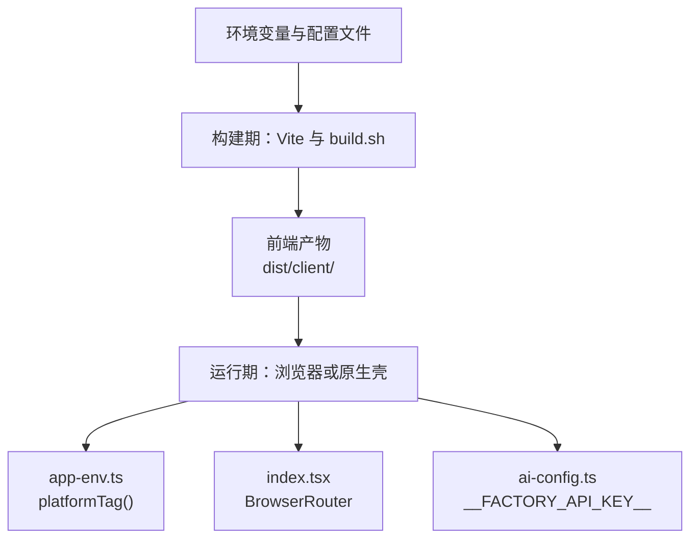
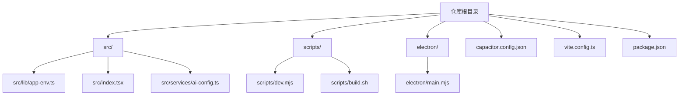
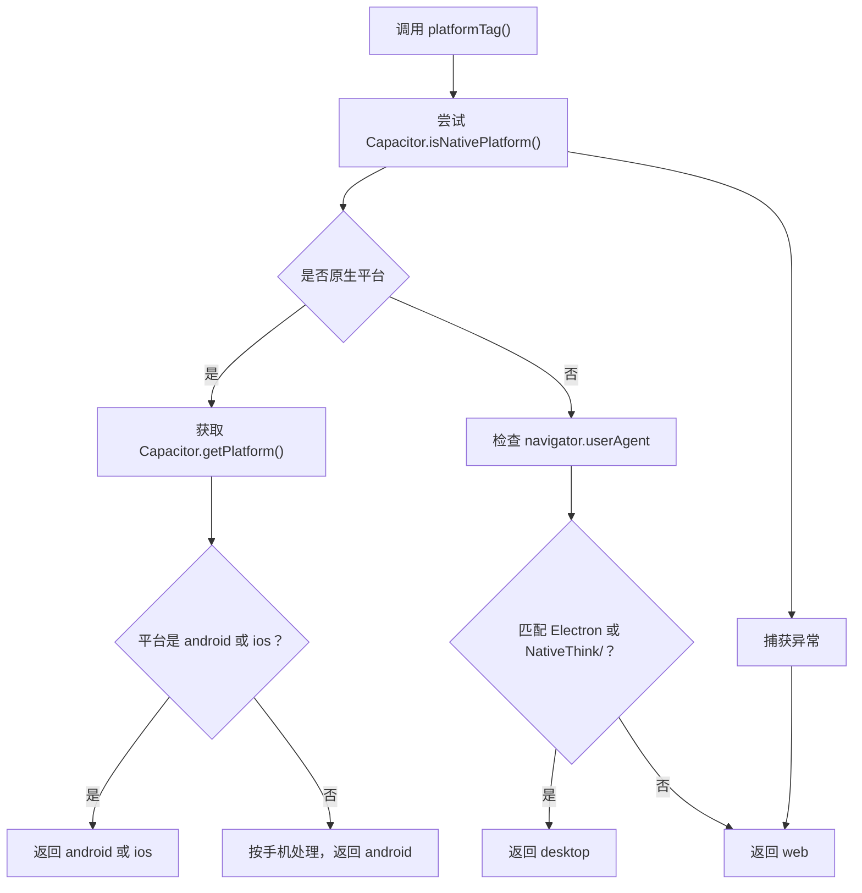
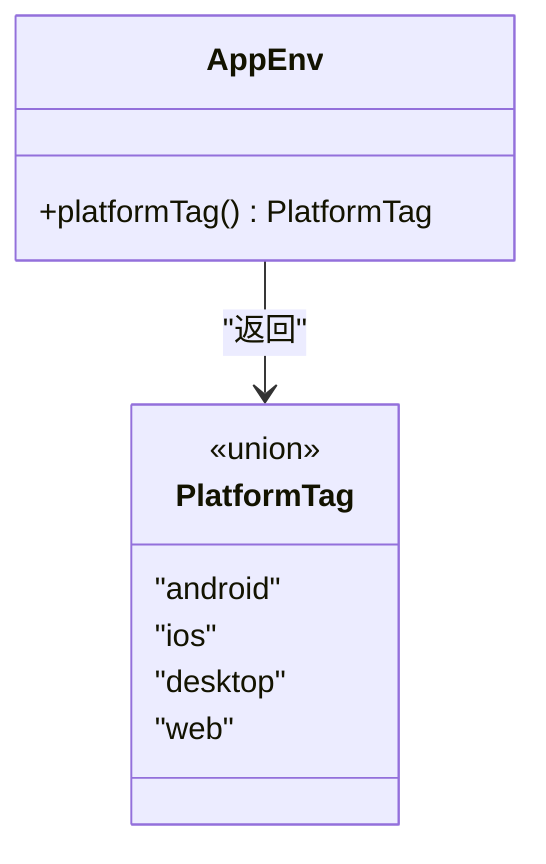
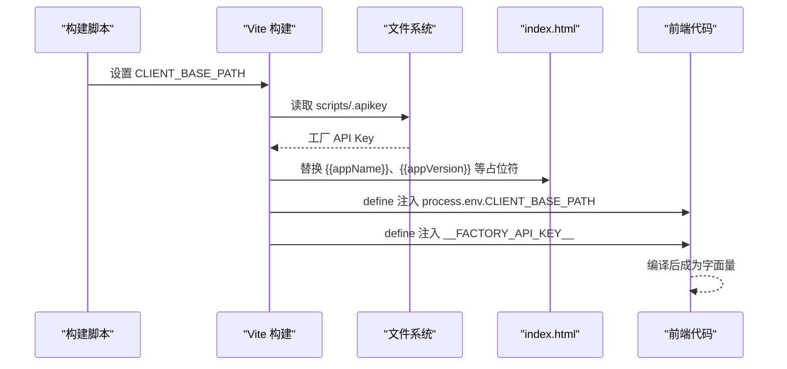
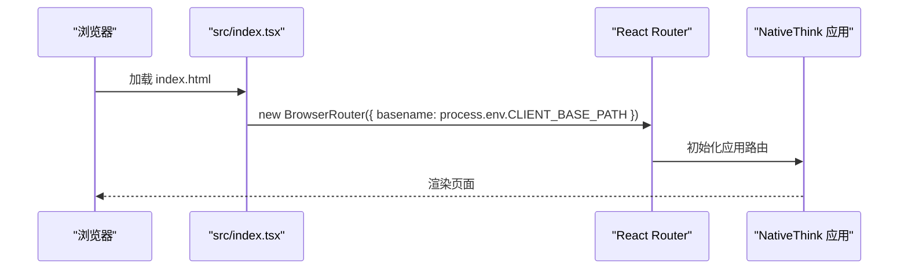
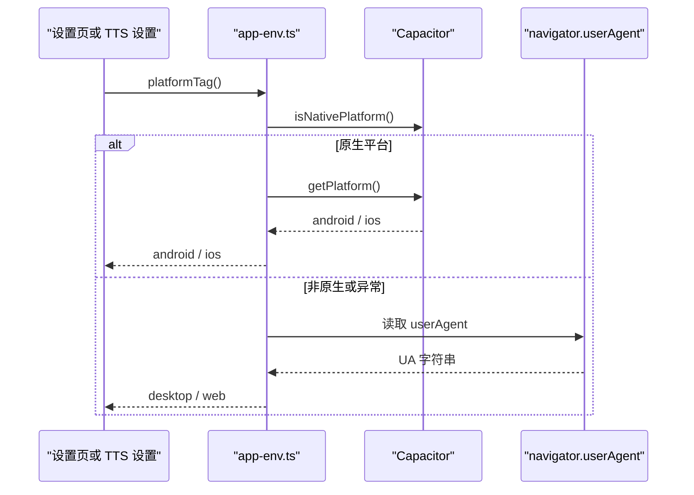
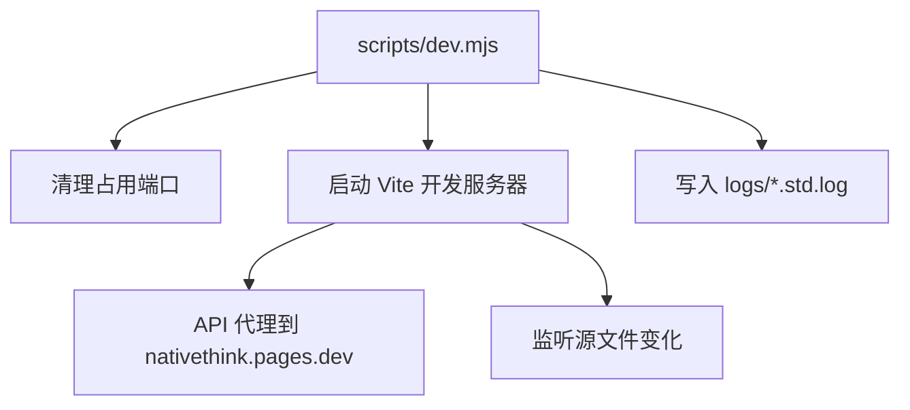
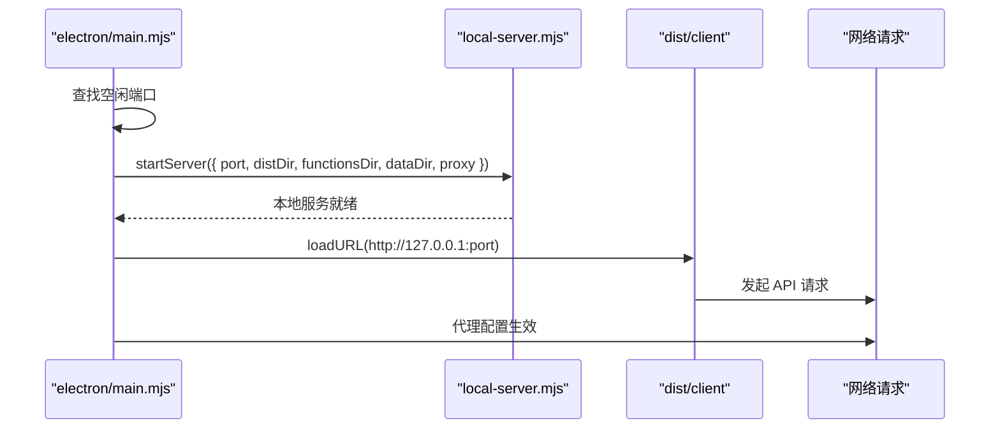
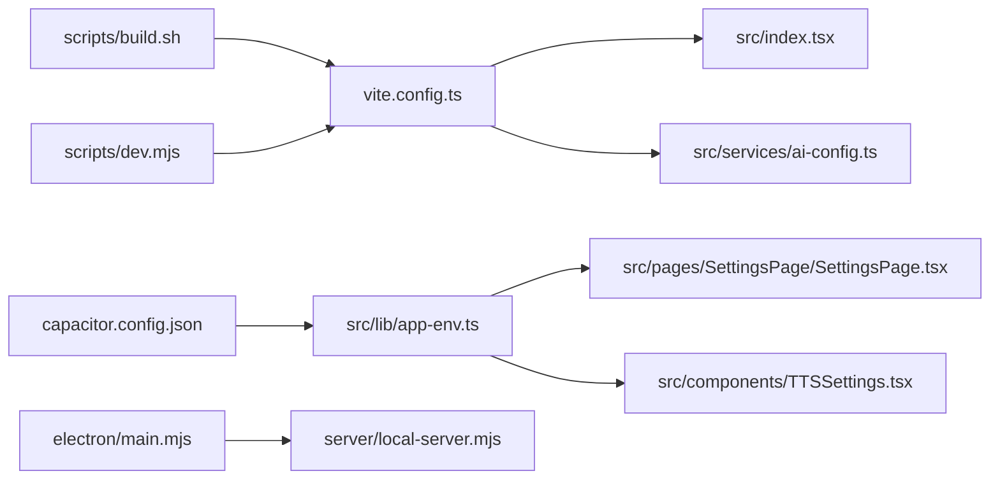

# 应用环境配置

<cite>
**本文引用的文件**   
- [src/lib/app-env.ts](file://src/lib/app-env.ts)
- [vite.config.ts](file://vite.config.ts)
- [scripts/build.sh](file://scripts/build.sh)
- [scripts/dev.mjs](file://scripts/dev.mjs)
- [electron/main.mjs](file://electron/main.mjs)
- [capacitor.config.json](file://capacitor.config.json)
- [.env.example](file://.env.example)
- [package.json](file://package.json)
- [src/index.tsx](file://src/index.tsx)
- [src/services/ai-config.ts](file://src/services/ai-config.ts)
- [src/pages/SettingsPage/SettingsPage.tsx](file://src/pages/SettingsPage/SettingsPage.tsx)
- [src/components/TTSSettings.tsx](file://src/components/TTSSettings.tsx)
</cite>

## 目录

1. [引言](#引言)
2. [项目结构定位](#项目结构定位)
3. [环境变量总览与命名规范](#环境变量总览与命名规范)
4. [运行时环境模块分析](#运行时环境模块分析)
5. [构建期注入机制](#构建期注入机制)
6. [运行期读取与验证流程](#运行期读取与验证流程)
7. [开发、测试、生产与环境差异](#开发测试生产与环境差异)
8. [Electron 与 Capacitor 的差异](#electron-与-capacitor-的差异)
9. [扩展新环境变量的最佳实践](#扩展新环境变量的最佳实践)
10. [依赖关系分析](#依赖关系分析)
11. [常见问题排查](#常见问题排查)
12. [结论](#结论)

## 引言

NativeThink 的环境配置体系分为两个层面：

- **构建期配置**：由 Vite 和构建脚本处理，把平台基础路径、出厂 API Key、应用版本等常量编译进前端资源。
- **运行期配置**：由 `src/lib/app-env.ts` 暴露平台识别能力，供设置页、TTS 设置等业务组件判断当前是 Android、iOS、桌面还是网页环境。

该项目没有集中维护一份“所有环境变量清单”，而是通过以下四个位置共同定义环境语义：

| 维度 | 主要文件 | 职责 |
|---|---|---|
| 运行期平台信息 | [src/lib/app-env.ts](file://src/lib/app-env.ts) | 提供 `PlatformTag` 类型和 `platformTag()` 函数 |
| 构建期变量注入 | [vite.config.ts](file://vite.config.ts) | 注入 `CLIENT_BASE_PATH`、`__FACTORY_API_KEY__`、版本号、HTML 占位符 |
| 打包脚本 | [scripts/build.sh](file://scripts/build.sh)、[scripts/dev.mjs](file://scripts/dev.mjs) | 设置 `NODE_ENV`、`CLIENT_BASE_PATH`、端口、日志目录 |
| 原生宿主 | [electron/main.mjs](file://electron/main.mjs)、[capacitor.config.json](file://capacitor.config.json) | Electron 本地服务、Capacitor 应用标识与 WebView 行为 |

**图表来源**
- [vite.config.ts:109-114](file://vite.config.ts#L109-L114)
- [scripts/build.sh:13-26](file://scripts/build.sh#L13-L26)
- [src/lib/app-env.ts:1-29](file://src/lib/app-env.ts#L1-L29)
- [src/index.tsx:94](file://src/index.tsx#L94)
- [src/services/ai-config.ts:10-13](file://src/services/ai-config.ts#L10-L13)

**本节来源**
- [src/lib/app-env.ts:1-29](file://src/lib/app-env.ts#L1-L29)
- [vite.config.ts:109-114](file://vite.config.ts#L109-L114)
- [scripts/build.sh:13-26](file://scripts/build.sh#L13-L26)

## 项目结构定位

与环境配置直接相关的代码集中在以下区域：

| 路径 | 说明 |
|---|---|
| `src/lib/app-env.ts` | 运行期平台检测、类型定义 |
| `vite.config.ts` | Vite 构建配置、环境变量注入、HTML 模板替换 |
| `scripts/build.sh` | Web 构建主脚本，决定输出模式 |
| `scripts/dev.mjs` | 开发服务器启动器，管理端口与日志 |
| `electron/main.mjs` | Electron 主进程，读取系统代理并启动本地服务 |
| `capacitor.config.json` | Capacitor 应用 ID、Web 目录、Android Scheme |
| `.env.example` | 示例环境变量（飞书机器人） |
| `package.json` | npm 脚本入口，统一 `dev`、`build`、打包命令 |

**图表来源**
- [src/lib/app-env.ts:1-29](file://src/lib/app-env.ts#L1-L29)
- [vite.config.ts:109-114](file://vite.config.ts#L109-L114)
- [scripts/build.sh:13-26](file://scripts/build.sh#L13-L26)
- [scripts/dev.mjs:1-130](file://scripts/dev.mjs#L1-L130)
- [electron/main.mjs:1-176](file://electron/main.mjs#L1-L176)
- [capacitor.config.json:1-11](file://capacitor.config.json#L1-L11)
- [package.json:1-130](file://package.json#L1-L130)

**本节来源**
- [src/lib/app-env.ts:1-29](file://src/lib/app-env.ts#L1-L29)
- [vite.config.ts:109-114](file://vite.config.ts#L109-L114)
- [scripts/build.sh:13-26](file://scripts/build.sh#L13-L26)
- [scripts/dev.mjs:1-130](file://scripts/dev.mjs#L1-L130)
- [electron/main.mjs:1-176](file://electron/main.mjs#L1-L176)
- [capacitor.config.json:1-11](file://capacitor.config.json#L1-L11)
- [package.json:1-130](file://package.json#L1-L130)

## 环境变量总览与命名规范

### 已使用的环境变量

| 变量名 | 作用域 | 默认值 | 说明 |
|---|---|---:|---|
| `CLIENT_BASE_PATH` | 构建期 → 运行期 | `/` | Vite 的 `base`，同时以 `process.env.CLIENT_BASE_PATH` 形式注入浏览器 |
| `ASSETS_CDN_PATH` | 构建期 | `/` | 构建脚本导出，用于静态资源 CDN 前缀 |
| `STATIC_ASSETS_BASE_URL` | 构建期 | 空 | 构建脚本导出，用于私有静态资源基地址 |
| `NODE_ENV` | 构建期 | `production` | 构建脚本显式设置，未设置时回退为生产环境 |
| `MIAODA_APP_ID` | 构建期 | 空 | 若存在，则 `CLIENT_BASE_PATH` 变为 `/app/<appId>` |
| `MIAODA_RESOURCE_CDN_PREFIX` | 构建期 | `/` | 资源 CDN 前缀 |
| `MIAODA_STATIC_CDN_PREFIX` | 构建期 | 空 | 静态资源 CDN 前缀 |
| `CF_PAGES` | 构建期 | 空 | 等于 `1` 时跳过 Miaoda 输出拆分 |
| `LOG_DIR` | 开发期 | `logs` | 开发脚本日志目录 |
| `CLIENT_DEV_PORT` | 开发期 | `8001` | 开发服务器端口 |
| `NATIVETHINK_DEV` | Electron 主进程 | 空 | 标记 Electron 开发模式 |
| `NATIVETHINK_PROXY` | Electron 主进程 | 空 | 手动指定系统代理 |
| `NATIVETHINK_PORT` | 本地服务器 | `31745` | Electron 本地服务端口 |
| `VITE_FEISHU_WEBHOOK_URL` | 示例 | 空 | 仅示例，仓库中未消费该变量 |

### 命名规范

1. **Vite 构建期注入的客户端变量使用 `VITE_` 前缀**。这是 Vite 对客户端暴露环境变量的约定，但本项目当前实际使用的客户端变量是 `CLIENT_BASE_PATH`，它通过 `define` 显式注入。
2. **Electron 主进程变量使用 `NATIVETHINK_` 前缀**，如 `NATIVETHINK_DEV`、`NATIVETHINK_PROXY`、`NATIVETHINK_PORT`。
3. **构建脚本导出的平台变量使用大写下划线风格**，如 `CLIENT_BASE_PATH`、`ASSETS_CDN_PATH`、`STATIC_ASSETS_BASE_URL`。
4. **平台无关的运行时常量不通过环境变量传递**，例如 `__FACTORY_API_KEY__` 是通过 Vite `define` 在构建期编译进代码的字符串常量。
5. **敏感信息不进入仓库**。工厂 API Key 从 `scripts/.apikey` 读取，该文件被忽略；`.env.example` 只包含非敏感示例。

**本节来源**
- [vite.config.ts:109-114](file://vite.config.ts#L109-L114)
- [scripts/build.sh:13-26](file://scripts/build.sh#L13-L26)
- [scripts/dev.mjs:17-22](file://scripts/dev.mjs#L17-L22)
- [electron/main.mjs:27,94,721](file://electron/main.mjs#L27-L27)
- [electron/main.mjs:94](file://electron/main.mjs#L94)
- [server/local-server.mjs:721](file://server/local-server.mjs#L721)
- [.env.example:1-3](file://.env.example#L1-L3)

## 运行时环境模块分析

`src/lib/app-env.ts` 是运行期环境信息的单一来源，但它更准确地说是一个**平台识别模块**，而不是传统意义上的环境变量读取模块。

### 类型定义

模块导出一个联合类型：

| 类型值 | 含义 |
|---|---|
| `android` | Android 原生应用 |
| `ios` | iOS 原生应用 |
| `desktop` | Electron 桌面应用 |
| `web` | 普通网页环境 |

这个类型保证了调用方不能传入任意字符串，从而获得 TypeScript 类型安全。

### 平台判定逻辑

`platformTag()` 的执行顺序如下：

**图表来源**
- [src/lib/app-env.ts:10-29](file://src/lib/app-env.ts#L10-L29)

### 关键设计要点

1. **Capacitor 优先于 UA 判断**：因为 Capacitor 内置 Chromium 的 User-Agent 也可能包含 `Chrome`，所以必须先询问原生桥。
2. **异常隔离**：如果 `Capacitor.isNativePlatform` 或 `navigator.userAgent` 访问失败，模块会降级为 `web`，避免整个应用崩溃。
3. **未知原生平台回退到 Android**：当检测到有原生桥但无法解析具体平台时，按手机环境处理。
4. **Electron 识别基于 UA**：匹配 `Electron` 或 `NativeThink/` 前缀，这是 Electron 渲染进程的典型 UA 特征。

**图表来源**
- [src/lib/app-env.ts:9-29](file://src/lib/app-env.ts#L9-L29)

### 消费者

| 文件 | 用途 |
|---|---|
| [src/pages/SettingsPage/SettingsPage.tsx](file://src/pages/SettingsPage/SettingsPage.tsx) | 根据平台显示或隐藏相关设置项 |
| [src/components/TTSSettings.tsx](file://src/components/TTSSettings.tsx) | 根据平台调整 TTS 行为或 UI |

**本节来源**
- [src/lib/app-env.ts:1-29](file://src/lib/app-env.ts#L1-L29)
- [src/pages/SettingsPage/SettingsPage.tsx:9](file://src/pages/SettingsPage/SettingsPage.tsx#L9)
- [src/components/TTSSettings.tsx:38](file://src/components/TTSSettings.tsx#L38)

## 构建期注入机制

### Vite 注入的变量

Vite 通过 `define` 将 Node.js 侧的值替换成 JavaScript 字面量，最终编译进浏览器可执行的代码：

| 注入名称 | 来源 | 运行时形态 |
|---|---|---|
| `process.env.CLIENT_BASE_PATH` | `process.env.CLIENT_BASE_PATH || '/'` | 字符串，作为路由 base 使用 |
| `__FACTORY_API_KEY__` | `scripts/.apikey` 文件内容 | 字符串常量，可能为空 |

此外，`vite.config.ts` 还设置了 `base: process.env.CLIENT_BASE_PATH || '/'`，影响静态资源 URL 生成。

**图表来源**
- [vite.config.ts:32-36](file://vite.config.ts#L32-L36)
- [vite.config.ts:109-114](file://vite.config.ts#L109-L114)
- [vite.config.ts:60-90](file://vite.config.ts#L60-L90)

### 版本信息来源

应用版本不是普通环境变量，而是构建期从以下优先级读取：

1. `android/version.properties` 中的 `versionName`
2. 如果读不到，构建直接报错，拒绝继续

这意味着版本链必须保持完整：APK 版本、Web 元数据版本、构建脚本应保持一致。注释明确指出，反馈功能下线后，`<meta name="app-version">` 是诊断信息与构建校验的唯一载体。

### 工厂 API Key

工厂 API Key 是可选的：

- 如果 `scripts/.apikey` 不存在，值为空字符串。
- 如果存在，内容为单行文本。
- 该文件被加入 gitignore，不会提交到仓库。
- 前端通过 `src/services/ai-config.ts` 消费，并以 `__FACTORY_API_KEY__` 形式参与 provider 选择。

**本节来源**
- [vite.config.ts:32-36](file://vite.config.ts#L32-L36)
- [vite.config.ts:60-90](file://vite.config.ts#L60-L90)
- [vite.config.ts:109-114](file://vite.config.ts#L109-L114)
- [src/services/ai-config.ts:10-13](file://src/services/ai-config.ts#L10-L13)

## 运行期读取与验证流程

### 路由基础路径

应用入口在 `src/index.tsx` 中使用 `process.env.CLIENT_BASE_PATH` 作为 `BrowserRouter` 的 `basename`：

**图表来源**
- [src/index.tsx:94](file://src/index.tsx#L94)
- [vite.config.ts:109-114](file://vite.config.ts#L109-L114)

### 平台信息读取

业务组件导入 `platformTag()` 并调用它：

**图表来源**
- [src/lib/app-env.ts:10-29](file://src/lib/app-env.ts#L10-L29)
- [src/pages/SettingsPage/SettingsPage.tsx:9](file://src/pages/SettingsPage/SettingsPage.tsx#L9)
- [src/components/TTSSettings.tsx:38](file://src/components/TTSSettings.tsx#L38)

### 验证策略

当前项目的验证策略偏轻量：

| 层级 | 验证方式 |
|---|---|
| 类型安全 | `PlatformTag` 联合类型保证平台值只能是四个枚举之一 |
| 构建期 | 缺少 `android/version.properties` 时直接抛错 |
| 运行期 | `platformTag()` 用 try/catch 包裹异常，失败时降级为 `web` |
| 路由 | 使用 Vite 注入的 `CLIENT_BASE_PATH`，默认回退 `/` |
| 密钥 | `__FACTORY_API_KEY__` 是字符串常量，空值表示无出厂 Key |

项目中没有引入 Zod 或其他运行时校验库来验证 `app-env` 本身的结构；类型安全主要来自 TypeScript。

**本节来源**
- [src/lib/app-env.ts:1-29](file://src/lib/app-env.ts#L1-L29)
- [src/index.tsx:94](file://src/index.tsx#L94)
- [vite.config.ts:109-114](file://vite.config.ts#L109-L114)

## 开发、测试、生产与环境差异

### 开发环境

开发入口是 `npm run dev`，实际执行 `scripts/dev.mjs`：

- 使用 `CLIENT_DEV_PORT`（默认 `8001`）启动 Vite 开发服务器。
- 使用 `LOG_DIR`（默认 `logs`）写入带时间戳的日志。
- Vite 开发服务器自带代理，将 `/api/*` 转发到 Cloudflare Pages 后端。
- 开发模式下，Vite 的 `define` 会把 `process.env.CLIENT_BASE_PATH` 设为 `/`，除非外部显式设置。

**图表来源**
- [scripts/dev.mjs:17-22](file://scripts/dev.mjs#L17-L22)
- [scripts/dev.mjs:63-88](file://scripts/dev.mjs#L63-L88)
- [vite.config.ts:126-168](file://vite.config.ts#L126-L168)

### 构建环境

`npm run build` 执行 `scripts/build.sh`，核心行为包括：

- 设置 `CLIENT_BASE_PATH`、`ASSETS_CDN_PATH`、`STATIC_ASSETS_BASE_URL`。
- 设置 `NODE_ENV=production`。
- 调用 `npx vite build --outDir dist/client --emptyOutDir`。
- 如果是 Cloudflare Pages 模式，直接输出 `dist/client/`。
- 如果是 Miaoda 模式，进一步拆出 HTML、资源、静态文件和 capability 配置。

### 生产环境

生产部署有两种主要模式：

| 模式 | 条件 | 输出 |
|---|---|---|
| Cloudflare Pages | `CF_PAGES=1` | `dist/client/` |
| Miaoda | 未设置 `CF_PAGES=1` | `dist/output/`、`dist/output_resource/`、`dist/output_static/`、`dist/output_capabilities/` |

### 测试环境

仓库中没有独立的测试环境配置文件。测试类任务主要通过 `scripts/verify-*.mjs` 和 `npm run verify:*` 命令完成，这些脚本属于验证工具，不是运行时环境配置的一部分。

**本节来源**
- [scripts/dev.mjs:1-130](file://scripts/dev.mjs#L1-L130)
- [scripts/build.sh:1-69](file://scripts/build.sh#L1-L69)
- [vite.config.ts:126-168](file://vite.config.ts#L126-L168)
- [package.json:1-130](file://package.json#L1-L130)

## Electron 与 Capacitor 的差异

### Electron 环境

Electron 主进程负责：

1. 寻找空闲端口，默认从 `31745` 开始。
2. 启动本地后端服务 `server/local-server.mjs`。
3. 加载 `dist/client/index.html`。
4. 注入 B站登录态。
5. 针对 bilibili 域名伪造请求头。
6. 读取 `NATIVETHINK_PROXY` 或使用 Chromium 的系统代理探测。

**图表来源**
- [electron/main.mjs:27-30](file://electron/main.mjs#L27-L30)
- [electron/main.mjs:88-115](file://electron/main.mjs#L88-L115)
- [electron/main.mjs:117-176](file://electron/main.mjs#L117-L176)
- [server/local-server.mjs:721](file://server/local-server.mjs#L721)

### Capacitor 环境

Capacitor 配置位于 `capacitor.config.json`：

- 应用 ID：`com.nativethink.app`
- 应用名称：`NativeThink`
- Web 目录：`dist/client`
- Android 禁止混合内容
- Android Scheme 使用 `https`

运行期平台识别依赖 `@capacitor/core` 提供的 `isNativePlatform()` 和 `getPlatform()`。

### 差异对照表

| 维度 | Electron | Capacitor |
|---|---|---|
| 平台识别 | 通过 UA 匹配 `Electron` 或 `NativeThink/` | 通过 `Capacitor.isNativePlatform()` |
| 后端通信 | 本地 `http://127.0.0.1:<port>/api/*` | 通常走 WebView 内嵌 SPA 及远程或本地 API |
| 代理处理 | 主进程读取 `NATIVETHINK_PROXY` 或系统代理 | 由 WebView 和网络栈决定 |
| 平台返回值 | `desktop` | `android` 或 `ios` |
| 配置位置 | `electron/main.mjs` | `capacitor.config.json` |
| 数据持久化 | Electron `userData/data` | Capacitor 原生存储或 IndexedDB |

**本节来源**
- [electron/main.mjs:1-176](file://electron/main.mjs#L1-L176)
- [capacitor.config.json:1-11](file://capacitor.config.json#L1-L11)
- [src/lib/app-env.ts:10-29](file://src/lib/app-env.ts#L10-L29)

## 扩展新环境变量的最佳实践

### 新增构建期客户端变量

如果新变量需要在浏览器端使用，建议遵循以下步骤：

1. **确定变量来源**：来自 `.env`、构建脚本、文件或运行时注入。
2. **在构建脚本中导出**：如 `scripts/build.sh` 中 `export VITE_X_Y_Z=...`。
3. **在 Vite 中注入**：在 `define` 中映射为浏览器可用的常量，例如 `process.env.VITE_X_Y_Z`。
4. **在 `src/index.tsx` 或对应模块中消费**：不要直接拼接全局对象。
5. **添加类型约束**：如果是复杂配置，建议创建专用类型并做默认值回退。

当前项目更倾向使用 `define` 注入 `process.env.CLIENT_BASE_PATH`，而不是依赖 Vite 默认的 `import.meta.env.*`。

### 新增 Electron 主进程变量

如果新变量只在 Electron 主进程使用：

1. 使用 `NATIVETHINK_` 前缀，例如 `NATIVETHINK_FEATURE_FLAG`。
2. 在 `electron/main.mjs` 中读取 `process.env.NATIVETHINK_*`。
3. 不要在浏览器端直接引用该变量。
4. 如需传给渲染进程，应通过 IPC 或预加载上下文暴露，而不是直接注入全局对象。

### 新增运行期平台配置

如果新配置依赖平台：

1. 先在 `PlatformTag` 中添加新分支，保持类型安全。
2. 在 `platformTag()` 中实现检测逻辑。
3. 为异常场景提供降级策略。
4. 在设置页或相关组件中消费，并给出用户可见的行为差异。

### 不建议的做法

| 做法 | 风险 |
|---|---|
| 把敏感密钥放入 `.env.example` | 密钥可能被提交到仓库 |
| 在运行时动态修改 `process.env.CLIENT_BASE_PATH` | 它已是构建期字面量，修改无效 |
| 绕过 `platformTag()` 直接判断 UA | 容易误判 Capacitor 或自定义 WebView |
| 把环境变量直接拼接到路由路径而不加前导斜杠 | 可能导致资源 404 |
| 在 Electron 主进程直接读取浏览器 `window` | 主进程没有 DOM 上下文 |

**本节来源**
- [vite.config.ts:109-114](file://vite.config.ts#L109-L114)
- [scripts/build.sh:13-26](file://scripts/build.sh#L13-L26)
- [electron/main.mjs:27,94](file://electron/main.mjs#L27-L27)
- [src/lib/app-env.ts:9-29](file://src/lib/app-env.ts#L9-L29)
- [.env.example:1-3](file://.env.example#L1-L3)

## 依赖关系分析

### 模块依赖图

**图表来源**
- [scripts/build.sh:13-26](file://scripts/build.sh#L13-L26)
- [scripts/dev.mjs:63-88](file://scripts/dev.mjs#L63-L88)
- [vite.config.ts:109-114](file://vite.config.ts#L109-L114)
- [src/index.tsx:94](file://src/index.tsx#L94)
- [src/services/ai-config.ts:10-13](file://src/services/ai-config.ts#L10-L13)
- [src/lib/app-env.ts:1-29](file://src/lib/app-env.ts#L1-L29)
- [src/pages/SettingsPage/SettingsPage.tsx:9](file://src/pages/SettingsPage/SettingsPage.tsx#L9)
- [src/components/TTSSettings.tsx:38](file://src/components/TTSSettings.tsx#L38)
- [electron/main.mjs:1-176](file://electron/main.mjs#L1-L176)
- [capacitor.config.json:1-11](file://capacitor.config.json#L1-L11)

### 耦合性评估

- **低耦合**：`app-env.ts` 只依赖 `@capacitor/core` 和浏览器 `navigator`，不依赖业务状态。
- **高内聚**：平台检测逻辑集中在一个函数中，便于测试和维护。
- **构建期与运行期分离清晰**：Vite 处理构建期常量，`app-env.ts` 处理运行期平台信息。
- **Electron 与 Capacitor 共享运行时层**：两者都通过 `platformTag()` 获得统一平台标签。

**本节来源**
- [src/lib/app-env.ts:1-29](file://src/lib/app-env.ts#L1-L29)
- [vite.config.ts:109-114](file://vite.config.ts#L109-L114)
- [electron/main.mjs:1-176](file://electron/main.mjs#L1-L176)
- [capacitor.config.json:1-11](file://capacitor.config.json#L1-L11)

## 常见问题排查

### 问题一：路由刷新 404

**现象**：访问子路由正常，刷新后返回 404。

**可能原因**：

- `CLIENT_BASE_PATH` 不为 `/`，但部署路径没有对应 base。
- Cloudflare Pages 或托管平台没有启用 SPA fallback。
- `dist/client/404.html` 没有被正确复制。

**排查步骤**：

1. 检查 `scripts/build.sh` 输出的 `CLIENT_BASE_PATH`。
2. 检查浏览器控制台中的路由路径。
3. 确认部署平台启用了 SPA 路由回退。
4. 确认 `dist/client/404.html` 存在且内容与 `index.html` 一致。

**本节来源**
- [scripts/build.sh:25-31](file://scripts/build.sh#L25-L31)
- [src/index.tsx:94](file://src/index.tsx#L94)

### 问题二：静态资源 404

**现象**：JS、CSS、字体或图片加载失败。

**可能原因**：

- `base` 与实际部署路径不一致。
- CDN 前缀 `ASSETS_CDN_PATH` 或 `STATIC_ASSETS_BASE_URL` 配置错误。
- 开发模式代理未生效。

**排查步骤**：

1. 查看网络面板中资源的完整 URL。
2. 对比 `vite.config.ts` 中的 `base`。
3. 检查 `scripts/build.sh` 导出的 CDN 环境变量。
4. 开发模式下检查 `/api/*` 代理目标是否正确。

**本节来源**
- [vite.config.ts:109-114](file://vite.config.ts#L109-L114)
- [scripts/build.sh:13-26](file://scripts/build.sh#L13-L26)
- [vite.config.ts:126-168](file://vite.config.ts#L126-L168)

### 问题三：平台识别错误

**现象**：Electron 被识别为 web，或 Capacitor 被识别为 desktop。

**可能原因**：

- UA 被篡改或自定义 WebView 未携带预期 UA。
- Capacitor 未正确初始化。
- 在非浏览器环境调用 `platformTag()`。

**排查步骤**：

1. 在运行时打印 `navigator.userAgent`。
2. 检查 Capacitor 是否在原生环境中可用。
3. 确认 Electron 渲染进程未被重定向到非 Electron UA。
4. 在设置页或 TTS 设置中观察平台标签是否符合预期。

**本节来源**
- [src/lib/app-env.ts:10-29](file://src/lib/app-env.ts#L10-L29)
- [src/pages/SettingsPage/SettingsPage.tsx:9](file://src/pages/SettingsPage/SettingsPage.tsx#L9)
- [src/components/TTSSettings.tsx:38](file://src/components/TTSSettings.tsx#L38)

### 问题四：Electron 无法访问外部网络

**现象**：Wikipedia、Google TTS 或第三方 API 请求失败。

**可能原因**：

- 企业网络需要代理。
- `NATIVETHINK_PROXY` 未设置。
- 系统代理探测失败。

**排查步骤**：

1. 检查 `NATIVETHINK_PROXY` 是否设置。
2. 检查 Electron 主进程日志中代理探测结果。
3. 临时设置代理环境变量后重启 Electron。
4. 确认代理地址格式符合 Electron 要求。

**本节来源**
- [electron/main.mjs:94-107](file://electron/main.mjs#L94-L107)

### 问题五：构建时报版本缺失

**现象**：构建过程中抛出版本读取错误。

**可能原因**：

- `android/version.properties` 不存在。
- 文件中没有 `versionName`。
- 在非 Android 工程中直接构建。

**排查步骤**：

1. 检查 `android/version.properties` 是否存在。
2. 确认 `versionName` 字段格式正确。
3. 如果确实是非 Android 工程，需要补充兜底版本逻辑或调整构建命令。

**本节来源**
- [vite.config.ts:90-108](file://vite.config.ts#L90-L108)

### 问题六：工厂 API Key 未生效

**现象**：AI 功能提示缺少 API Key，即使存在出厂 Key。

**可能原因**：

- `scripts/.apikey` 不存在。
- 重新打包时没有读取新的 Key。
- 前端 provider 选择逻辑未使用出厂 Key。

**排查步骤**：

1. 检查 `scripts/.apikey` 是否存在且非空。
2. 重新执行构建命令。
3. 检查 `src/services/ai-config.ts` 中 `__FACTORY_API_KEY__` 的消费逻辑。
4. 确认部署产物中包含注入后的 Key。

**本节来源**
- [vite.config.ts:32-36](file://vite.config.ts#L32-L36)
- [vite.config.ts:112-114](file://vite.config.ts#L112-L114)
- [src/services/ai-config.ts:10-13](file://src/services/ai-config.ts#L10-L13)

## 结论

NativeThink 的应用环境配置系统具有以下特点：

1. **关注点分离**：`app-env.ts` 专注运行期平台识别，Vite 专注构建期常量注入。
2. **类型安全优先**：通过 `PlatformTag` 联合类型限制平台值，避免运行时出现非法字符串。
3. **构建期常量化**：`CLIENT_BASE_PATH` 和 `__FACTORY_API_KEY__` 在构建期编译为字面量，减少运行期开销。
4. **多宿主兼容**：Electron、Capacitor 和普通 Web 共用同一套平台识别接口。
5. **可观测性强**：开发脚本输出带时间戳日志，Electron 主进程记录代理和会话注入信息。
6. **扩展成本可控**：新增环境变量需同时考虑构建期注入、运行期消费和平台差异。

推荐在扩展环境配置时坚持以下原则：

- 敏感信息不进仓库。
- 构建期常量与运行期配置分开。
- 平台差异通过 `PlatformTag` 表达，而不是散落的全局判断。
- 默认值要保守，异常要降级，错误要明确。
- 任何新环境变量都要明确其作用域：构建期、Electron 主进程、渲染进程，还是原生宿主。