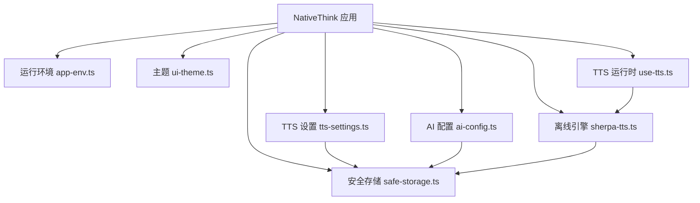
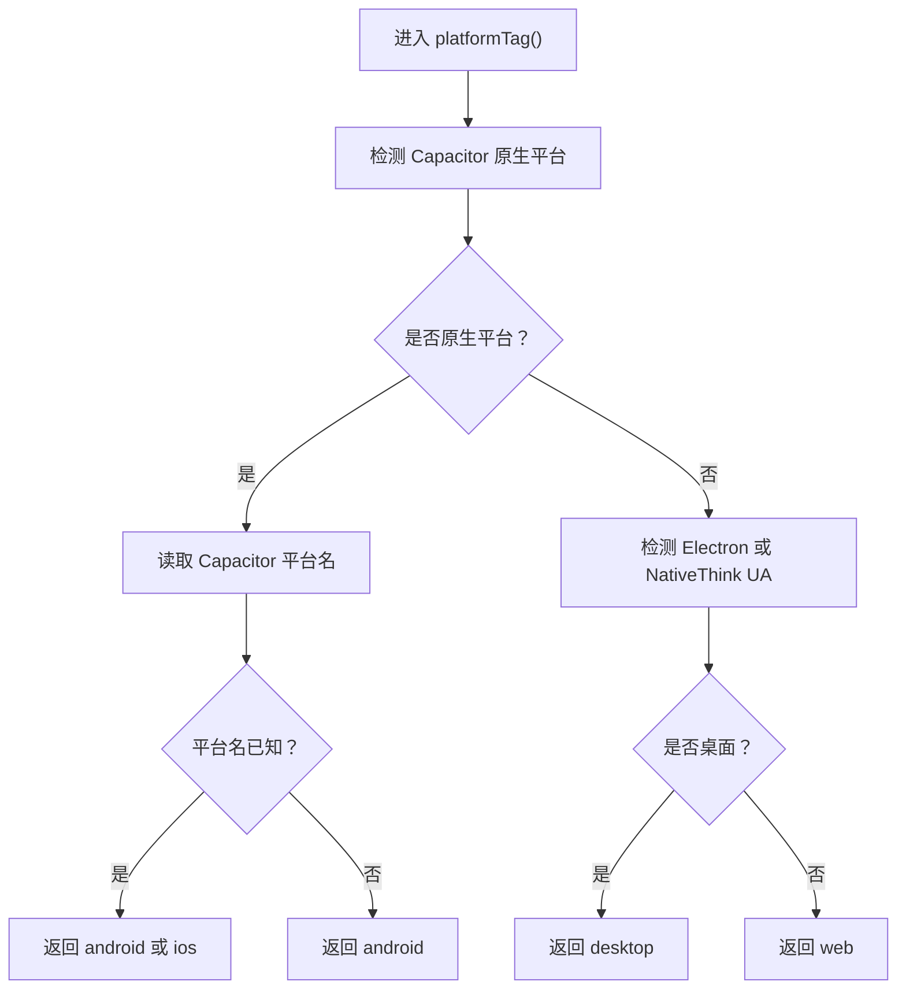
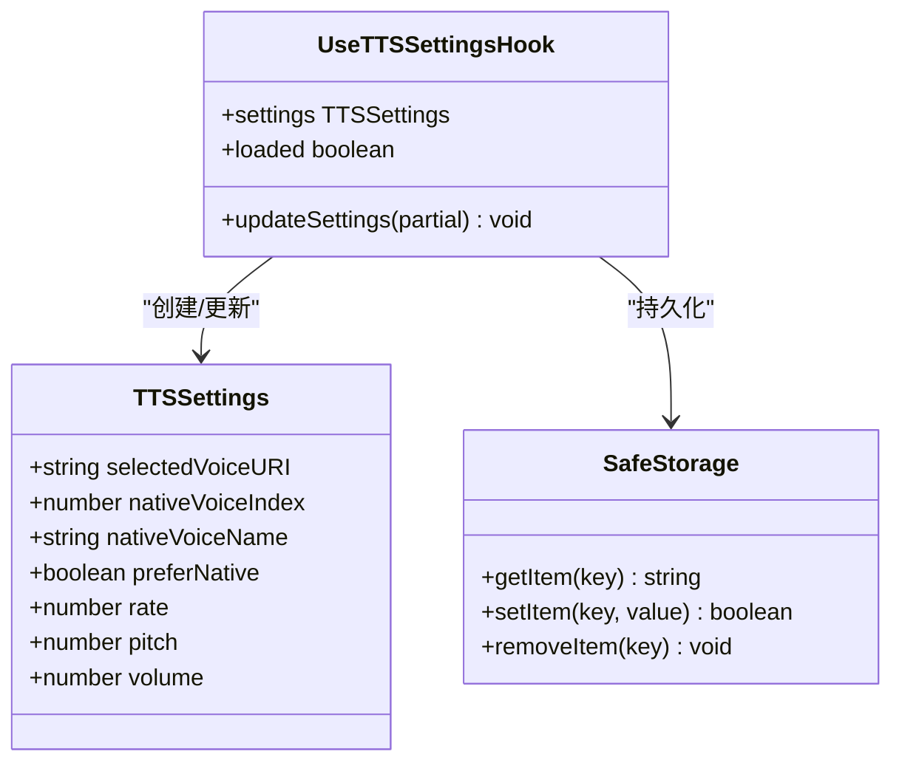
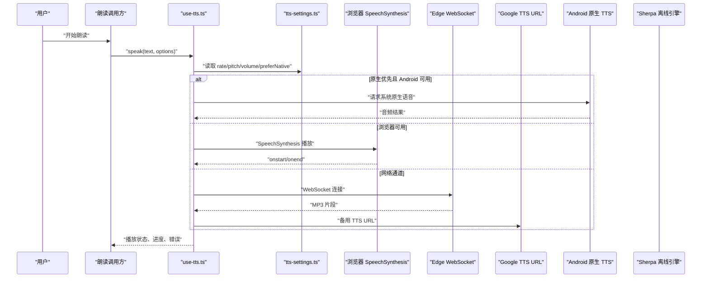
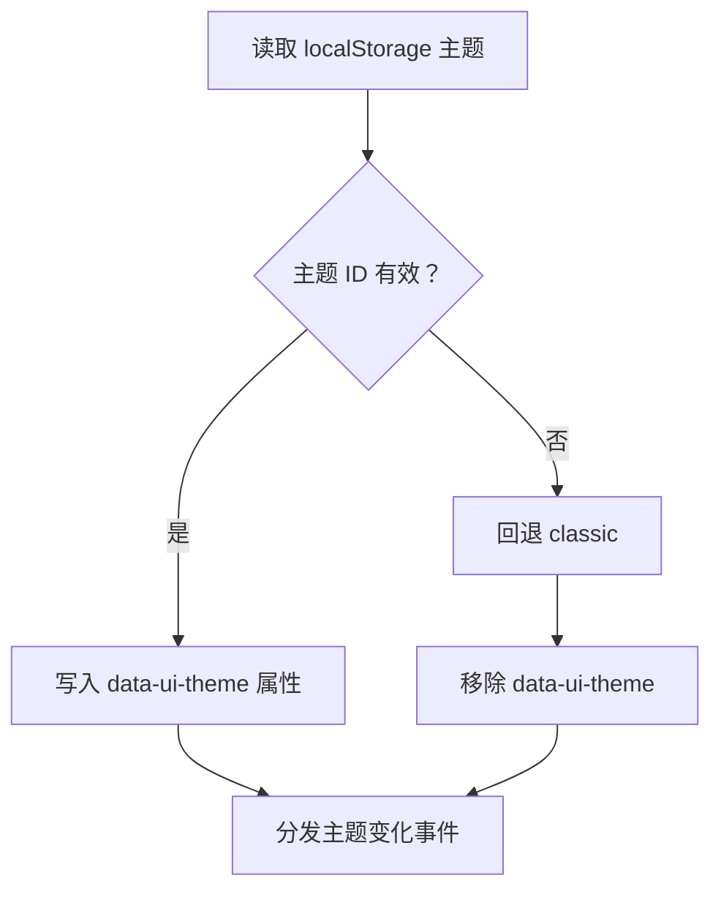
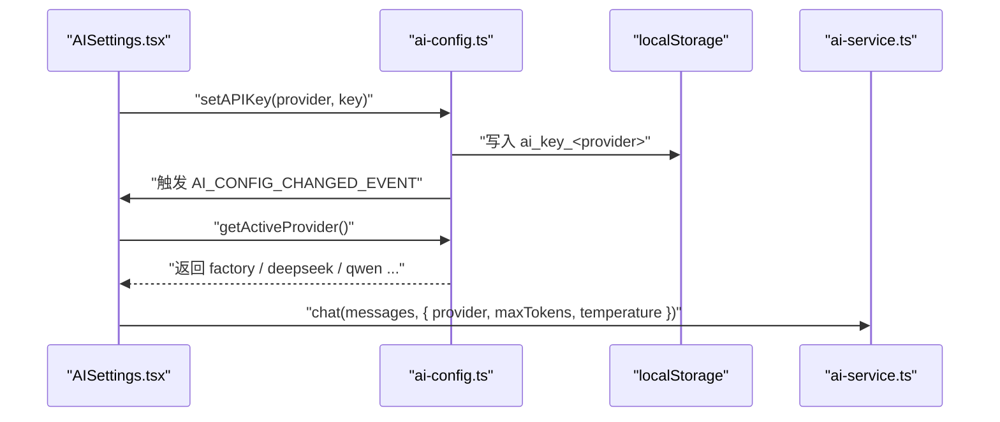
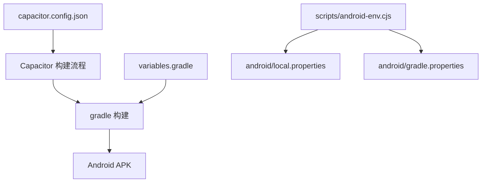
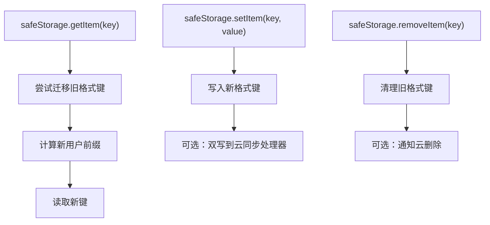
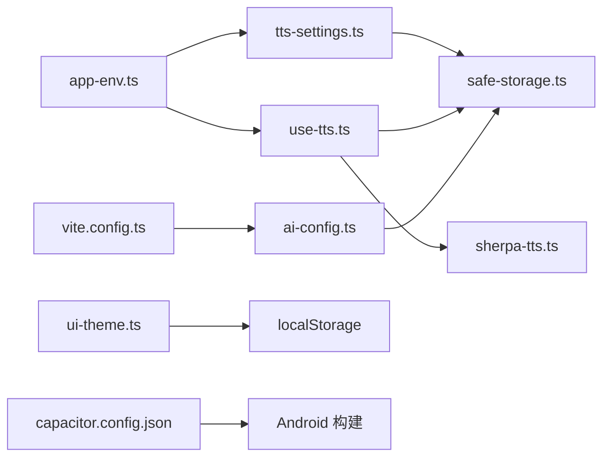

# 配置与定制化

<cite>
**本文引用的文件**   
- [app-env.ts](file://src/lib/app-env.ts)
- [tts-settings.ts](file://src/lib/tts-settings.ts)
- [use-tts.ts](file://src/lib/use-tts.ts)
- [sherpa-tts.ts](file://src/lib/sherpa-tts.ts)
- [ui-theme.ts](file://src/lib/ui-theme.ts)
- [ai-config.ts](file://src/services/ai-config.ts)
- [safe-storage.ts](file://src/lib/safe-storage.ts)
- [TTSSettings.tsx](file://src/components/TTSSettings.tsx)
- [AISettings.tsx](file://src/components/AISettings.tsx)
- [capacitor.config.json](file://capacitor.config.json)
- [variables.gradle](file://android/variables.gradle)
- [android-env.cjs](file://scripts/android-env.cjs)
- [package.json](file://package.json)
- [vite.config.ts](file://vite.config.ts)
</cite>

## 目录
1. [简介](#简介)
2. [项目结构与配置边界](#项目结构与配置边界)
3. [应用环境配置](#应用环境配置)
4. [文本转语音设置系统](#文本转语音设置系统)
5. [主题与界面定制](#主题与界面定制)
6. [AI 服务与多提供商配置](#ai-服务与多提供商配置)
7. [Capacitor 与 Android 原生配置](#capacitor-与-android-原生配置)
8. [环境变量、配置文件与默认值回退](#环境变量配置文件与默认值回退)
9. [常见定制化场景示例](#常见定制化场景示例)
10. [依赖关系与架构总览](#依赖关系与架构总览)
11. [性能与稳定性注意事项](#性能与稳定性注意事项)
12. [故障排查指南](#故障排查指南)
13. [结论](#结论)

## 简介
NativeThink 的配置体系围绕“可观察、可持久化、可迁移”的目标组织：用户偏好通过本地存储保存，平台差异由运行环境层处理，构建期常量通过打包工具注入。核心能力包括：

- 运行平台识别：区分 Android、iOS、桌面 Electron 与网页。
- TTS 个性化：引擎选择、音色排序、播放速率、音高、音量、系统原生优先模式。
- 主题系统：品牌色主题、数据属性驱动样式、跨组件同步事件。
- AI 提供商配置：内置免费 Key、多服务商注册信息、活跃提供商切换、密钥生命周期管理。
- Capacitor 与 Android 配置：应用标识、Web 目录、Android 最低版本、Gradle 依赖版本。
- 安全存储与键迁移：按应用和用户隔离的键前缀、匿名 ID 恢复、旧格式迁移。

## 项目结构与配置边界
配置相关代码主要分布在以下位置：

| 层次 | 文件 | 职责 |
|---|---|---|
| 运行环境 | `src/lib/app-env.ts` | 提供 `platformTag()`，统一判定 Capacitor、Electron、网页。 |
| TTS 设置 | `src/lib/tts-settings.ts` | 持久化音色、语速、音高、音量及原生优先开关。 |
| TTS 运行时 | `src/lib/use-tts.ts` | 多引擎编排：浏览器合成、Edge WebSocket、Google TTS、原生插件。 |
| 离线引擎 | `src/lib/sherpa-tts.ts` | Sherpa-onnx + Piper 模型加载、健康检查、缓存与降级。 |
| 主题 | `src/lib/ui-theme.ts` | 主题枚举、读取与应用、自定义事件分发。 |
| AI 配置 | `src/services/ai-config.ts` | 提供商清单、出厂 Key、活跃提供商、密钥读写与变更事件。 |
| 安全存储 | `src/lib/safe-storage.ts` | 带前缀的本地存储封装、匿名 ID、云同步钩子、旧键迁移。 |
| UI 设置页 | `src/components/TTSSettings.tsx`、`src/components/AISettings.tsx` | 用户交互入口。 |
| 原生壳 | `capacitor.config.json` | Capacitor 应用标识、名称、Web 目录、Android 行为。 |
| Android 构建 | `android/variables.gradle`、`scripts/android-env.cjs` | SDK 版本、Gradle Java 路径等环境初始化。 |
| 构建期 | `vite.config.ts`、`package.json` | 注入出厂 API Key、应用版本、开发代理与脚本命令。 |

**图表来源**
- [app-env.ts:1-29](file://src/lib/app-env.ts#L1-L29)
- [ui-theme.ts:1-84](file://src/lib/ui-theme.ts#L1-L84)
- [tts-settings.ts:1-140](file://src/lib/tts-settings.ts#L1-L140)
- [use-tts.ts:1-200](file://src/lib/use-tts.ts#L1-L200)
- [sherpa-tts.ts:1-200](file://src/lib/sherpa-tts.ts#L1-L200)
- [ai-config.ts:1-206](file://src/services/ai-config.ts#L1-L206)
- [safe-storage.ts:1-216](file://src/lib/safe-storage.ts#L1-L216)

**章节来源**
- [app-env.ts:1-29](file://src/lib/app-env.ts#L1-L29)
- [package.json:1-130](file://package.json#L1-L130)

## 应用环境配置
`app-env.ts` 是运行平台的单一来源。它通过 Capacitor 原生桥判断是否处于原生平台；若不可用，则回退到 `navigator.userAgent` 检测 Electron 或通用 Web。

关键行为：

| 条件 | 返回平台标签 |
|---|---|
| Capacitor 原生平台且平台名为 Android | `android` |
| Capacitor 原生平台且平台名为 iOS | `ios` |
| Capacitor 有原生桥但无法获取平台名 | `android`（按手机处理） |
| UA 包含 Electron 或 `NativeThink/` | `desktop` |
| 其他情况或异常捕获 | `web` |

扩展方法建议：

- 新增平台类型时，先在 `PlatformTag` 联合类型中声明，再在 `platformTag()` 分支中增加判定。
- 对于 WebView 内嵌场景，应优先使用 Capacitor 检测，因为某些 WebView 的 UA 可能模拟 Chrome。
- 如果未来需要区分 iPad 与 iPhone，可在 UA 层补充 `platformTag()` 的子函数，而不是直接修改返回值语义。

**图表来源**
- [app-env.ts:1-29](file://src/lib/app-env.ts#L1-L29)

**章节来源**
- [app-env.ts:1-29](file://src/lib/app-env.ts#L1-L29)

## 文本转语音设置系统
TTS 设置分为“用户偏好”和“运行时引擎”两层：

- 用户偏好保存在 `tts-settings.ts`，包括所选语音 URI、Android 原生语音索引、原生优先模式、语速、音高、音量。
- 运行时引擎由 `use-tts.ts` 编排，根据平台、网络、可用语音和性能选择浏览器合成、Edge WebSocket、Google TTS URL、原生插件或 Sherpa 离线引擎。
- 设置页 `TTSSettings.tsx` 聚合系统语音、本地服务器语音、原生语音、Sherpa 状态，并提供试听、自检和诊断功能。

### TTSSettings 数据结构

**图表来源**
- [tts-settings.ts:1-140](file://src/lib/tts-settings.ts#L1-L140)
- [safe-storage.ts:1-216](file://src/lib/safe-storage.ts#L1-L216)

### 音色选择与优先级
`getEnglishVoices()` 会过滤英文语音并按质量评分排序。评分规则优先考虑本地服务、知名厂商语音以及特定系统音色名称。`getBestVoice()` 优先匹配用户上次选择的 `voiceURI`，否则返回评分最高的英文语音。

### 播放参数限制
所有数值型参数在写入时都会被钳制：

| 参数 | 合法范围 |
|---|---|
| `rate` | 0.5 – 1.5 |
| `pitch` | 0.5 – 2.0 |
| `volume` | 0.0 – 1.0 |

### 云同步与热更新
TTS 设置通过 `useSyncDown` 监听云端下行事件；当另一台设备修改了设置后，当前设备会重新从本地存储加载最新值。`updateSettings` 是唯一写入点，避免 React effect 导致重复回写。

### 多引擎流程

**图表来源**
- [use-tts.ts:1-200](file://src/lib/use-tts.ts#L1-L200)
- [tts-settings.ts:1-140](file://src/lib/tts-settings.ts#L1-L140)

**章节来源**
- [tts-settings.ts:1-140](file://src/lib/tts-settings.ts#L1-L140)
- [use-tts.ts:1-200](file://src/lib/use-tts.ts#L1-L200)
- [TTSSettings.tsx:1-200](file://src/components/TTSSettings.tsx#L1-L200)

## 主题与界面定制
主题系统以 `UiThemeId` 为唯一标识，目前支持经典青绿、电蓝、石墨、青柠、暖沙、莓果六种方案。`classic` 不覆盖任何 token，表示“保持现有外观”，其余主题仅调整 shadcn 设计变量中的背景、卡片、描边、主色和品牌文字色。

核心机制：

- `readUiTheme()` 从本地存储读取已保存的主题，非法值回退到 `classic`。
- `applyUiTheme()` 将主题写入 `<html data-ui-theme>`；`classic` 会移除该属性。
- `initUiTheme()` 在应用挂载前执行，避免首帧闪回默认主题。
- `useUiTheme()` 提供 React 状态和设置函数，并通过 `nativethink:ui-theme-change` 自定义事件通知其他组件。

**图表来源**
- [ui-theme.ts:1-84](file://src/lib/ui-theme.ts#L1-L84)

**章节来源**
- [ui-theme.ts:1-84](file://src/lib/ui-theme.ts#L1-L84)

## AI 服务与多提供商配置
AI 配置集中在 `ai-config.ts`，支持多种 OpenAI 兼容的聊天补全提供商。系统同时支持“出厂内置免费 Key”和“用户自配 Key”。

### 提供商类型与配置
| 字段 | 含义 |
|---|---|
| `name` | 显示名称 |
| `description` | 简短描述 |
| `apiEndpoint` | 聊天补全接口地址 |
| `defaultModel` | 默认模型 |
| `freeModel` | 免费模型 |
| `registerUrl` | 注册链接 |
| `supportsStreaming` | 是否支持流式响应 |

支持的提供商包括 `factory`、`deepseek`、`doubao`、`qwen`、`glm`、`siliconflow`、`moonshot`、`groq`。

### 出厂 Key 与活跃提供商
- `__FACTORY_API_KEY__` 由 `vite.config.ts` 从 `scripts/.apikey` 注入。
- `FACTORY_PROVIDER` 指定出厂 Key 归属的默认提供商。
- `getAPIKey(provider)` 对 `factory` 始终返回内置 Key；对用户自有提供商，先从 `localStorage` 读取，再按默认提供商回退。
- `getActiveProvider()` 默认返回 `factory`；老版本中未配置 GLM Key 的 `glm` 会被迁移到 `factory`。

### 密钥管理与变更事件
- `setAPIKey` / `clearAPIKey` 会更新 `localStorage` 并触发 `nativethink-ai-config-changed` 事件。
- `getConfiguredProviders()` 返回所有已配置 API Key 的提供商列表。
- `AISettings.tsx` 负责输入、隐藏/显示、测试连接、清除和切换活跃提供商。

**图表来源**
- [ai-config.ts:1-206](file://src/services/ai-config.ts#L1-L206)
- [AISettings.tsx:1-200](file://src/components/AISettings.tsx#L1-L200)

**章节来源**
- [ai-config.ts:1-206](file://src/services/ai-config.ts#L1-L206)
- [AISettings.tsx:1-200](file://src/components/AISettings.tsx#L1-L200)
- [vite.config.ts:1-200](file://vite.config.ts#L1-L200)

## Capacitor 与 Android 原生配置
Capacitor 配置位于 `capacitor.config.json`，定义应用 ID、应用名称、Web 输出目录、Android 行为和服务协议。

| 配置项 | 含义 |
|---|---|
| `appId` | Android 应用包名 |
| `appName` | 应用显示名称 |
| `webDir` | 前端构建产物目录 |
| `android.allowMixedContent` | 是否允许混合内容 |
| `server.androidScheme` | Android 服务器协议 |

Android 构建环境由 `android/variables.gradle` 控制，包括最低 SDK、编译 SDK、目标 SDK 以及 AndroidX、Cordova、JUnit 等依赖版本。`scripts/android-env.cjs` 会在构建前尝试生成 `android/local.properties`，并在缺少 Gradle Java 配置时追加 JDK 路径与 JVM 内存参数。

**图表来源**
- [capacitor.config.json:1-11](file://capacitor.config.json#L1-L11)
- [variables.gradle:1-16](file://android/variables.gradle#L1-L16)
- [android-env.cjs:1-12](file://scripts/android-env.cjs#L1-L12)

**章节来源**
- [capacitor.config.json:1-11](file://capacitor.config.json#L1-L11)
- [variables.gradle:1-16](file://android/variables.gradle#L1-L16)
- [android-env.cjs:1-12](file://scripts/android-env.cjs#L1-L12)

## 环境变量、配置文件与默认值回退
本项目存在三类配置来源：

| 类别 | 来源 | 说明 |
|---|---|---|
| 构建期常量 | `vite.config.ts` | 注入 `CLIENT_BASE_PATH`、`__FACTORY_API_KEY__`，读取 `android/version.properties` 获取版本号。 |
| 运行期本地配置 | `localStorage`、`safeStorage` | 保存 AI Key、活跃提供商、TTS 设置、主题、用户隔离数据。 |
| 原生构建配置 | `capacitor.config.json`、`variables.gradle`、`local.properties`、`gradle.properties` | 决定 Android 应用标识、SDK 版本、JDK 路径。 |

### 默认值回退机制
| 配置 | 默认值或回退策略 |
|---|---|
| TTS 设置 | 缺失或解析失败时回退 `DEFAULTS`，数值参数被钳制。 |
| 主题 | 非预期值回退 `classic`。 |
| 活跃 AI 提供商 | 未配置或无效值回退 `factory`。 |
| GLM 提供商迁移 | 老默认值 `glm` 且无用户 Key 时迁移到 `factory`。 |
| 出厂 API Key | `scripts/.apikey` 不存在时为空字符串，运行时仍可正常启动。 |
| 应用版本 | 读不到 `android/version.properties` 时抛出构建错误；非 Android 工程也要求版本链完整。 |

### 安全存储与键迁移
`safeStorage.ts` 提供按应用和用户隔离的键前缀，并在首次访问时尝试把旧格式键迁移到新格式。它还暴露匿名 ID 恢复逻辑：如果引导键丢失，但历史键仍存在，则从既有键名中提取匿名 ID，避免“数据看似丢失”。

**图表来源**
- [safe-storage.ts:1-216](file://src/lib/safe-storage.ts#L1-L216)

**章节来源**
- [vite.config.ts:1-200](file://vite.config.ts#L1-L200)
- [tts-settings.ts:1-140](file://src/lib/tts-settings.ts#L1-L140)
- [ui-theme.ts:1-84](file://src/lib/ui-theme.ts#L1-L84)
- [ai-config.ts:1-206](file://src/services/ai-config.ts#L1-L206)
- [safe-storage.ts:1-216](file://src/lib/safe-storage.ts#L1-L216)

## 常见定制化场景示例

### 品牌定制
- 修改应用名称和包名：编辑 `capacitor.config.json` 中的 `appName` 与 `appId`。
- 修改应用标题、描述和图标引用：由 `vite.config.ts` 中的 HTML 占位替换逻辑控制，部署模板通常由上层平台注入。
- 调整主题：在 `ui-theme.ts` 中添加新的 `UiThemeId`，并在 `UI_THEMES` 数组中注册名称、描述和预览色板。

### 功能开关
- 禁用内置离线朗读引擎：Sherpa 引擎崩溃时会自动标记停用，可通过 `reenableBundledEngine()` 手动恢复。
- 关闭提示音效：设置页使用 `isSfxEnabled` 和 `setSfxEnabled` 控制反馈音效。
- 启用原生优先朗读：在 TTS 设置中打开 `preferNative`，使系统原生引擎成为首选。

### 性能调优
- 预热离线引擎：在进入阅读或学习页前调用 `warmSherpa()`，减少首次朗读延迟。
- 预合成下一段：使用 `sherpaPrewarm()` 提前准备后续文本，降低滚动停顿。
- 合并重复请求：Sherpa 引擎内部对相同音色、文本、语速的请求进行去重，避免原生串行队列堆积。
- 调整构建产物：`vite.config.ts` 中已配置 dev server 忽略大型模型目录，防止开发服务器因 EBUSY 崩溃。

### 多提供商切换
- 添加自有提供商：在 `ALL_PROVIDERS` 中新增类型，并在 `PROVIDER_CONFIGS` 中填写端点、默认模型、免费模型和注册链接。
- 切换活跃提供商：调用 `setActiveProvider()`，或使用 AISettings 对话框完成 UI 操作。
- 测试连接：AISettings 会发送一条最小消息验证连通性，成功或失败均会更新 UI 状态。

**章节来源**
- [capacitor.config.json:1-11](file://capacitor.config.json#L1-L11)
- [vite.config.ts:1-200](file://vite.config.ts#L1-L200)
- [ui-theme.ts:1-84](file://src/lib/ui-theme.ts#L1-L84)
- [sherpa-tts.ts:1-278](file://src/lib/sherpa-tts.ts#L1-L278)
- [ai-config.ts:1-206](file://src/services/ai-config.ts#L1-L206)
- [AISettings.tsx:1-200](file://src/components/AISettings.tsx#L1-L200)

## 依赖关系与架构总览
下图展示配置模块之间的依赖关系：

**图表来源**
- [app-env.ts:1-29](file://src/lib/app-env.ts#L1-L29)
- [tts-settings.ts:1-140](file://src/lib/tts-settings.ts#L1-L140)
- [use-tts.ts:1-200](file://src/lib/use-tts.ts#L1-L200)
- [sherpa-tts.ts:1-278](file://src/lib/sherpa-tts.ts#L1-L278)
- [ui-theme.ts:1-84](file://src/lib/ui-theme.ts#L1-L84)
- [ai-config.ts:1-206](file://src/services/ai-config.ts#L1-L206)
- [safe-storage.ts:1-216](file://src/lib/safe-storage.ts#L1-L216)
- [capacitor.config.json:1-11](file://capacitor.config.json#L1-L11)
- [vite.config.ts:1-200](file://vite.config.ts#L1-L200)

## 性能与稳定性注意事项
- TTS 起播延迟：浏览器合成最快，但移动端可能受限于系统语音；Edge WebSocket 有 1.5 秒连接超时保护，避免长时间卡住。
- 原生引擎健壮性：Sherpa 引擎通过“加载前打标记、成功才清除”的方式检测上一次是否异常退出，异常时自动停用并由用户手动恢复。
- 并发合成保护：Sherpa 引擎对相同请求去重，避免原生线程数耗尽导致进程闪退。
- 存储失败防护：`safeStorage.setItem` 返回布尔值，明确区分“写入成功”和“静默失败”，避免 UI 误判。
- 构建稳定性：Vite dev server 忽略 `android/`、`models-bundled/` 等目录，防止大文件监听导致开发服务器崩溃。

[本节为通用指导，不直接分析具体代码行]

## 故障排查指南

| 问题 | 排查方向 | 对应实现 |
|---|---|---|
| 主题刷新闪烁 | 确认是否在应用挂载前调用 `initUiTheme()` | [ui-theme.ts:1-84](file://src/lib/ui-theme.ts#L1-L84) |
| TTS 设置刷新后丢失 | 检查 `safeStorage` 是否可写、配额是否已满 | [tts-settings.ts:1-140](file://src/lib/tts-settings.ts#L1-L140) |
| Android 上无系统语音列表 | 查看原生语音列表加载与 `nativeVoiceIndex` 配置 | [TTSSettings.tsx:1-200](file://src/components/TTSSettings.tsx#L1-L200) |
| Sherpa 引擎反复崩溃 | 查看健康检查标志、重建日志、是否被护栏停用 | [sherpa-tts.ts:1-278](file://src/lib/sherpa-tts.ts#L1-L278) |
| AI 提供商连接失败 | 检查 API Key 是否保存、活跃提供商是否正确、测试结果状态 | [ai-config.ts:1-206](file://src/services/ai-config.ts#L1-L206)、[AISettings.tsx:1-200](file://src/components/AISettings.tsx#L1-L200) |
| 构建时报版本缺失 | 检查 `android/version.properties` 是否存在且含 `versionName` | [vite.config.ts:1-200](file://vite.config.ts#L1-L200) |
| Android 构建找不到 SDK | 检查 `scripts/android-env.cjs` 生成的 `local.properties` | [android-env.cjs:1-12](file://scripts/android-env.cjs#L1-L12) |

**章节来源**
- [ui-theme.ts:1-84](file://src/lib/ui-theme.ts#L1-L84)
- [tts-settings.ts:1-140](file://src/lib/tts-settings.ts#L1-L140)
- [TTSSettings.tsx:1-200](file://src/components/TTSSettings.tsx#L1-L200)
- [sherpa-tts.ts:1-278](file://src/lib/sherpa-tts.ts#L1-L278)
- [ai-config.ts:1-206](file://src/services/ai-config.ts#L1-L206)
- [AISettings.tsx:1-200](file://src/components/AISettings.tsx#L1-L200)
- [vite.config.ts:1-200](file://vite.config.ts#L1-L200)
- [android-env.cjs:1-12](file://scripts/android-env.cjs#L1-L12)

## 结论
NativeThink 的配置系统以清晰的分层组织：运行环境层屏蔽平台差异，TTS 与主题提供用户级个性化，AI 配置管理多提供商密钥与活跃选择，Capacitor 与 Android 配置负责原生构建属性。持久化层通过 `safeStorage` 实现用户隔离与旧键迁移，构建层通过 Vite 注入出厂 Key 和应用版本。对于二次定制，推荐优先修改配置对象和枚举，而不是直接侵入业务逻辑；对于高风险原生能力，应保留健康检查和降级路径，确保用户在配置错误或环境问题下仍能获得可用体验。