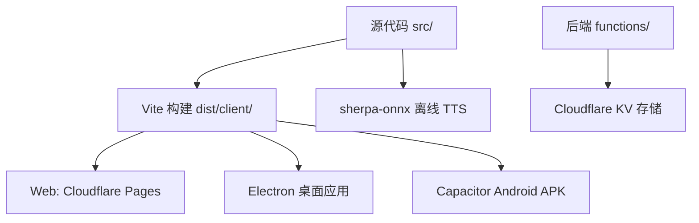
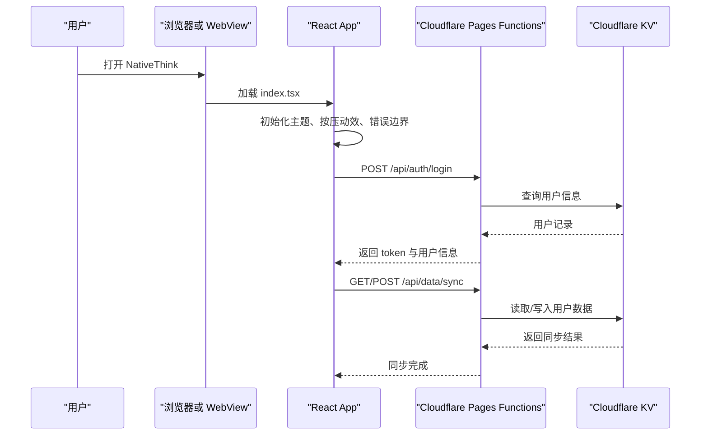
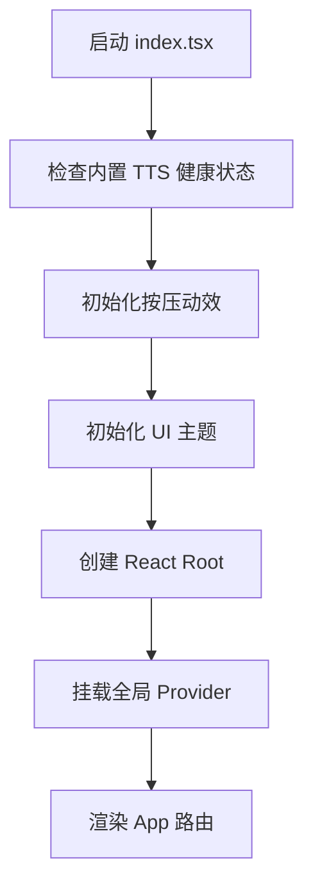
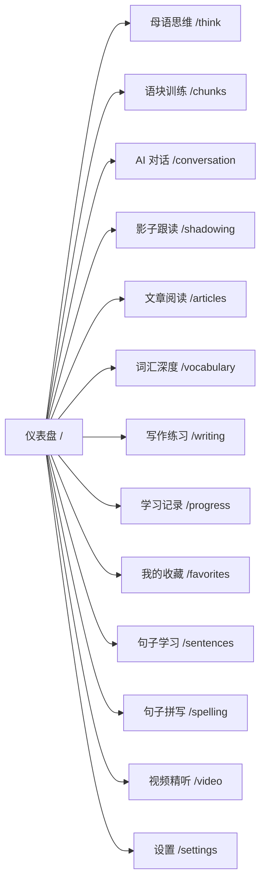
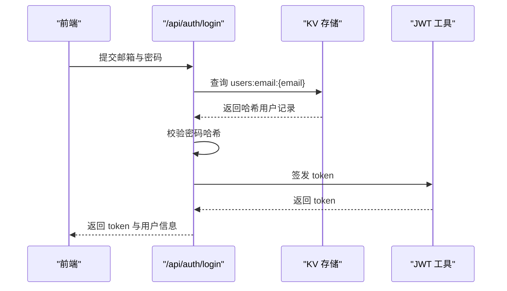
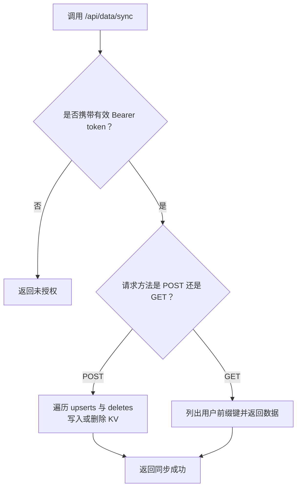
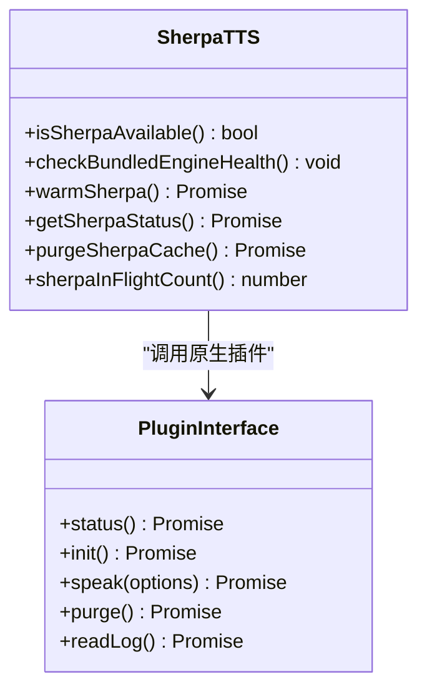
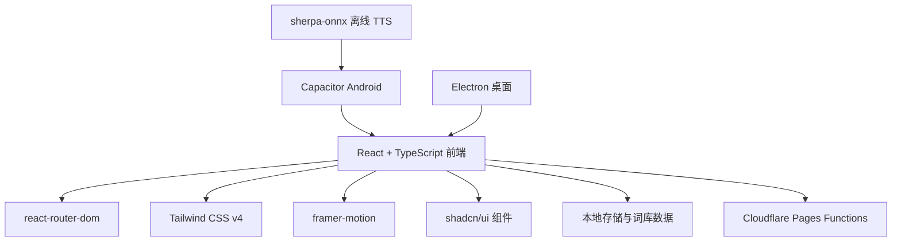
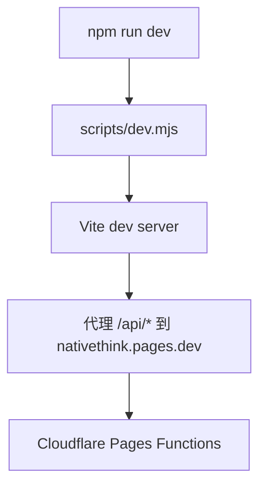
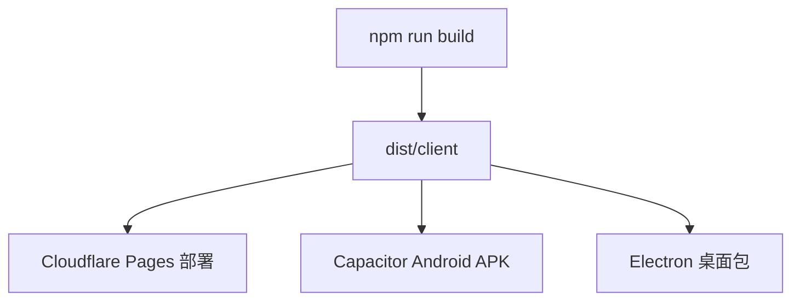

# 项目概览与快速开始

<cite>
**本文引用的文件**   
- [README.md](file://README.md)
- [package.json](file://package.json)
- [vite.config.ts](file://vite.config.ts)
- [capacitor.config.json](file://capacitor.config.json)
- [wrangler.toml](file://wrangler.toml)
- [src/index.tsx](file://src/index.tsx)
- [src/app.tsx](file://src/app.tsx)
- [scripts/dev.mjs](file://scripts/dev.mjs)
- [scripts/build.sh](file://scripts/build.sh)
- [functions/_lib/auth.js](file://functions/_lib/auth.js)
- [functions/api/auth/login.js](file://functions/api/auth/login.js)
- [functions/api/data/sync.js](file://functions/api/data/sync.js)
- [src/lib/sherpa-tts.ts](file://src/lib/sherpa-tts.ts)
- [src/pages/DashboardPage/DashboardPage.tsx](file://src/pages/DashboardPage/DashboardPage.tsx)
- [src/components/Layout.tsx](file://src/components/Layout.tsx)
</cite>

## 目录
1. [引言](#引言)
2. [项目结构](#项目结构)
3. [核心组件](#核心组件)
4. [架构总览](#架构总览)
5. [详细组件分析](#详细组件分析)
6. [依赖关系分析](#依赖关系分析)
7. [性能考量](#性能考量)
8. [故障排查指南](#故障排查指南)
9. [结论](#结论)
10. [附录：开发与部署清单](#附录开发与部署清单)

## 引言
NativeThink 是一个面向中文母语者的英语思维训练应用。它的核心目标是帮助用户通过“母语思维路径”建立英语能力，而不是机械地中译英；围绕这一目标，项目提供仪表盘、母语思维训练、语块训练、AI 对话、影子跟读、文章阅读、词汇深度、写作练习、句子学习、拼写、视频精听等模块，并通过统一的侧边栏和移动端底部导航组织入口。

从技术定位看，它是一个全栈多形态前端工程：
- Web：由 Vite 构建，部署到 Cloudflare Pages。
- Electron 桌面：复用同一套 Web 产物。
- Android 移动应用：通过 Capacitor 将 `dist/client` 嵌入原生 WebView。

后端采用 Cloudflare Pages Functions，配合 KV 存储用户认证与会话数据；离线语音合成使用 sherpa-onnx + Piper 音色，在安卓端实现低延迟、离线的 TTS。

## 项目结构
仓库根目录的核心布局如下：
- `src/`：React 19 + TypeScript 前端源码，按 pages / components / lib / hooks / data 分层组织。
- `functions/`：Cloudflare Pages Functions 后端代码，包含认证、同步、AI 代理、TTS、维基、B站等接口。
- `electron/`：Electron 主进程入口。
- `android/`：Capacitor 生成的 Android 工程。
- `scripts/`：开发启动、打包、数据生成、版本管理、验证脚本。
- `public/`、`shared/`：静态资源与跨平台共享数据。
- `vite.config.ts`、`wrangler.toml`、`capacitor.config.json`：三形态构建与运行配置。
- `package.json`：统一脚本入口，暴露 web / apk / desktop / verify 系列命令。

**图示来源**
- [vite.config.ts:1-200](file://vite.config.ts#L1-L200)
- [capacitor.config.json:1-11](file://capacitor.config.json#L1-L11)
- [wrangler.toml:1-9](file://wrangler.toml#L1-L9)
- [package.json:1-130](file://package.json#L1-L130)

**章节来源**
- [README.md:1-111](file://README.md#L1-L111)
- [package.json:1-130](file://package.json#L1-L130)

## 核心组件
- 前端运行时入口：`src/index.tsx` 负责创建 React Root、挂载全局错误边界、主题初始化、按压动效、Toast、聚焦模式、认证与云同步上下文，并渲染 `App`。
- 路由与页面注册：`src/app.tsx` 使用 react-router-dom 的 `<Routes>` 注册仪表盘、母语思维、语块、对话、跟读、阅读、词汇、写作、进度、收藏、句子、拼写、视频、设置等页面，并对每个页面包裹错误边界。
- 布局容器：`src/components/Layout.tsx` 提供侧边栏、头部、移动端底部导航、安全区域适配、模块强调色、页面滚动重置与错误兜底。
- 仪表盘：`src/pages/DashboardPage/DashboardPage.tsx` 聚合学习统计、日历、每日一句、模块进度、复习提醒等卡片，是用户首次进入后的主入口。
- 后端中间件：`functions/_lib/auth.js` 解析 Authorization 头并校验 JWT。
- 认证接口：`functions/api/auth/login.js` 处理邮箱密码登录、KV 用户查询、JWT 签发与 CORS 预检。
- 数据同步接口：`functions/api/data/sync.js` 提供基于用户会话的批量上传与下载。
- 离线朗读引擎：`src/lib/sherpa-tts.ts` 封装 sherpa-onnx 插件状态、预热、健康检查、请求去重与结果缓存。

**章节来源**
- [src/index.tsx:1-123](file://src/index.tsx#L1-L123)
- [src/app.tsx:1-66](file://src/app.tsx#L1-L66)
- [src/components/Layout.tsx:1-155](file://src/components/Layout.tsx#L1-L155)
- [src/pages/DashboardPage/DashboardPage.tsx:1-200](file://src/pages/DashboardPage/DashboardPage.tsx#L1-L200)
- [functions/_lib/auth.js:1-8](file://functions/_lib/auth.js#L1-L8)
- [functions/api/auth/login.js:1-49](file://functions/api/auth/login.js#L1-L49)
- [functions/api/data/sync.js:1-63](file://functions/api/data/sync.js#L1-L63)
- [src/lib/sherpa-tts.ts:1-200](file://src/lib/sherpa-tts.ts#L1-L200)

## 架构总览
NativeThink 的前端以 React Router 驱动页面切换，所有业务页面被 `Layout` 包裹；认证状态由 `AuthProvider` 提供，云同步由 `CloudSyncProvider` 管理。本地数据主要落在 IndexedDB 与 localStorage，必要时通过 `/api/data/sync` 与 Cloudflare KV 同步。

**图示来源**
- [src/index.tsx:1-123](file://src/index.tsx#L1-L123)
- [src/app.tsx:1-66](file://src/app.tsx#L1-L66)
- [functions/api/auth/login.js:1-49](file://functions/api/auth/login.js#L1-L49)
- [functions/api/data/sync.js:1-63](file://functions/api/data/sync.js#L1-L63)

## 详细组件分析

### 前端入口与全局初始化
`src/index.tsx` 是整个应用的唯一入口。它先执行内置 TTS 健康检查、全站按压动效初始化与主题初始化，再创建 React Root，最后按以下顺序挂载 Provider：
1. Toast 出口。
2. 平台外壳（仅在 Lark miaoda 环境动态加载）。
3. 奖励动画层。
4. 专注模式上下文。
5. 认证上下文。
6. 云同步上下文。
7. 全局错误边界。
8. `App` 路由容器。

该文件还定义了全局错误回退界面，用于避免页面级错误直接白屏。

**图示来源**
- [src/index.tsx:1-123](file://src/index.tsx#L1-L123)

**章节来源**
- [src/index.tsx:1-123](file://src/index.tsx#L1-L123)

### 路由与页面体系
`src/app.tsx` 集中声明所有页面路由。首页默认指向仪表盘；其余模块包括：
- 母语思维训练：`/think`
- 语块训练：`/chunks`
- AI 对话：`/conversation`
- 影子跟读：`/shadowing`
- 文章阅读：`/articles`
- 词汇深度：`/vocabulary`
- 写作练习：`/writing`
- 学习记录：`/progress`
- 我的收藏：`/favorites`
- 句子学习：`/sentences`
- 句子拼写：`/spelling`
- 视频精听：`/video`
- 设置：`/settings`

每个页面都包裹了独立错误边界，页面加载失败时显示可刷新重试的错误提示。

**图示来源**
- [src/app.tsx:1-66](file://src/app.tsx#L1-L66)

**章节来源**
- [src/app.tsx:1-66](file://src/app.tsx#L1-L66)

### 布局与导航
`src/components/Layout.tsx` 承担三大职责：
1. 提供 SidebarProvider、头部、移动端底部导航。
2. 根据当前路径设置模块强调色，让不同学习模块有轻微视觉区分。
3. 处理页面滚动复位、最近访问记忆、Android 系统英文语音包安装引导。

布局还包含一个类组件错误边界，用于捕获子树渲染异常并提供刷新按钮。

**章节来源**
- [src/components/Layout.tsx:1-155](file://src/components/Layout.tsx#L1-L155)

### 仪表盘与首次使用流程
仪表盘是用户第一次打开应用后看到的主界面。它聚合：
- 学习统计数据。
- 历史日历。
- 每日一句。
- 模块进度卡片。
- 复习待办卡片。
- 纠偏本待复习条目。
- 快速开始网格，引导进入各学习模块。

首次使用建议流程：
1. 打开应用后停留在仪表盘，查看本周学习与复习提醒。
2. 点击“母语思维训练”进入 `/think`，完成模式诊断与概览。
3. 根据需要进入“语块训练”“词汇深度”“句子学习”“影子跟读”“视频精听”。
4. 若需要云端同步，先完成登录；否则应用仍可离线使用大部分功能。
5. 在 Android 上，如果系统缺少英文语音包，布局会弹出安装引导，以获得更低延迟的朗读体验。

**章节来源**
- [src/pages/DashboardPage/DashboardPage.tsx:1-200](file://src/pages/DashboardPage/DashboardPage.tsx#L1-L200)
- [src/components/Layout.tsx:1-155](file://src/components/Layout.tsx#L1-L155)

### 后端认证与数据同步
后端基于 Cloudflare Pages Functions，关键流程如下：

#### 登录流程

**图示来源**
- [functions/api/auth/login.js:1-49](file://functions/api/auth/login.js#L1-L49)
- [functions/_lib/auth.js:1-8](file://functions/_lib/auth.js#L1-L8)

#### 数据同步流程

**图示来源**
- [functions/api/data/sync.js:1-63](file://functions/api/data/sync.js#L1-L63)
- [functions/_lib/auth.js:1-8](file://functions/_lib/auth.js#L1-L8)

**章节来源**
- [functions/_lib/auth.js:1-8](file://functions/_lib/auth.js#L1-L8)
- [functions/api/auth/login.js:1-49](file://functions/api/auth/login.js#L1-L49)
- [functions/api/data/sync.js:1-63](file://functions/api/data/sync.js#L1-L63)

### 离线 TTS 与 sherpa-onnx
`src/lib/sherpa-tts.ts` 为 Android 应用提供离线朗读能力。其设计要点包括：
- 只在 Android 原生环境下启用。
- 启动时检测上次是否崩溃，如崩溃则自动停用内置引擎，避免反复闪退。
- 支持模型预热，减少首次朗读延迟。
- 对相同音色、文本、语速的合成请求进行去重，防止原生串行队列堆积导致内存问题。
- 维护 URL 缓存，避免重复合成。
- 提供状态查询、日志读取、缓存清理等诊断能力。

**图示来源**
- [src/lib/sherpa-tts.ts:1-200](file://src/lib/sherpa-tts.ts#L1-L200)

**章节来源**
- [src/lib/sherpa-tts.ts:1-200](file://src/lib/sherpa-tts.ts#L1-L200)

## 依赖关系分析
项目依赖可分为四类：
- 运行时前端依赖：React 19、react-router-dom、tailwindcss、framer-motion、sonner、recharts 等。
- 原生与移动端依赖：@capacitor/core、@capacitor/android、@capacitor-community/text-to-speech。
- 推理与离线能力：onnxruntime-node、@huggingface/transformers、sherpa-onnx 相关逻辑。
- 构建与打包依赖：vite、typescript、electron、electron-packager。

**图示来源**
- [package.json:1-130](file://package.json#L1-L130)
- [vite.config.ts:1-200](file://vite.config.ts#L1-L200)
- [capacitor.config.json:1-11](file://capacitor.config.json#L1-L11)

**章节来源**
- [package.json:1-130](file://package.json#L1-L130)
- [vite.config.ts:1-200](file://vite.config.ts#L1-L200)

## 性能考量
- 首屏优化：Vite 配置中对 React 与 React Router 拆分为 vendor chunk，并使用手动分包策略；仪表盘中的每日句语文本数据采用懒加载，避免主包膨胀。
- 并发控制：sherpa-onnx 合成请求通过 Map 去重，防止原生线程堆积导致崩溃。
- 构建期警告：版本链断裂时会拒绝构建，确保发布产物与 Android 版本号一致。
- 开发服务器保护：忽略 android、release、dist、models-bundled、logs 等目录，避免大体积模型监听引发 EBUSY。
- 资源隔离：开发服务器开启 Cross-Origin-Opener-Policy 与 Cross-Origin-Embedder-Policy，有利于多线程 WASM 推理。

[本节为通用性能说明，不直接分析具体代码行]

## 故障排查指南
常见问题与定位方式：
- 页面白屏或加载出错：
  - 检查全局错误边界是否触发，`src/index.tsx` 提供全局错误回退界面。
  - 页面级错误边界会显示对应页面名称，例如“母语思维训练页面出错”。
- 登录后仍无法同步：
  - 检查后端是否配置 KV 命名空间；`functions/api/auth/login.js` 在未配置 KV 时返回明确错误。
  - 确认 Authorization 头是否为 `Bearer <token>`。
- 安卓端朗读失败或闪退：
  - 内置 TTS 健康检查会自动停用上一次崩溃过的引擎；可在设置页重新启用。
  - 使用 `getSherpaInitLog()` 获取原生初始化日志，定位模型加载阶段问题。
- 开发服务器频繁退出：
  - 确认没有误监听到 `android/`、`release/`、`models-bundled/` 等大目录。
  - 检查端口占用脚本是否成功清理旧进程。

**章节来源**
- [src/index.tsx:1-123](file://src/index.tsx#L1-L123)
- [src/app.tsx:1-66](file://src/app.tsx#L1-L66)
- [functions/api/auth/login.js:1-49](file://functions/api/auth/login.js#L1-L49)
- [src/lib/sherpa-tts.ts:1-200](file://src/lib/sherpa-tts.ts#L1-L200)
- [vite.config.ts:1-200](file://vite.config.ts#L1-L200)

## 结论
NativeThink 以“母语思维路径”为核心教学理念，用 React 19 + TypeScript + Tailwind CSS v4 构建出可运行于 Web、Electron 与 Android 的多形态前端，并通过 Cloudflare Pages Functions 提供轻量后端能力。sherpa-onnx 的加入使安卓端具备离线、低延迟朗读能力，显著改善语音学习体验。整体架构清晰：前端负责学习交互，后端负责认证与数据同步，本地存储负责离线可用性与隐私数据。

对于初学者，可从仪表盘入手，逐步体验各个学习模块；对于开发者，可从 `scripts/dev.mjs`、`vite.config.ts`、`package.json` 和 `functions/` 入手理解构建、路由、前后端交互与部署差异。

[本节为总结性内容，不直接分析具体文件]

## 附录：开发与部署清单

### 环境与版本要求
- Node.js：建议使用现代 LTS 版本，能够运行 Node ESM 与 npm scripts。
- npm：用于安装依赖、运行开发服务器与构建产物。
- Android 调试：需要 Android SDK、Gradle 与模拟器或真机；Capacitor 已集成在工程中。
- Electron 调试：Windows/macOS/Linux 均可运行，需 Node 环境。

**章节来源**
- [package.json:1-130](file://package.json#L1-L130)

### 安装依赖
在项目根目录执行依赖安装命令，完成后即可使用 scripts 中定义的各类命令。

**章节来源**
- [package.json:1-130](file://package.json#L1-L130)

### 本地开发服务器
- 启动开发服务器：执行项目脚本中的 dev 命令。
- 开发脚本会启动 Vite dev server，并将输出写到 `logs/client.std.log`。
- 开发模式下，`/api/*` 请求会通过 Vite proxy 转发到线上 Cloudflare Pages 地址，便于联调后端。

**图示来源**
- [scripts/dev.mjs:1-130](file://scripts/dev.mjs#L1-L130)
- [vite.config.ts:1-200](file://vite.config.ts#L1-L200)

**章节来源**
- [scripts/dev.mjs:1-130](file://scripts/dev.mjs#L1-L130)
- [vite.config.ts:1-200](file://vite.config.ts#L1-L200)

### Android 模拟器调试
- 打包 Web 产物：执行 package 命令生成 Web 构建。
- 复制至 Capacitor 工程：Capacitor copy 会把 `dist/client` 复制到 Android 工程。
- 拷贝离线模型：脚本会将 sherpa-onnx 所需模型复制到 Android 工程。
- 构建 debug APK：通过 Gradle 构建，并在模拟器或真机上安装测试。

**章节来源**
- [package.json:1-130](file://package.json#L1-L130)
- [capacitor.config.json:1-11](file://capacitor.config.json#L1-L11)

### Electron 桌面应用运行
- 运行桌面应用：执行 app:start 命令，Electron 会加载当前目录作为应用入口。
- 打包桌面应用：执行 app:build 或 package:desktop，复用 Web 构建产物。

**章节来源**
- [package.json:1-130](file://package.json#L1-L130)

### 三形态部署方式与差异
- Web 部署：
  - 使用 build 脚本构建到 `dist/client`。
  - 将 `dist/client` 部署到 Cloudflare Pages。
  - `wrangler.toml` 指定 Pages 构建输出目录与 KV 命名空间绑定。
- Android 部署：
  - 通过 Capacitor 将 `dist/client` 作为 WebView 内容。
  - 通过 Gradle 构建 APK，可分发到模拟器或真机。
- Electron 部署：
  - 复用 Web 构建产物，使用 electron-packager 打包桌面安装包。

**图示来源**
- [scripts/build.sh:1-69](file://scripts/build.sh#L1-L69)
- [wrangler.toml:1-9](file://wrangler.toml#L1-L9)
- [capacitor.config.json:1-11](file://capacitor.config.json#L1-L11)
- [package.json:1-130](file://package.json#L1-L130)

**章节来源**
- [scripts/build.sh:1-69](file://scripts/build.sh#L1-L69)
- [wrangler.toml:1-9](file://wrangler.toml#L1-L9)
- [capacitor.config.json:1-11](file://capacitor.config.json#L1-L11)
- [package.json:1-130](file://package.json#L1-L130)